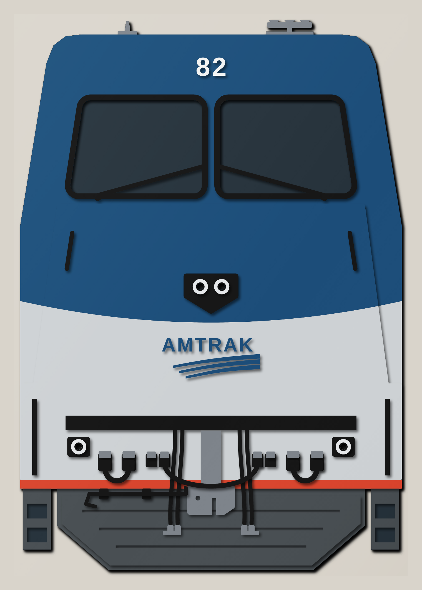
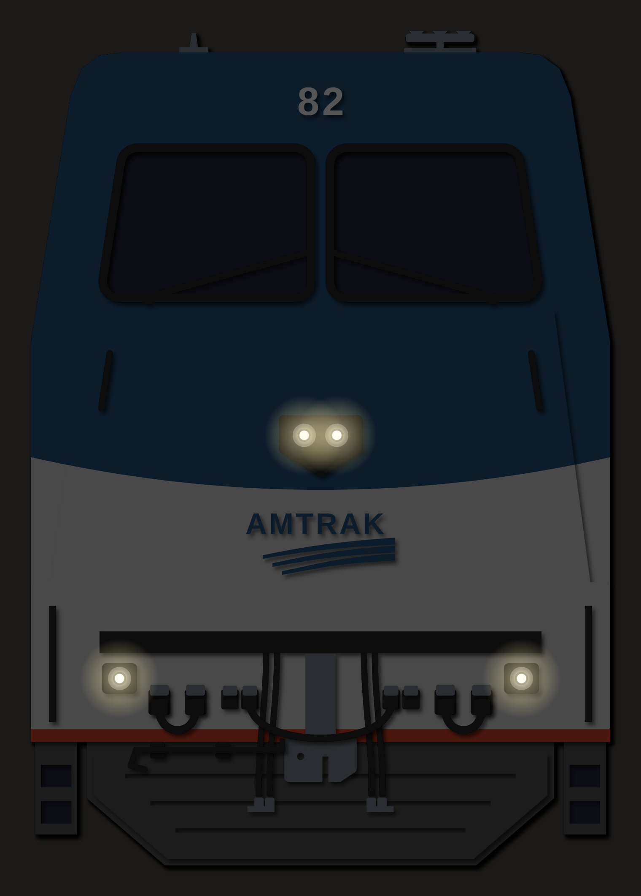
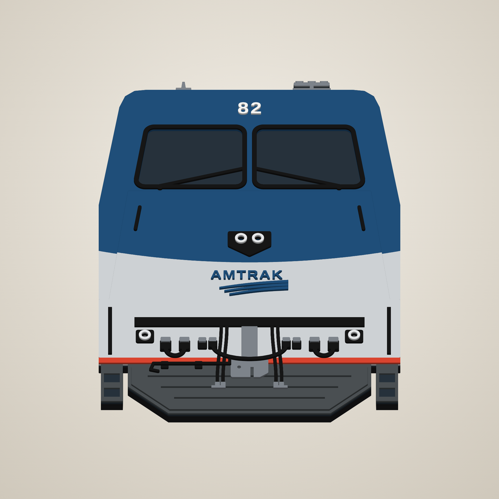
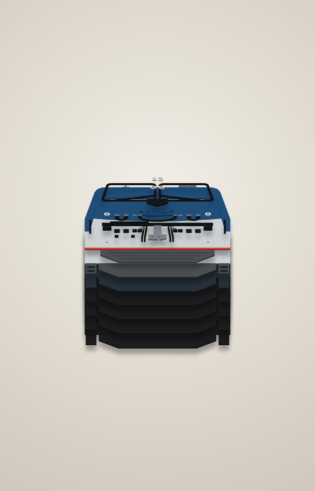
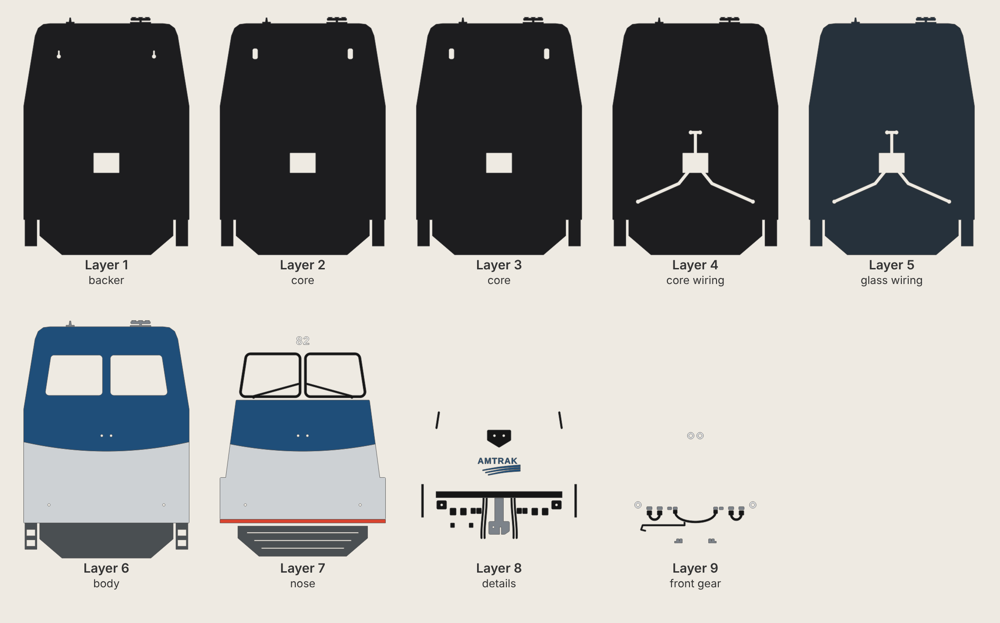
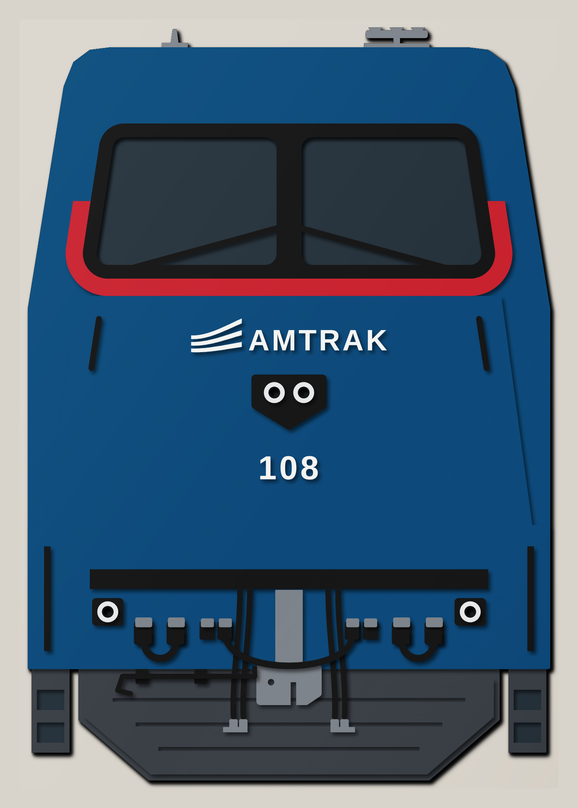

# Amtrak P42 (GE Genesis) – 16" × 23" stacked MDF sign with working lights

A head-on relief of a GE Genesis P42DC, cut from nine layers of 1/8" MDF and stacked.
It's built the same way as the IAIS 510 sign: every layer is cut, painted, then glued
from 1 (back) to 9 (front). The two headlights and two ditch lights are 5 mm LEDs that
run on a battery holder hidden in a pocket in the back.

The design comes in two liveries. Each has its own folder of cut files and renders:

| Livery | Folder | Unit |
|---|---|---|
| **Phase V** (main version) | `phase5/` | #82 |
| Phase VI | `phase6/` | #108 |

## Phase V

| Unlit | Lit |
|---|---|
|  |  |

| Angle | Exploded |
|---|---|
|  |  |



Colours follow Amtrak's livery guide for the P42 in Phase V: Platinum Mist body,
Amtrak Blue nose and roof as a "wave", Anthracite Gray underbody, Amtrak Red sill stripe,
and the Travelmark logo.

* **Blue wave**: everything above a curve that dips toward the centre of the nose,
  just under the headlight, is blue. Below it is Platinum Mist. Change `wave_p5()` to
  move the curve.
* **Travelmark**: the AMTRAK wordmark (Liberation Sans Bold) over three sweeping stripes,
  cut in MDF and painted blue, on the silver nose below the headlight. It's an approximation
  drawn so every stripe is at least 0.1" wide. Swap in the official artwork in
  `travelmark_p5()` if you have it.
* **Road number**: "82", cut in white on the blue above the windshield. Change the
  `number` for `phase5` in `LIVERIES`, or set it to `""` for no number.
* Red sill stripe across the bottom of the front, with the anthracite plow and steps below.

| Colour | Hex used in previews | Pieces |
|---|---|---|
| Amtrak Blue | `#1f4e79` | wave on the cab and nose, Travelmark |
| Platinum Mist | `#cdd1d4` | lower body and nose |
| Amtrak Red | `#d9442f` | sill stripe |
| Anthracite Gray | `#4a4f52` | plow, steps |
| Black | | gaskets, wipers, headlight and ditch light housings, anticlimber, hoses, cables, receptacles, grab irons |
| White | | road number |
| Grey | | coupler, horns, antenna, glad hands, receptacle lids |
| Chrome/silver | | lens rings |

## Phase VI



Blue body, black window mask with a red band around it, white logo and number.
The only P42 in Phase VI was #108, and the sources I found don't describe its nose in
detail, so the mask and red band are an interpretation.

## Cut files (`phase5/svg/`, `phase6/svg/`)

All files are 16.5" × 23.5" (the sign plus a 1/4" margin) and share the same origin, so
every layer lines up. They contain cut lines only (red hairline, no fill). The sign is
16" wide × 23" tall (about 1:7.5 scale). It fits a 24" × 18" laser bed if you rotate it.
Layers 1–5 and 8–9 are the same shapes in both liveries. Layers 6–8 differ in how the
paint areas are split.

| # | File | What it is |
|---|------|------------|
| 1 | `layer1_backer.svg` | backer: battery pocket + 2 keyhole hangers |
| 2 | `layer2_core.svg` | core: room for the hanging-screw heads |
| 3 | `layer3_core.svg` | same as layer 2 |
| 4 | `layer4_core_wiring.svg` | core: wire channels |
| 5 | `layer5_glass_wiring.svg` | wire channels; its top shows through the windshield |
| 6 | `layer6_body.svg` | carbody with the windshield cut out (split by paint), plow backing, steps, roof horns, antenna |
| 7 | `layer7_nose.svg` | raised nose and lower front, sill stripe / red band, gaskets or mask with wipers, ribbed plow face (Phase V: road number) |
| 8 | `layer8_details.svg` | headlight bezel, ditch light housings, logo, anticlimber, coupler, MU + HEP receptacles, air hoses, lever brackets, grab irons |
| 9 | `layer9_front_gear.svg` | lens rings, MU jumper cable, HEP jumper cables, receptacle lids, glad hands, uncoupling lever |
| – | `back_cover.svg` | battery pocket cover (screws to the back, with a slot to reach the switch) |

The stack is 1-1/8" thick. Each piece in a layer is cut on its own, so where two paint
colours meet (for example blue and silver on layer 6) the piece is cut in two.

Other files:
* `preview_flat.svg` – full-colour flat preview.
* `placement_template.svg` – every layer's outline in its own colour. Print it at 1:1
  (actual size, tiled) to place the small parts (logo letters, hoses, cables) during glue-up.

## Front-end detail
Everything between the anticlimber and the plow, as on the real locomotive:
* **Coupler**: draft gear and an E-type head with the knuckle gap and lock-lift hole.
* **MU receptacles** (two each side of the coupler) with a **MU jumper cable** draped
  across the coupler between the inner pair, plug heads on the receptacles.
* **HEP (head-end power) receptacles** further out, each with its jumper stowed in a loop
  to the dummy socket beside it.
* **Air hoses** (brake pipe and main reservoir, two each side) hanging from the
  anticlimber, ending in **glad hands**.
* **Uncoupling lever** across the top of the plow on the left, on two brackets.
* Receptacle lids, grab irons beside the steps and on the nose, and a ribbed plow.

Layer 9 parts sit on layer 8 parts: the cables end on the receptacles, and the lever rests
on its brackets and on the air hoses where it crosses them. Glue the receptacles and hoses
first, then lay the cables and lever on top using the placement template.

## Lights and battery
* **Battery pocket**: 2.50" × 1.95", cut through layers 1–5 (0.625" deep), behind the nose.
  It's sized for a 3×AAA holder with an on/off switch. **Measure your holder** and change
  `POCKET` in `generate.py` if it differs.
* **Wire channels**: 0.32" wide, cut through layers 4 and 5. They run from the pocket to
  each light. Layers 1–3 close them from the back, and layer 6 covers them from the front.
* **LEDs**: four 5 mm warm-white LEDs. The holes in layers 6–8 are 0.25", so each LED goes
  in from the front after glue-up. Its rim sits inside the chrome ring on layer 9.
* **Wiring**: wire all four LEDs in parallel, each with its own 100 Ω resistor
  (4.5 V, about 14 mA each). Solder the leads and resistor to two thin wires first
  (heat-shrink the joints). Then feed the wires down the LED hole and along the channel
  to the pocket. Fit the wires before you glue on layer 6 to avoid fishing them through later.
* **Hanging**: layer 1 has two keyhole slots. Layers 2 and 3 leave room behind them for
  the screw heads. Drive two screws 9.2" apart into the wall, leaving the heads 1/8" out.

## Build notes
* Paint each piece before glue-up, including the edges: the edges of the raised layers show
  from an angle. Layers 1–5 only show their edges, so paint those black. Paint the top of
  layer 5 dark glass grey: it shows through the windshield.
* Glue order: 1 → 5 (all the same outline), check the wire channels are clear, then 6,
  7, 8 and 9.
* The wipers are joined to the gaskets (or mask) at both ends, so they don't snap.
* Kerf is not compensated. Pieces come out a few thousandths undersize, which is fine for
  stacked art. If your LEDs fit loosely, a dab of hot glue holds them.
* The Amtrak name and logo are trademarks. This sign is for personal use.
* The shape was drawn from general P42 references, not from factory drawings: the
  "home plate" headlight on the nose, ditch lights low on the front, a plow,
  corner steps, and cab sides that lean inward. Compare it with a photo of the unit
  you want, and adjust the coordinates in `generate.py` if needed.

## Regenerating
```
pip install shapely numpy fonttools
python3 generate.py            # writes phase5/svg and phase6/svg (or name one: python3 generate.py phase5)
node render.js phase5          # writes phase5/renders (needs Playwright + Chromium)
node render.js phase6
```
