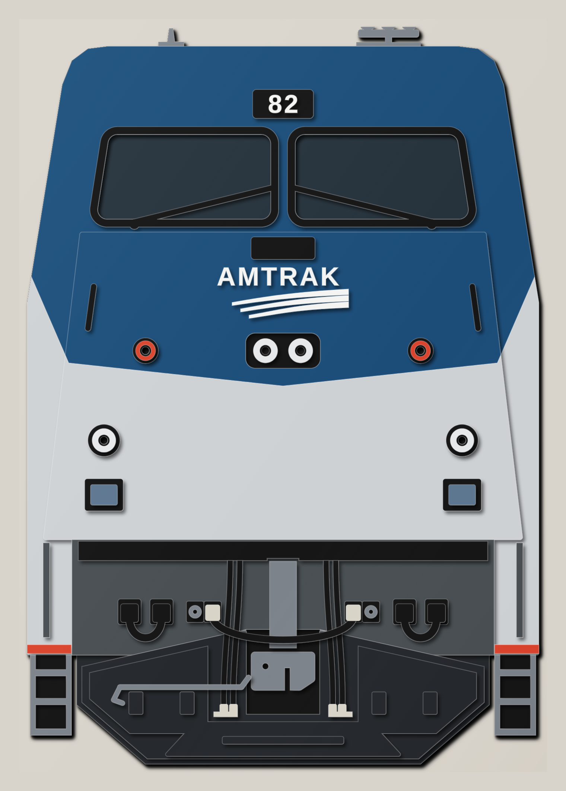
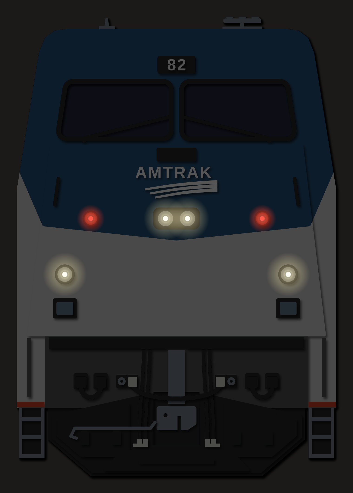
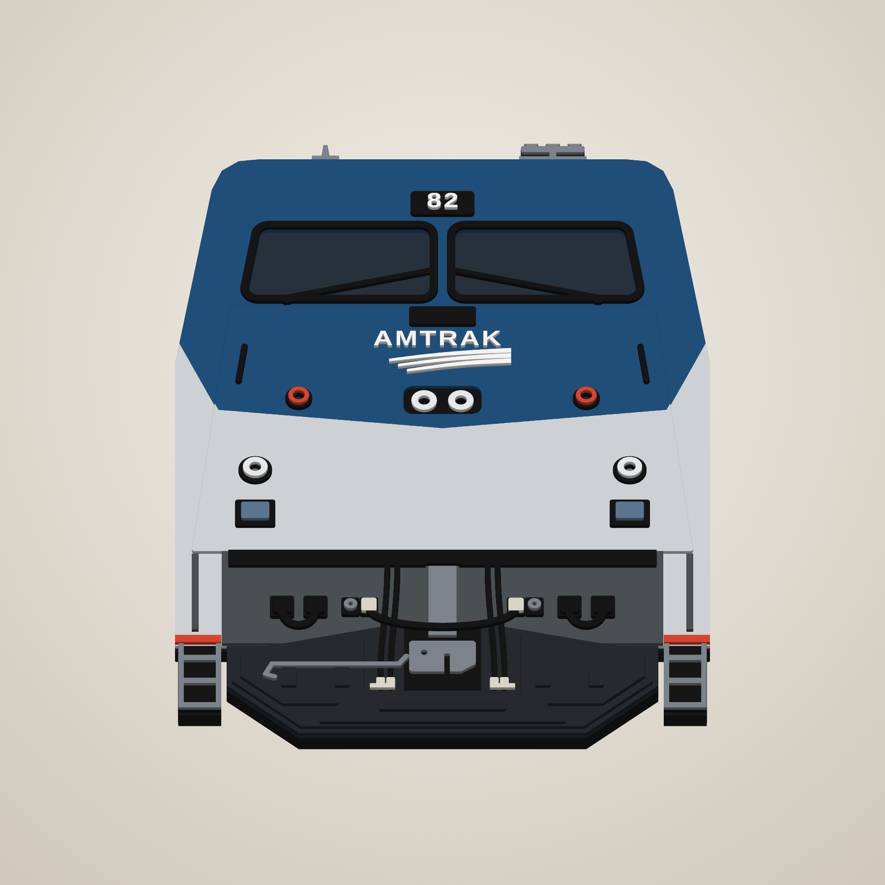
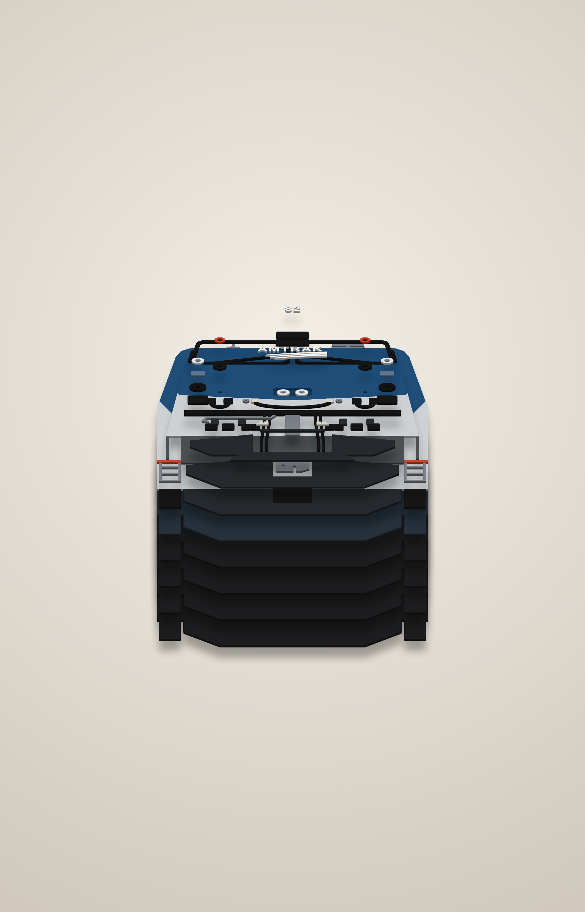
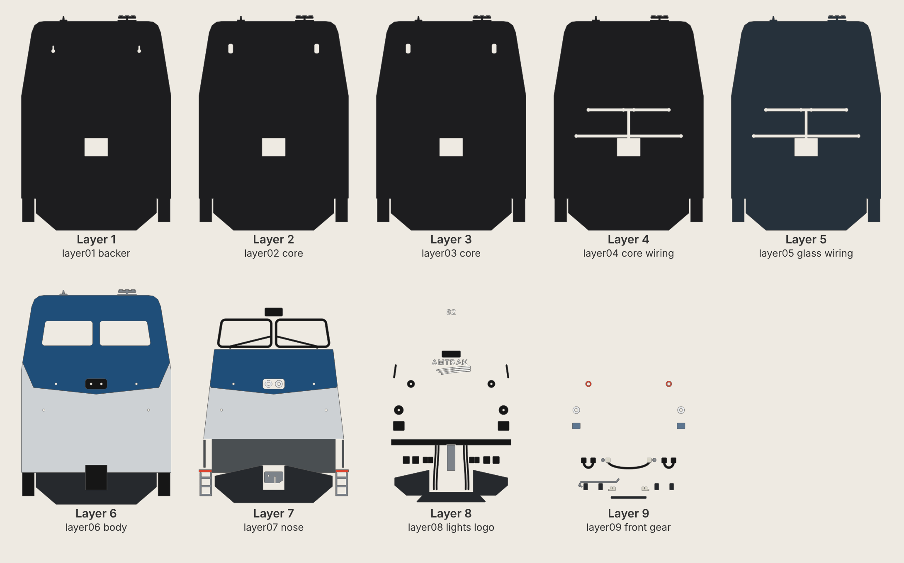

# Amtrak P42 (GE Genesis) in Phase V – 16" × 23" stacked MDF sign with working lights

A head-on relief of GE Genesis P42DC #82 in Amtrak Phase V, cut from nine layers of 1/8"
MDF and stacked. It's built the same way as the IAIS 510 sign: every layer is cut,
painted, then glued from 1 (back) to 9 (front). The headlights, ditch lights and red
rear lights are 5 mm LEDs that run on a battery holder hidden in a pocket in the back.

| Unlit | Lit |
|---|---|
|  |  |

| Angle | Exploded |
|---|---|
|  |  |



## What's on the front
The layout follows a head-on photo of a Phase V P42, top to bottom:

* **Roof**: horn cluster and radio antenna above the roof line.
* **Number board** above the windshield, between the panes: black board, white digits
  (`ROAD_NUMBER`, default 82, or `""` for a blank board).
* **Windshield**: two wide, short panes with black gaskets and parked wipers.
* **Nose plate**: the dark plate under the windshield.
* **Travelmark**: AMTRAK wordmark over three sweeping stripes, in white on the blue.
* **Light bar**: twin round **headlights** set into a recess in the nose (the recess is cut
  out of layer 7, so the lamps sit one layer in, with a black floor). A **red light**
  either side.
* **Blue/silver line**: a shallow V across the nose, lowest just under the headlights,
  sweeping up at the cab corners.
* **Ditch lights** on the silver, with the **dark lamp boxes** below them.
* **Anticlimber** across the full width.
* **Pilot** (anthracite):
  * **Coupler**: draft gear and an E-type head with the knuckle gap and lock-lift hole.
    The head sits down in a black pocket cut into the plow.
  * **MU receptacles**, two each side of the coupler. A **MU jumper** droops under the
    coupler between the inner pair, with light-grey plug heads. The outer pair have
    round socket faces.
  * **HEP (head-end power) receptacles** further out. Each HEP jumper is stowed in a loop
    to the dummy socket beside it.
  * **Air hoses** (brake pipe and main reservoir, two each side) hang from the
    anticlimber and end in **glad hands**.
  * **Uncoupling lever** across the left plow wing to the coupler, handle at the left.
  * **Grab irons** beside the steps and on the nose.
* **Plow**, near-black, in four steps:
  1. base (layer 6)
  2. one plate with two wings: the top slopes down to the outer corners, and the
     middle is cut away for the coupler pocket (layer 7)
  3. a lower centre plate and a raised plate on each wing (layer 8)
  4. bolted brackets on the wings and a rib on the centre plate (layer 9)
* **Corner steps** tucked into the pilot corners, either side of the plow: a black well
  (layer 6) with two stringers and three treads in grey (layer 7). The **red sill stripe**
  runs across the top of each well.

## Cut files (`svg/`)
All files are 16.5" × 23.5" (the sign plus a 1/4" margin) and share the same origin, so
every layer lines up. They contain cut lines only (red hairline, no fill). The sign is
16" wide × 23" tall (about 1:7.5 scale). It fits a 24" × 18" laser bed if you rotate it.

| # | File | What it is |
|---|------|------------|
| 1 | `layer01_backer.svg` | backer: battery pocket + 2 keyhole hangers |
| 2 | `layer02_core.svg` | core: room for the hanging-screw heads |
| 3 | `layer03_core.svg` | same as layer 2 |
| 4 | `layer04_core_wiring.svg` | core: wire channels |
| 5 | `layer05_glass_wiring.svg` | wire channels; its top shows through the windshield |
| 6 | `layer06_body.svg` | carbody (blue + silver, windshield cut out), plow base, steps, horns, antenna |
| 7 | `layer07_nose.svg` | raised nose (blue + silver) with headlight recess, headlight rings, coupler head, pilot face, gaskets with wipers, number board, low grab irons, plow wings |
| 8 | `layer08_lights_logo.svg` | red light + ditch light housings, nose plate, Travelmark, number digits, lamp boxes, anticlimber, coupler shank, receptacles, air hoses, nose grab irons, plow plates |
| 9 | `layer09_front_gear.svg` | ditch light rings, red light rings, lamp box lenses, socket faces, MU + HEP jumpers with plugs, glad hands, uncoupling lever, plow brackets |
| – | `back_cover.svg` | battery pocket cover (screws to the back, slot for the switch) |

The stack is 1-1/8" thick. Each piece is cut on its own, so where two paint colours meet
(for example blue and silver on layers 6 and 7) the piece is cut in two.
`generate.py` checks every layer: no pieces overlap, and every part has at least a
quarter of its area glued to the layer below.

Other files:
* `preview_flat.svg` – full-colour flat preview.
* `placement_template.svg` – every layer's outline in its own colour. Print it at 1:1
  (actual size, tiled) to place the small parts (logo, digits, hoses, jumpers) during glue-up.

## Paint (Phase V, from Amtrak's livery guide)
| Colour | Preview hex | Pieces |
|---|---|---|
| Amtrak Blue | `#1f4e79` | top of the carbody and nose (above the wave line) |
| Platinum Mist | `#cdd1d4` | lower carbody and nose |
| Near-black | `#26292d` | the four plow steps (darker than prototype so the plow stands out) |
| Anthracite Gray | `#4a4f52` | pilot face, low grab irons |
| Amtrak Red | `#d9442f` | red light rings, sill stripe at the corners |
| Black | | step wells, gaskets, wipers, number board, nose plate, headlight recess floor, coupler pocket floor, light housings, lamp boxes, anticlimber, receptacles, hoses, jumpers, nose grab irons |
| White | | Travelmark, number digits |
| Grey | | coupler, uncoupling lever, step treads, horns, antenna, socket faces |
| Light grey | | MU plug heads, glad hands |
| Chrome/silver | | headlight and ditch light rings |
| Steel blue | `#5d7690` | lamp box lenses |

## Lights and battery
* **Six 5 mm LEDs**: two warm-white headlights, two warm-white ditch lights and two red
  rear lights. The holes in layers 6–8 are 0.25", so each LED goes in from the front after
  glue-up. Its rim sits inside the ring on layer 9.
* **Battery pocket**: 2.50" × 1.95", cut through layers 1–5 (0.625" deep), behind the nose.
  It's sized for a 3×AAA holder with an on/off switch. **Measure your holder** and change
  `POCKET` in `generate.py` if it differs.
* **Wire channels** (0.32" wide, through layers 4 and 5): one runs straight up from the
  pocket to the light bar, then across to the headlights and red lights. Two more run
  sideways to the ditch lights. Layers 1–3 close them from the back, layer 6 from the front.
* **Wiring**: each LED gets its own resistor: 100 Ω for white, 150 Ω for red (4.5 V,
  about 15 mA each). On a real locomotive the red lights are on at the rear end and the
  white lights at the front. To copy that, put a small slide switch (SPDT) in the cover's
  slot: one side feeds the four white LEDs, the other the two red ones. Run a common
  negative wire to all six. Solder each LED and its resistor to thin wire before you feed
  it down the LED hole and along the channel, and fit the wires before you glue on layer 6.
* **Hanging**: layer 1 has two keyhole slots. Layers 2 and 3 leave room behind them for
  the screw heads. Drive two screws 9.2" apart into the wall, leaving the heads 1/8" out.

## Build notes
* Paint each piece before glue-up, including the edges: the edges of the raised layers show
  from an angle. Layers 1–5 only show their edges, so paint those black. Paint the top of
  layer 5 dark glass grey: it shows through the windshield.
* Glue order: 1 → 5 (all the same outline), check the wire channels are clear, then 6, 7,
  8 and 9. On layer 8, glue the receptacles, air hoses and plow plates before the
  jumpers and lever from layer 9, which rest on them.
* Paint the headlight recess floor (on layer 6) and the coupler pocket floor black before
  gluing layer 7 over them: they're cut as separate pieces so you can paint them on their own.
* The wipers are joined to the gaskets at both ends, so they don't snap.
* The smallest parts are the Travelmark stripes and letters (about 0.1" strokes). Cut them
  from good MDF, or from 1/8" hardboard or birch ply, for clean edges.
* Kerf is not compensated. Pieces come out a few thousandths undersize, which is fine for
  stacked art. If your LEDs fit loosely, a dab of hot glue holds them.
* The Travelmark is an approximation drawn to be cuttable. Swap in the official artwork
  in `travelmark()` if you have it. The Amtrak name and logo are trademarks; this sign is
  for personal use.
* The shape was drawn from a head-on photo and general P42 references, not from factory
  drawings. Every part is a set of coordinates in `generate.py`, so it's easy to adjust.

## Regenerating
```
pip install shapely numpy fonttools
python3 generate.py        # writes svg/
node render.js             # writes renders/ (needs Playwright + Chromium)
```
