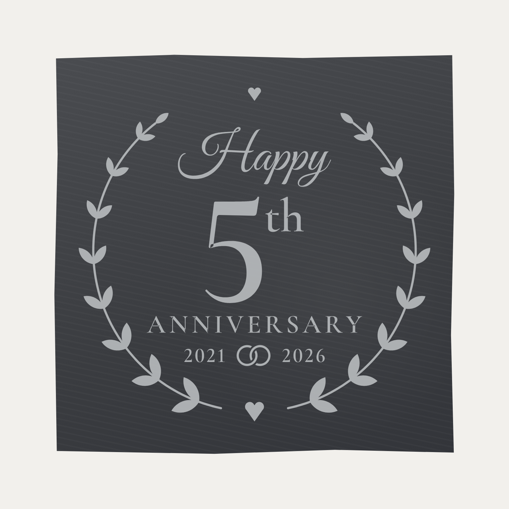
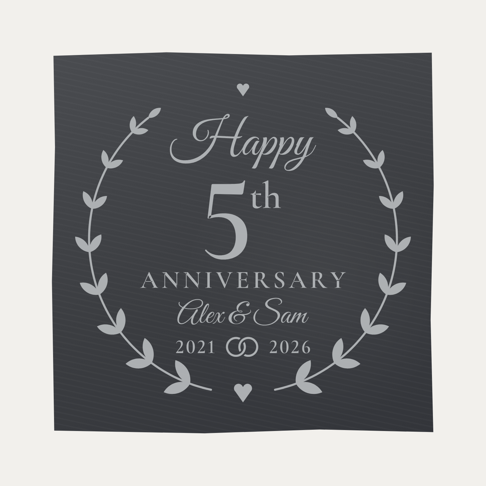

# 5th wedding anniversary – 4" slate coaster

Laser-engraving design for a 4" × 4" square slate coaster.

| Default | With names (`--names "Alex & Sam"`) |
|---|---|
|  |  |

"Happy 5th Anniversary" with a laurel wreath, hearts, and two interlocking wedding
rings between the years.

## Files
| File | What it is |
|------|------------|
| `slate_5th_anniversary.svg` | Ready to engrave: 2021 → 2026, no names |
| `slate_5th_anniversary_keith_tracy.svg` | **Keith & Tracy**, 2021 → 2026 |
| `slate_5th_anniversary_alex_sam.svg` | Example with a names line (placeholder names) |

* **Black fill = engrave.** Slate engraves pale grey, so everything drawn is the light part
  and the natural dark slate is the background.
* **Blue square = tile guide only.** Set it to *not output* (or delete it) before running.
* **Size.** The artwork is 3.5" across, centred on the 4" tile, which keeps it 1/4" clear of the
  chipped edges.
* **Text is already outlines**, so the laser software doesn't need the fonts.

## Customising
```
pip install shapely fonttools brotli
python3 generate.py --years 2020 2025
python3 generate.py --names "Jess & Mark"        # writes slate_5th_anniversary_jess_mark.svg
python3 generate.py --design 3.25               # smaller artwork for a tile with rough edges
node render.js slate_5th_anniversary_jess_mark.svg   # preview PNG (Playwright + Chromium)
```
Long names are scaled down to fit inside the wreath. When a names line is added, the big 5
gets smaller to make room.

## Engraving tips
Slate needs only light power: you're bleaching the surface, not cutting it. Test on the back
or a spare tile first. Wipe with a little mineral oil afterwards to darken the slate and make
the engraving stand out.

## Fonts
Great Vibes (script) and Cormorant Garamond SemiBold (serif), both SIL Open Font License;
the licence texts are in `fonts/`.
