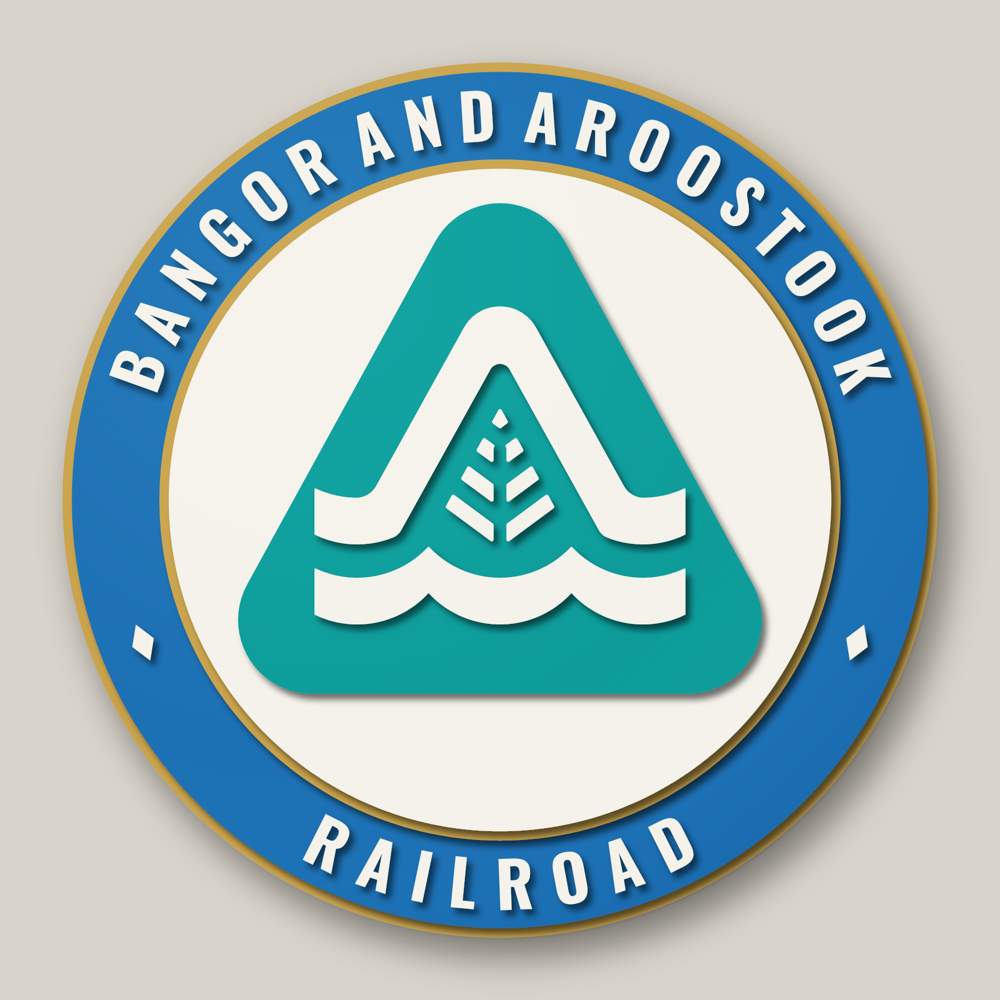
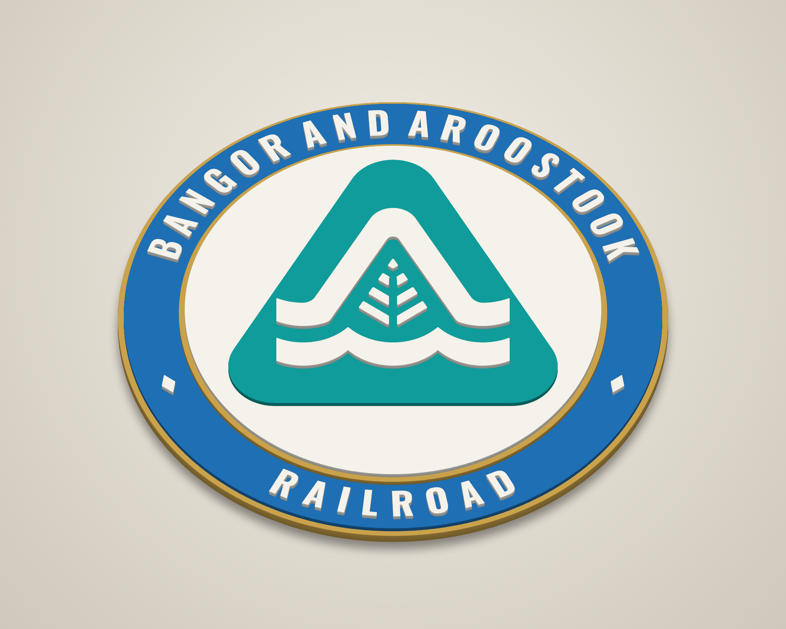
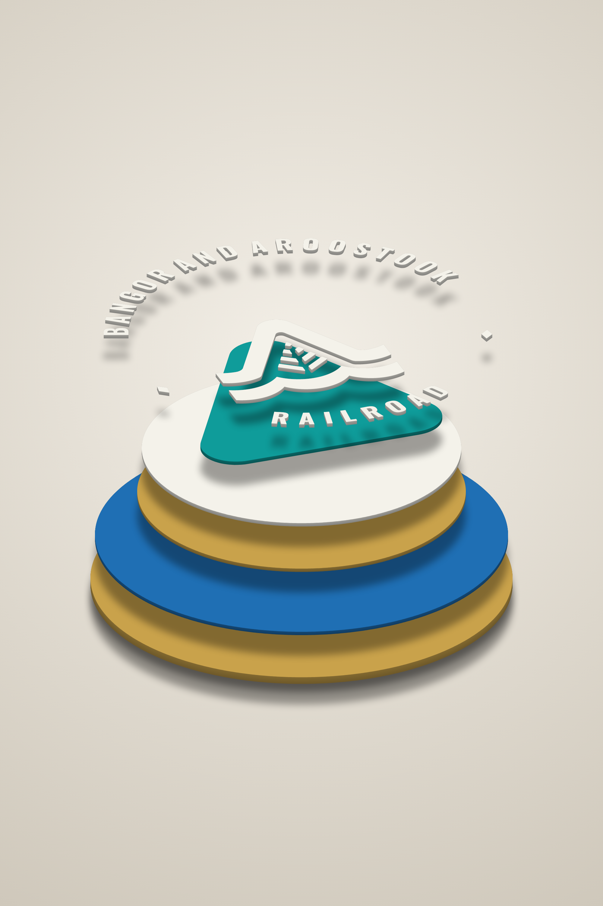
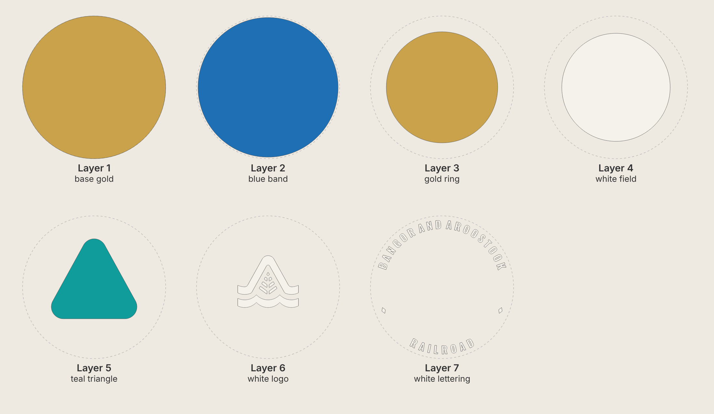
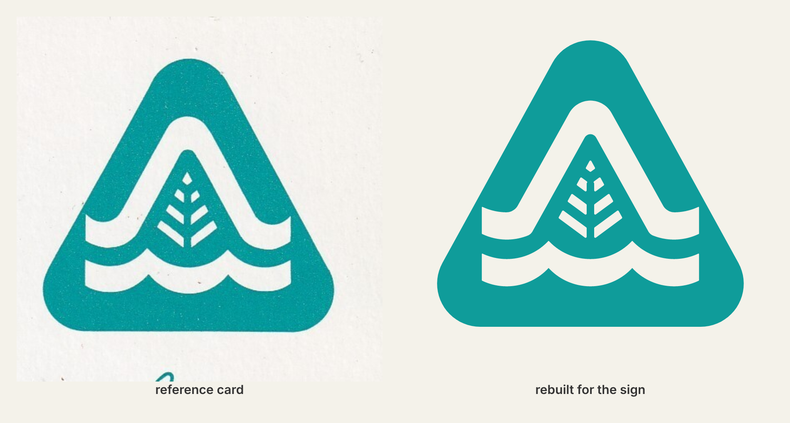

# Bangor and Aroostook – 14" round stacked laser-cut sign

Seven-layer 3-D sign of the Bangor and Aroostook Railroad triangle logo (the "A" over
the waves with the potato-leaf), made in the same style as the Susquehanna "S" sign.
Each layer is cut, painted one colour, then stacked and glued.



| Angle | Exploded |
|---|---|
|  |  |



The logo was traced from the playing card (`reference_card.jpg`) and rebuilt from clean
lines and arcs:



## Design
* Gold rim, blue lettering band with **BANGOR AND AROOSTOOK** across the top and
  **RAILROAD** across the bottom (both read upright), two diamond separators.
  Lettering is Oswald Bold (a condensed sans like the one on the blue card), 0.82" tall.
* Gold pinstripe, then a white field with the teal triangle (8.4" wide).
* The A with the upper wave, the lower wave and the seven leaf pieces are raised white
  pieces on the teal, like the card with the white logo.

## Cut files (`svg/`)

All files are 14 in × 14 in on the same centre, so every layer lines up. They contain
cut lines only (red hairline, no fill).

| # | File | Paint | Suggested stock | Pieces | What it is |
|---|------|-------|-----------------|--------|------------|
| 1 | `layer1_base_gold.svg` | Gold | 1/4" | 1 | 14.00" disc – gold outer rim and backer |
| 2 | `layer2_blue_band.svg` | Blue | 1/8" | 1 | 13.70" disc – blue lettering band |
| 3 | `layer3_gold_ring.svg` | Gold | 1/8" | 1 | 10.90" disc – gold pinstripe |
| 4 | `layer4_white_field.svg` | White | 1/8" | 1 | 10.60" disc – white field |
| 5 | `layer5_teal_triangle.svg` | Teal | 1/8" | 1 | rounded triangle |
| 6 | `layer6_white_logo.svg` | White | 1/8" | 9 | A + upper wave, lower wave, 7 leaf pieces |
| 7 | `layer7_white_lettering.svg` | White | 1/8" | 28 | 26 letters + 2 diamonds, glued onto the blue band |

Total thickness at the logo is 7/8" with this stock. Layer 7 sits on layer 2, so the
letters stand level with the gold pinstripe.

Other files:
* `preview_flat.svg` – full-colour flat preview.
* `placement_template.svg` – every layer's outline in a different colour; print 1:1 (tiled).

## Glue-up jigs (`jigs/`)
Cut these from card or scrap. They are not part of the sign; they only position the
loose pieces. Each has a 0.012" clearance.

| File | How to use |
|---|---|
| `jig_lettering_ring.svg` | A ring with letter-shaped holes. Lay it on the blue band with its inner edge against the raised gold ring (this centres it), turn it so the separators are level, drop the letters in, glue, lift the jig off. |
| `jig_triangle.svg` | A 10.60" disc with a triangle hole. Lay it on the white field, edges flush, drop the teal triangle in. |
| `jig_logo_art.svg` | The triangle shape with holes for the white pieces. Lay it on the teal triangle, edges flush, drop the white pieces in. |

Letter counters (inside A, B, D, O, R) drop out of the lettering jig; that's fine,
the outer edges do the positioning.

## Build notes
* Paint each layer before glue-up, edges too: they show from an angle.
* Glue order: 1 → 2 → 3 → 4 (concentric discs), then 5 and 6 with the jigs, then the
  lettering (7) onto the blue band.
* Kerf is not compensated (a few thousandths undersize is fine for stacked art).
* Smallest parts: the leaf pieces (top diamond is about 0.25" × 0.31"). Their sharp tips are
  rounded to 0.03"; other logo pieces to 0.015". Letter strokes are about 0.15"; the
  narrowest spots (where strokes join, e.g. in K and R) are about 0.09".
  Use hold-downs or tabs for the small parts.
* Colours used in the previews: gold `#C9A24B`, blue `#1F6FB4`, teal `#0F9C9A`,
  white `#F4F2EA`.

## Regenerating
Everything is parametric in `generate.py` (ring sizes, logo size, text, letter height,
how far the top line wraps, separators).

```
pip install shapely numpy fonttools scipy opencv-python-headless
python3 trace_logo.py reference_card.jpg   # scan -> logo_trace.json (raw outline)
python3 fit_logo.py                        # fit clean geometry -> logo_params.json
python3 generate.py                        # writes svg/ and jigs/
node render.js                             # writes renders/ (needs Playwright + Chromium)
```
`logo.py` builds the logo from `logo_params.json`: a rounded triangle, two scalloped
waves (circular arcs between sharp cusps), the A as a band with rounded apex and
fillets, and the leaf as a pointed outline cut by a centre stem and V-shaped veins.
The scan is mirror-averaged before fitting, so the logo is exactly symmetric.

To change the wording, edit `TEXT_TOP` / `TEXT_BOTTOM`; `TOP_SPAN` sets how far the top
line wraps around (the bottom line uses the same letter spacing).

The font is Oswald Bold (`fonts/`, SIL Open Font License, see `fonts/OFL.txt`).
