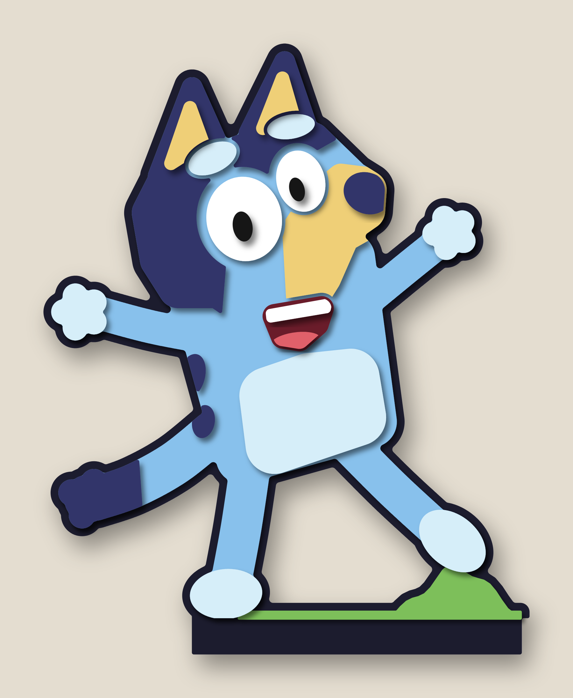
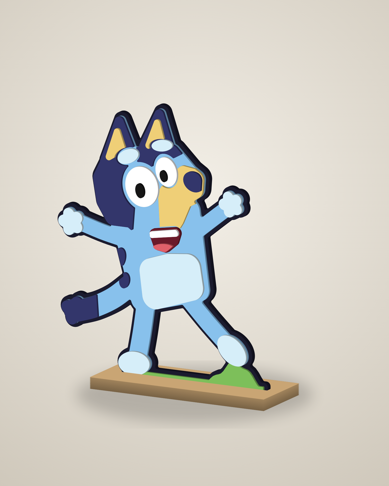
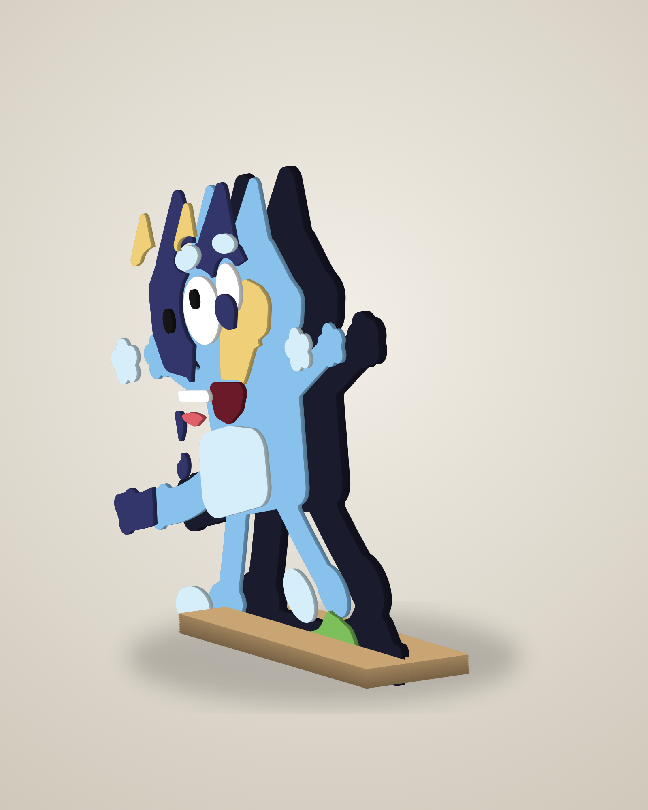
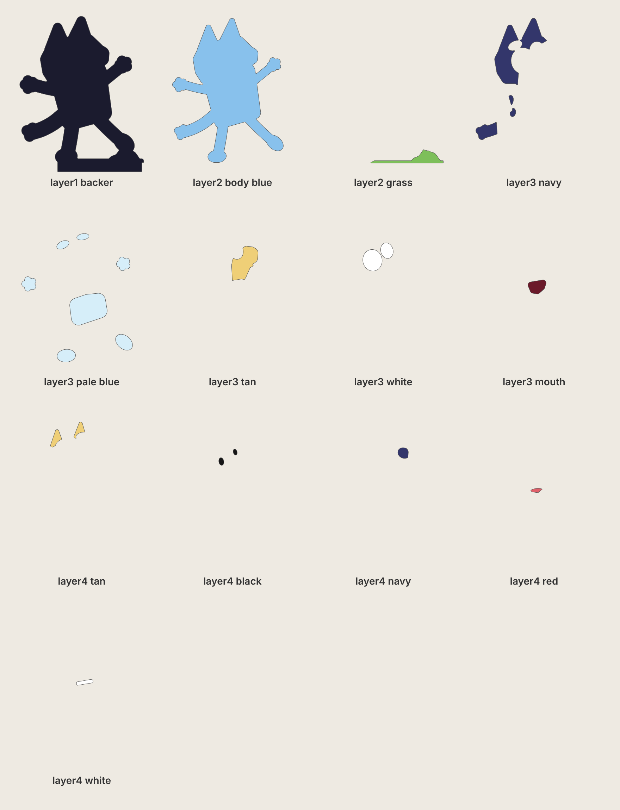

# Bluey – stand-up layered laser-cut figure (~12½" tall)

A homemade Christmas present. **Personal, non-commercial use only.** Bluey is © Ludo Studio / BBC,
so please don't sell it or share the files publicly.

Bluey in the jumping, arms-up pose from the reference picture, built from 4 levels of wood.
Each piece is cut, painted one colour, then glued on the level below. The figure slots into a
small wooden stand.



| Angle | Exploded |
|---|---|
|  |  |



## Cut files (`svg/`)
All figure files share the same 10.9" × 13.4" artboard, so every piece is in its correct place.
They contain cut lines only (red hairline, no fill). Files with the same level number are cut from the
same thickness; they are only split into separate files by paint colour.

| Level | File | Paint | Stock | What it is |
|---|------|-------|-------|------------|
| 1 | `layer1_backer.svg` | very dark navy / black | 1/4" | full outline (shows as the black cartoon line) + 0.75" tab that goes into the stand |
| 2 | `layer2_body_blue.svg` | light blue | 1/8" | whole body |
| 2 | `layer2_grass.svg` | green | 1/8" | grass mound under the feet (lets her stand with one foot raised) |
| 3 | `layer3_navy.svg` | dark navy | 1/8" | ears, head patch, back spots, tail tip |
| 3 | `layer3_pale_blue.svg` | very pale blue | 1/8" | belly, paws, feet, eyebrows |
| 3 | `layer3_tan.svg` | tan / yellow | 1/8" | muzzle |
| 3 | `layer3_white.svg` | white | 1/8" | eyes |
| 3 | `layer3_mouth.svg` | dark red | 1/8" | open mouth |
| 4 | `layer4_tan.svg` | tan / yellow | 1/8" | inner ears (go on the navy ears) |
| 4 | `layer4_black.svg` | black | 1/8" | pupils (go on the eyes) |
| 4 | `layer4_navy.svg` | dark navy | 1/8" | nose (goes on the muzzle) |
| 4 | `layer4_red.svg` | pink-red | 1/8" | tongue (goes in the mouth) |
| 4 | `layer4_white.svg` | white | 1/8" | teeth (go in the mouth) |
| stand | `base_top_slot.svg` | wood / any | 1/4" | 8.3" × 3.2" top plate with a slot for the tab |
| stand | `base_bottom.svg` | wood / any | 1/4" | solid bottom plate (glue under the top plate so the slot has a floor) |

Total thickness is 5/8". Every level-3/4 piece sits fully on the level below it (the generator checks this).

Other files:
* `preview_flat.svg` – full-colour flat preview.
* `placement_template.svg` – every piece's outline. Print it at 1:1 (actual size, tiled) and use it to place the small pieces during glue-up.
  You can also use the offcut sheets as a guide: each piece leaves a matching hole in its sheet.

Suggested paint colours: light blue `#88C1EC`, navy `#33366B`, pale blue `#D6EEF9`, tan `#EFCF77`,
mouth `#6B1A2A`, tongue `#E0606A`, outline `#1B1B2E`, grass `#7DBF5A`.

## Build notes
* 1/8" Baltic birch or MDF works well; use 1/4" for the backer and stand for strength.
* Paint before glue-up, including the edges (the edges of the raised pieces show from an angle).
  Spray the big pieces; brush the small ones. Sealing MDF first gives a smoother finish.
* Glue order: backer → body + grass → level 3 → level 4. Wood glue or CA, clamp/weigh the flat layers.
* Slot is cut 0.012" wider than 1/4". If your plywood is thicker (many "1/4"" sheets are 0.22–0.24"), change
  the slot or sand the tab for a snug fit, then glue the tab into the stand.
* Kerf is not compensated; pieces come out a few thousandths undersize, which is fine for stacked art.
* Smallest pieces (pupils, teeth, eyebrows) are about 0.3" across: use a honeycomb bed or tape so they don't fall through.
* Add a gloss clear coat at the end; it makes the cartoon colours pop and is easy to wipe clean.

## Changing the size
`SCALE` in `generate.py` scales the whole figure (1.0 ≈ 12½" tall; 0.8 ≈ 10"). Then:

```
pip install shapely numpy
python3 generate.py        # writes svg/
node render.js             # writes renders/ (needs Playwright + Chromium)
```
