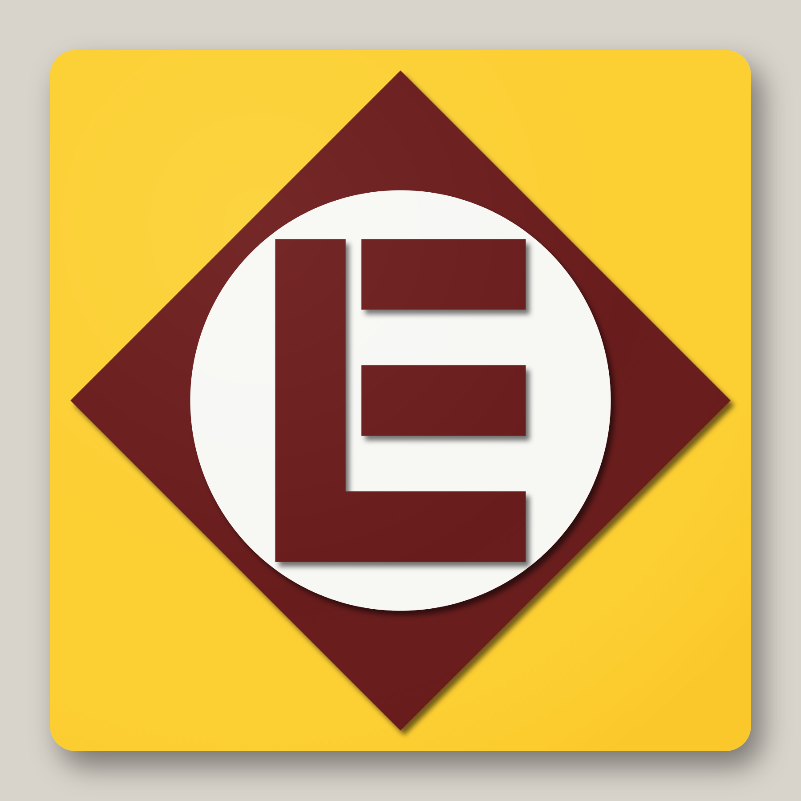
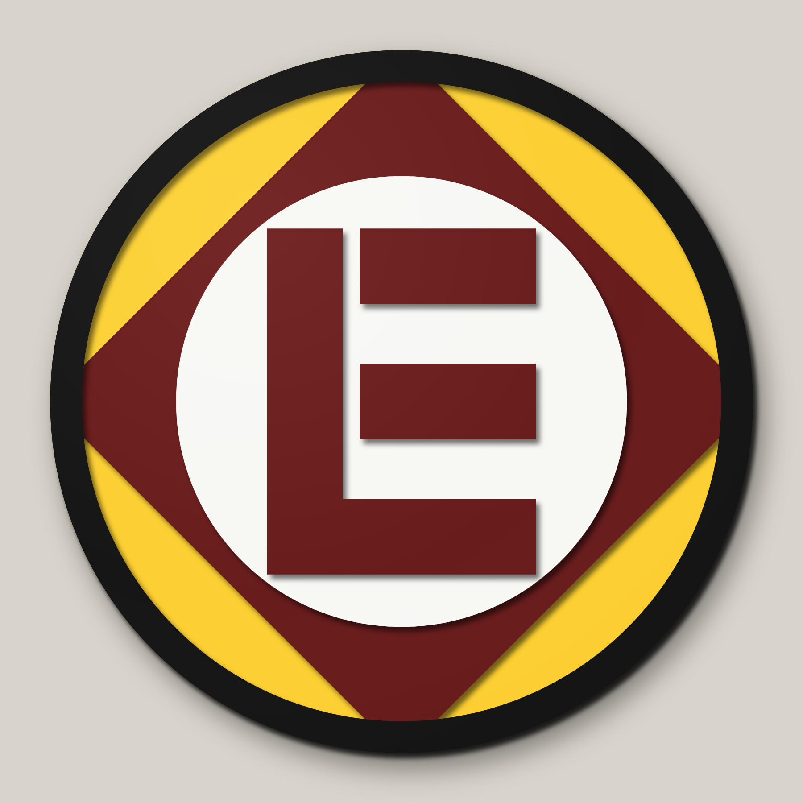
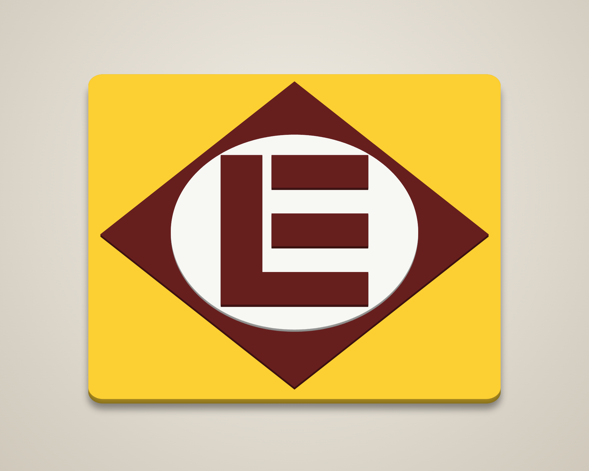
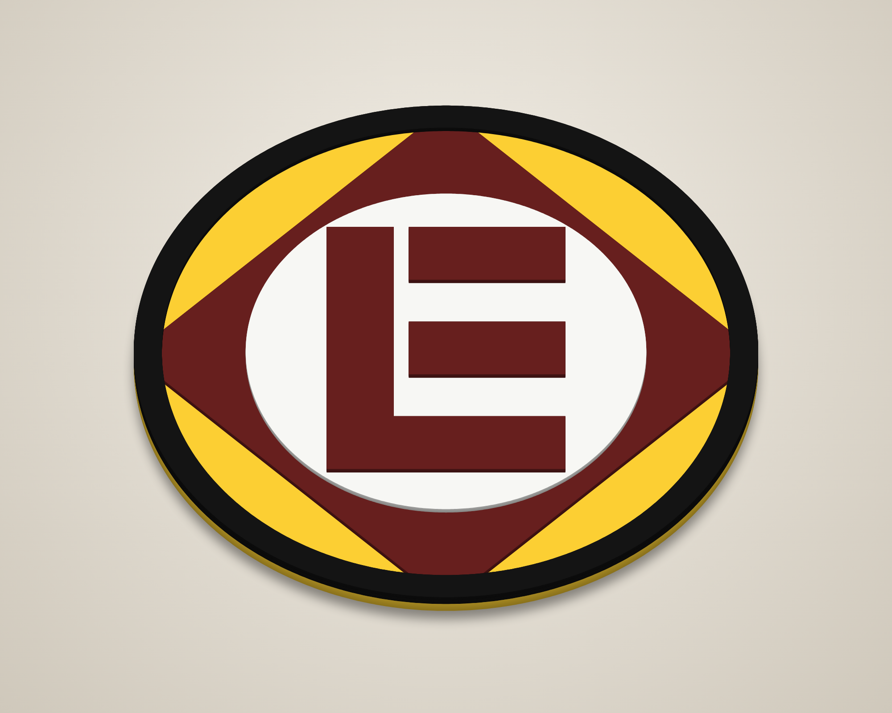
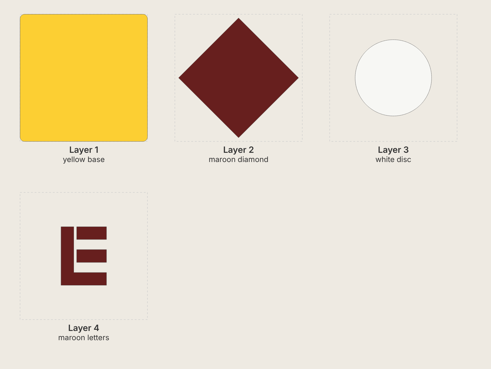
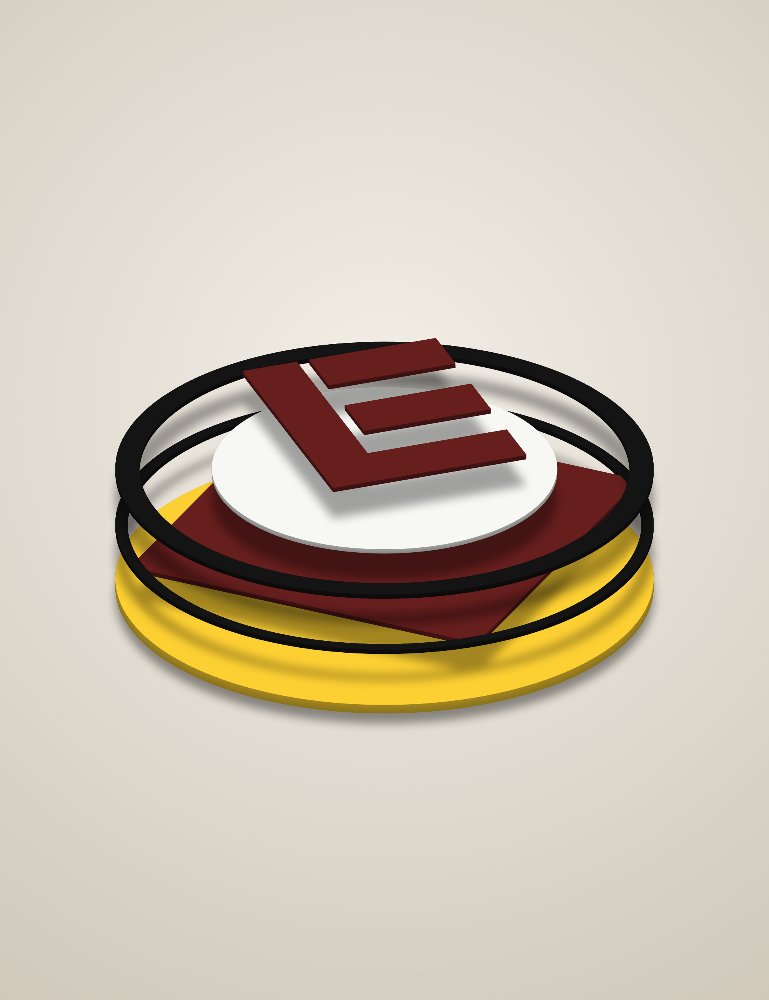
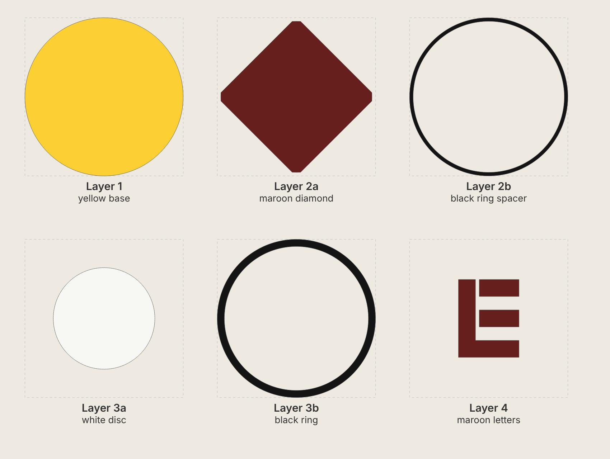

# Erie Lackawanna "EL" – stacked laser-cut signs

Two versions of the Erie Lackawanna diamond logo as layered 3-D signs. Each layer is cut,
painted one colour, then stacked and glued from the bottom up.

| Square (rounded corners) | Round |
|---|---|
|  |  |
|  |  |

The logo geometry was measured from a 2000 × 2000 px drawing: white disc r = 600 px,
diamond 942 px centre-to-point, L/E strokes 201 px thick, 45 px slot between the L and the E bars.
The L and the E share the bottom bar, as on the original logo.

## Square sign (`square/`)

Matches the logo as drawn: yellow square, maroon diamond, white disc, maroon L-E.
It is 14" × 14" with 0.5" rounded corners.

| File | Paint | Stock | Pieces | What it is |
|------|-------|-------|--------|------------|
| `svg/layer1_yellow_base.svg` | yellow | 1/4" | 1 | 14" square with 0.5" corner radius. Yellow background and backer |
| `svg/layer2_maroon_diamond.svg` | maroon | 1/8" | 1 | diamond, 13.19" point to point |
| `svg/layer3_white_disc.svg` | white | 1/8" | 1 | 8.40" disc |
| `svg/layer4_maroon_letters.svg` | maroon | 1/8" | 3 | L, E top bar, E middle bar |

Total thickness is 5/8".



## Round sign (`round/`)

This is a round sign like the Susquehanna one, based on the round concept: a raised black ring
14" across lies over the diamond's points. The points continue about 0.3" under the ring, so
they look tucked beneath it.

| File | Paint | Stock | Pieces | What it is |
|------|-------|-------|--------|------------|
| `svg/layer1_yellow_base.svg` | yellow face, black edge | 1/4" | 1 | 14.00" disc – backer |
| `svg/layer2a_maroon_diamond.svg` | maroon | 1/8" | 1 | diamond, points trimmed to a 13.37" circle |
| `svg/layer2b_black_ring_spacer.svg` | black | 1/8" | 1 | 13.37" ID × 14.00" OD ring. It is hidden; it holds the top ring level |
| `svg/layer3a_white_disc.svg` | white | 1/8" | 1 | 8.98" disc |
| `svg/layer3b_black_ring.svg` | black | 1/8" | 1 | 12.74" ID × 14.00" OD ring, overlapping the diamond points |
| `svg/layer4_maroon_letters.svg` | maroon | 1/8" | 3 | L, E top bar, E middle bar |

Layers 2a and 2b are cut from the same 1/8" stock and sit side by side; so do 3a and 3b.
Total thickness is 5/8".




## Files and build notes

* All cut files in a sign's folder are the same page size with the same centre, so every layer lines up.
  They contain cut lines only (red hairline, no fill).
* `preview_flat.svg` is a full-colour flat preview. `placement_template.svg` shows every layer's
  outline in a different colour. Print the template at 1:1 (actual size, tiled) to position
  the diamond, disc and letters during glue-up.
* Paint each layer before glue-up, edges too. On the round sign, paint the outer edge of
  layers 1, 2b and 3b black so the side reads as one black rim.
* Kerf is not compensated: with a typical 0.004–0.008" kerf the pieces come out a few thousandths
  undersize, which is fine for stacked art.
* Glue order (square): 1 → 2 → 3 → 4.
  Glue order (round): 1 → 2b (flush with the rim) → 2a (its trimmed points just meet 2b) → 3b → 3a → 4.
* The colours are close to the logo: yellow `#FCCF33`, maroon `#671F1E`.

## Regenerating

Sizes are set at the top of `generate.py`: `SQUARE_SIDE`, `SQUARE_CORNER_R` and `ROUND_DIAM`.
The logo proportions scale with them.

```
pip install shapely numpy
python3 generate.py        # writes square/svg/ and round/svg/
node render.js             # writes square/renders/ and round/renders/ (needs Playwright + Chromium)
```
