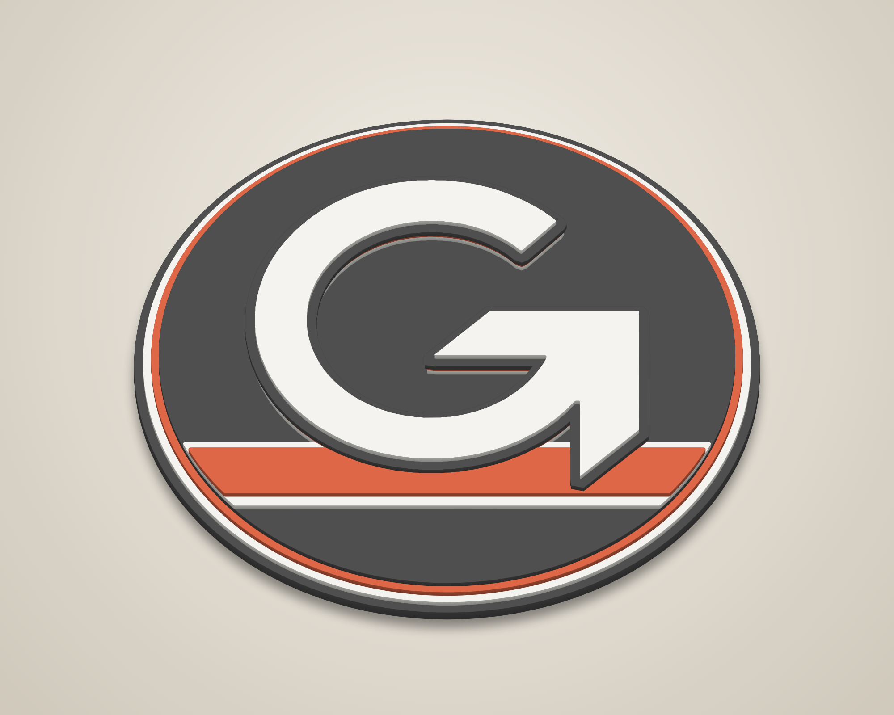
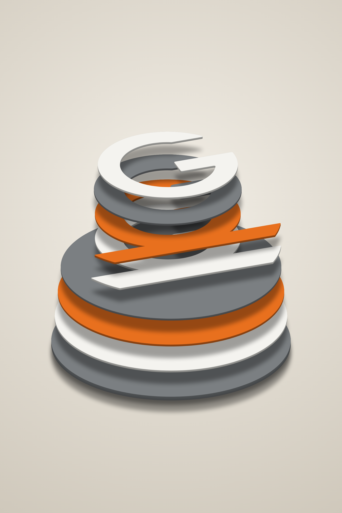
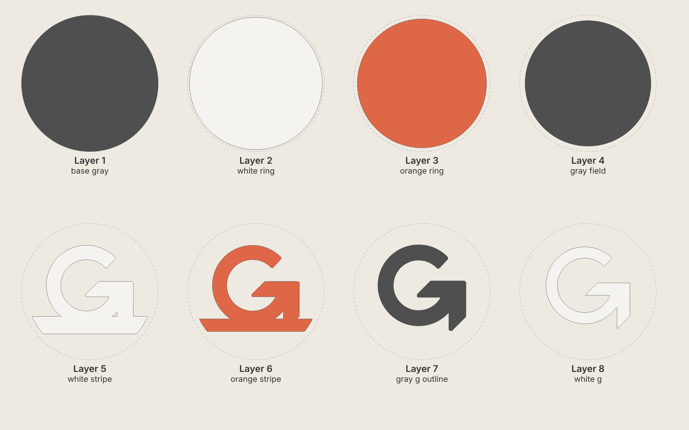
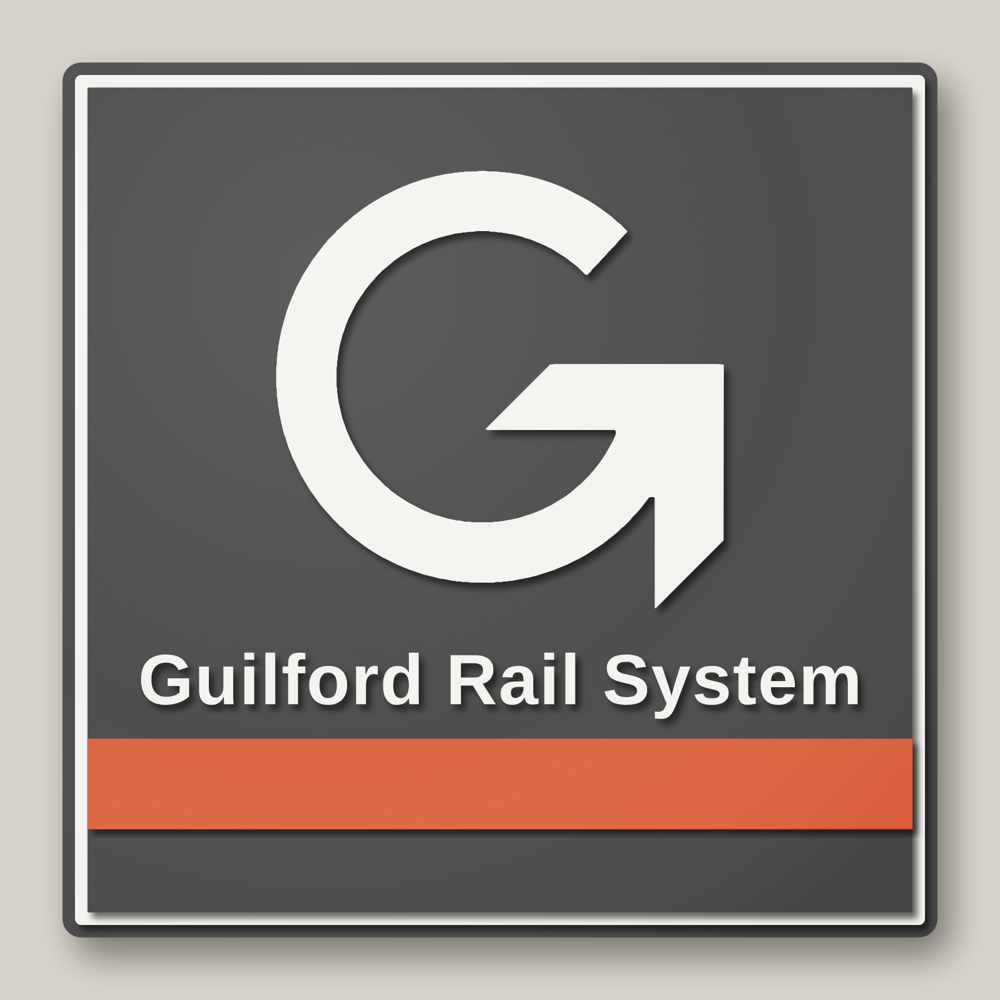
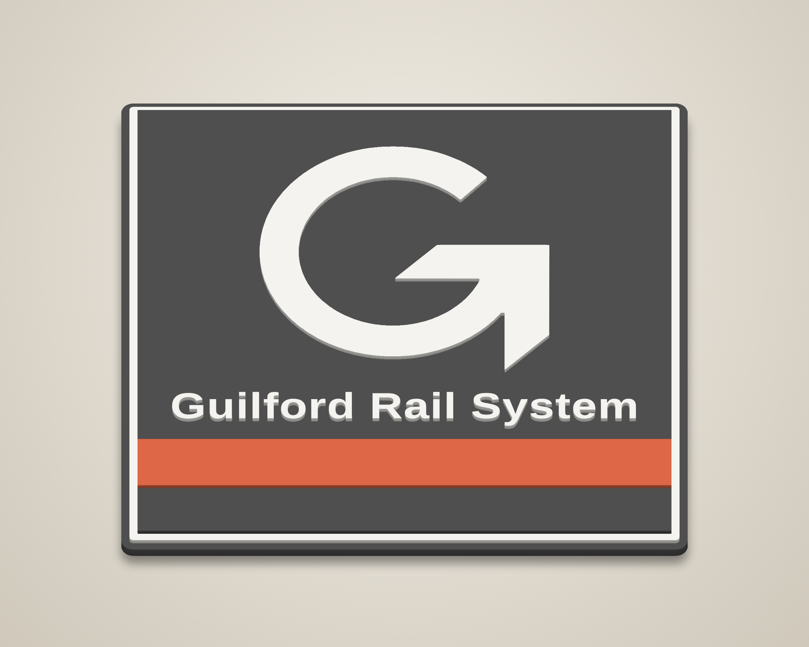
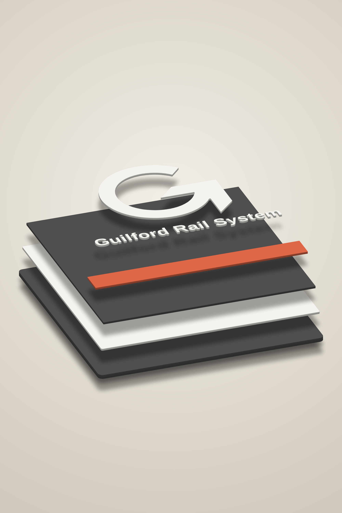
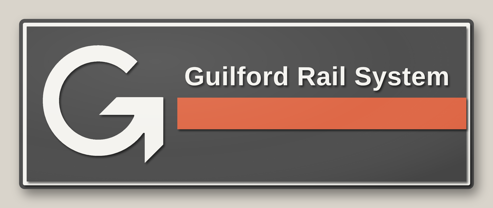
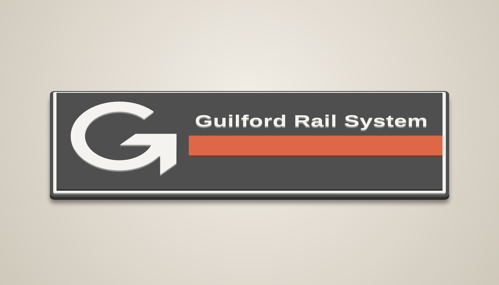

# Guilford Rail System – stacked laser-cut signs

Two 14" signs in Guilford gray, orange and white, built the same way as the Susquehanna S
sign. Each layer is cut and painted one colour, then the layers are stacked and glued from
the bottom up.

* **Round** (this page, `svg/`): an 8-layer disc with the G over an orange-and-white stripe.
* **Round with orange ring** (`round-ring/`): a 4-layer disc with no stripes. The orange
  becomes a wide outer border ring around the G.
* **Square** (`square/`): a 5-layer square with the G, "Guilford Rail System" and the orange
  bar, adapted from the wide logo.
* **Rectangle** (`rectangle/`): 24" × 9", 5 layers, laid out exactly like the logo.

The G with its arrow is traced from the logo in `reference/guilford_logo.jpg` by
`trace_g.py`, so its shape matches the logo exactly. Both signs use the logo's colours.

## Round version


| Angle | Exploded |
|---|---|
|  |  |



## Cut files (`svg/`)

All files are 14 in × 14 in on the same centre, so every layer lines up. They contain
cut lines only: red hairlines with no fill.

| # | File | Paint | Suggested stock | What it is |
|---|------|-------|-----------------|------------|
| 1 | `layer1_base_gray.svg` | Gray | 1/4" | 14.00" disc – outer gray rim and backer |
| 2 | `layer2_white_ring.svg` | White | 1/8" | 13.60" disc – white pinstripe ring |
| 3 | `layer3_orange_ring.svg` | Orange | 1/8" | 13.24" disc – orange ring |
| 4 | `layer4_gray_field.svg` | Gray | 1/8" | 12.90" disc – gray field |
| 5 | `layer5_white_stripe.svg` | White | 1/8" | white stripe band (with hidden G support) |
| 6 | `layer6_orange_stripe.svg` | Orange | 1/8" | orange stripe (with hidden G support) |
| 7 | `layer7_gray_g_outline.svg` | Gray | 1/8" | gray outline of the G (0.22" border, sharp arrow corners) |
| 8 | `layer8_white_g.svg` | White | 1/8" | white G |

With this stock the sign is about 1-1/8" thick in total. A different stock thickness doesn't change the cut files.

Other files:
* `preview_flat.svg` – full-colour flat preview.
* `placement_template.svg` – every layer's outline in a different colour. Print it at 1:1
  (actual size, tiled) to place the stripe pieces and the G during glue-up.

## Build notes
* Every layer is a single piece. Layers 5 and 6 each include a G-shaped support that sits
  under the G, inset 0.06" so it stays hidden. The support keeps the G flat where it crosses the
  stripes, and it locks the stripe band to the G, so the band lines up without
  measuring.
* The gray outline (layer 7) separates the white G from the white and orange stripes. Over the
  gray field it shows only as a raised step and a shadow line.
* Paint each layer before glue-up, including the edges.
* Kerf is not compensated, which is fine for stacked art.
* Glue order: 1 → 2 → 3 → 4 (concentric discs), then 5 and 6 using the template, then 7, 8.

## Square version (`square/`)



| Angle | Exploded |
|---|---|
|  |  |

All files are 14 in × 14 in on the same centre.

| # | File | Paint | Suggested stock | What it is |
|---|------|-------|-----------------|------------|
| 1 | `square/svg/layer1_base_gray.svg` | Gray | 1/4" | 14.00" square (0.3" corners) – gray border and backer |
| 2 | `square/svg/layer2_white_pinstripe.svg` | White | 1/8" | 13.60" square – white pinstripe |
| 3 | `square/svg/layer3_gray_field.svg` | Gray | 1/8" | 13.20" square – gray field |
| 4 | `square/svg/layer4_orange_bar.svg` | Orange | 1/8" | orange bar, edge to edge across the field |
| 5 | `square/svg/layer5_white_g_lettering.svg` | White | 1/8" | the G and "Guilford Rail System" (21 pieces) |

* With this stock the sign is about 3/4" thick in total.
* The lettering is Liberation Sans Bold, which has the same letter widths as the Helvetica
  Bold in the logo. The capitals are 0.78" tall, and the strokes are about 0.13" wide.
* Layer 5 is the G plus 20 separate pieces: the letters, and the dots of the i's
  as their own pieces. Glue it last, using `square/svg/placement_template.svg` printed at 1:1.
  Mark the baseline on the field with a light pencil line, or lay the cut-out
  sheet of layer 5 over the sign as a stencil. The pieces drop back into the holes they were cut from.

## Round version with orange ring (`round-ring/`)


| Angle | Exploded |
|---|---|
|  |  |

All files are 14 in × 14 in on the same centre.

| # | File | Paint | Suggested stock | What it is |
|---|------|-------|-----------------|------------|
| 1 | `round-ring/svg/layer1_base_orange.svg` | Orange | 1/4" | 14.00" disc – orange outer ring (0.60" showing) and backer |
| 2 | `round-ring/svg/layer2_white_ring.svg` | White | 1/8" | 12.80" disc – white pinstripe (0.18" showing) |
| 3 | `round-ring/svg/layer3_gray_field.svg` | Gray | 1/8" | 12.44" disc – gray field |
| 4 | `round-ring/svg/layer4_white_g.svg` | White | 1/4" | the G (8.4" tall) |

* The G has no stripes to cross, so it needs no outline or hidden support. It goes on 1/4"
  stock for a deeper shadow. With 1/8" stock it still works, and the sign is 5/8" thick
  instead of 3/4".
* Glue order: 1 → 2 → 3 (concentric discs), then the G, using `round-ring/svg/placement_template.svg`.

## Rectangle version (`rectangle/`)





All files are 24 in × 9 in on the same centre. The sign fits a 24" × 12" laser bed.

| # | File | Paint | Suggested stock | What it is |
|---|------|-------|-----------------|------------|
| 1 | `rectangle/svg/layer1_base_gray.svg` | Gray | 1/4" | 24" × 9" (0.3" corners) – gray border and backer |
| 2 | `rectangle/svg/layer2_white_pinstripe.svg` | White | 1/8" | 23.6" × 8.6" – white pinstripe |
| 3 | `rectangle/svg/layer3_gray_field.svg` | Gray | 1/8" | 23.2" × 8.2" – gray field |
| 4 | `rectangle/svg/layer4_orange_bar.svg` | Orange | 1/8" | orange bar, running to the right edge of the field |
| 5 | `rectangle/svg/layer5_white_g_lettering.svg` | White | 1/8" | the G (6.2" tall) and "Guilford Rail System" (21 pieces) |

* The G, lettering and bar are placed from pixel measurements of the logo image (`PX_*` in
  `generate_rectangle.py`), scaled to fit the field. The capital letters are 0.95" tall.
* Place the lettering as on the square sign: drop the pieces back into the cut-out sheet of layer
  5, used as a stencil, or use `rectangle/svg/placement_template.svg`.
* For another size, change `SIGN_W` / `SIGN_H`. The layout scales to fit.

## Regenerating
```
pip install shapely numpy fonttools
python3 generate.py          # round  -> svg/
python3 generate_square.py      # square -> square/svg/
python3 generate_rectangle.py   # rectangle -> rectangle/svg/
python3 generate_round_ring.py  # round with orange ring -> round-ring/svg/
node render.js                  # round renders -> renders/
node render.js square           # likewise: square, rectangle, round-ring
```
* `G_HEIGHT` / `G_CENTER` (round) and `G_HEIGHT`, the gaps and `BAR_H` (square) set the layout.
  `STRIPE_*` / `PIN` set the round sign's stripes.
* `COLORS` in `common.py` is used for the previews only. The cut files carry no colour.
* To re-trace the G from another image, run
  `pip install pillow scikit-image scipy`, then `python3 trace_g.py image.jpg`.

## Production cut sheets (`cut-sheets/`)

`nest.py` packs every piece for a run (default: 5 of each of the four designs) onto
24" × 96" strips of 1/8" MDF (a 4 × 8 sheet cut in half lengthwise) for a feeder laser with a
23.5" cutting width. Layers drawn for 1/4" stock are cut twice and laminated.

| Folder | Sign size | How it cuts | Strips | 4 × 8 sheets |
|---|---|---|---|---|
| `cut-sheets/14in_blocks` | 14" (rectangle 24" × 9") | 23.5" blocks, one job each | 16 | 8 |
| `cut-sheets/14in_full-strip` | 14" | whole 96" strip as one job | 12 | 6 |
| `cut-sheets/12in_blocks` | 12" (rectangle 20.6" × 7.7") | 23.5" blocks, one job each | 10 | 5 |
| `cut-sheets/12in_full-strip` | 12" | whole 96" strip as one job | 8 | 4 |

* **Blocks** are the safe layout. No part crosses a 23.5" block line, so each block can run
  as its own job (`blocks/strip_NN_X.svg`). At 14", the rectangle's base and pinstripe are
  longer than 23.5", so they go in a 72.5" **LONG** section at the start of strips 1–4. Those
  strips need the feeder to cut one part longer than 23.5" in a single job. At 12" every part fits a block.
* **Full-strip** files assume the feeder cuts the whole 96" in one job. Parts pack more tightly.
* Red = cut. Blue = block lines and part labels (for example `RND L4 #3 gray` = round sign,
  layer 4, set 3, paint gray). Set blue to *not output*.
  The labels also give the paint colour, so you can sort pieces for painting by colour.
* `preview.png` in each folder shows every strip.
* Smaller parts (the G's, bars and lettering) are cut in the leftover space beside the discs
  and squares.
* `python3 nest.py --rings` cuts the hidden lower layers as rings, with a 0.75" glue land, so that
  parts can be cut from their centres. On these designs it saves at most one strip, because
  the layout is limited by each disc's outside size, not its area. It also leaves the field
  layer unsupported in the middle, so it isn't recommended.

```
python3 nest.py [sets] [--size=12] [--full-strip] [--rings]
node preview_sheets.js cut-sheets/12in_blocks
```
`--size` scales the parts in the cut sheets only. The per-design files above stay at 14".
