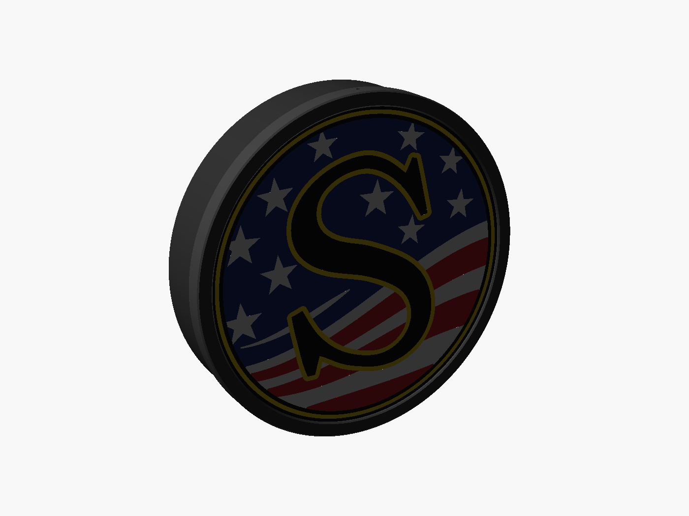
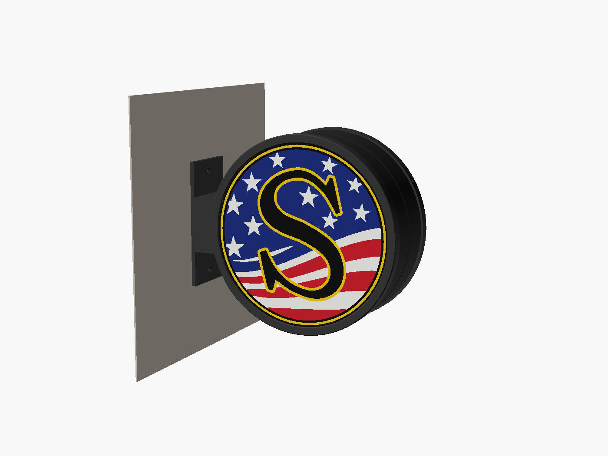
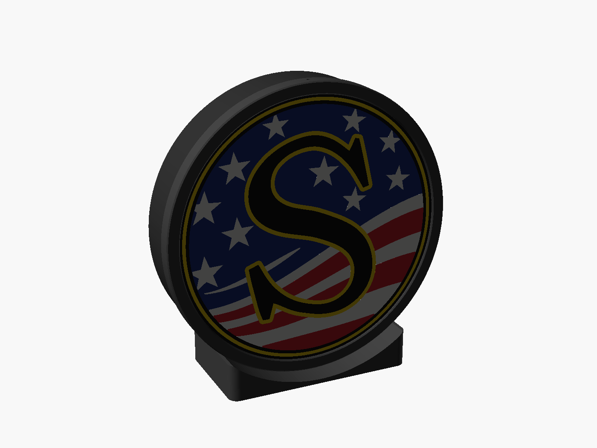

# Round light boxes for printed sign faces (Bambu Lab P1S)

This folder holds three light boxes. Each one takes a **printed face**: a flat, multi-colour
version of one of our sign designs, about 1.6 mm thick, that glows when the box is lit.
All three boxes use the same face, bezel and body, so any face fits any box. Each box can
run from a wall plug or from a battery.

| Flat on the wall | Projecting from the wall | Desk / shelf |
|---|---|---|
|  |  |  |
| one face | two faces, or one face + blank | one face |

Face as printed (left) and lit (right):

| Daylight | Lit |
|---|---|
|  |  |

Size: about **9.6" (245 mm) across**. The body is 240 mm, the opening shows 224 mm of
art, and the wired version is about 2" (50 mm) deep. The P1S bed is 256 mm, so this is
close to the biggest one-piece size it can print. Smaller sizes are covered further down.

**New to this? Start with the [test prints](test/README.md):** a colour coupon, a full-size
fit test and a working 4" mini box.

---

## 1. How the face glows

```
 front (printed face-down on the textured PEI plate = matte, textured front like the photos)
 ┌────────────────────────────────────────────┐ z = 0
 │ colour skin 0.6 mm  (yellow / blue / red / white) │ ← the colour you see
 ├────────────────────────────────────────────┤ z = 0.6
 │ white backing 1.0 mm                       │ ← spreads the light evenly
 └────────────────────────────────────────────┘ z = 1.6
 black areas (the S, rings, edge) are black all the way through, so no light gets out
```

Light from the LEDs passes through the white backing, then through the thin colour
skin. The colours light up and the black stays black, which is the effect in the Delta
and Great Northern photos.

### Make a face from any design
```
pip install shapely numpy trimesh svgelements mapbox_earcut manifold3d
python3 face.py  ../susquehanna-s/svg/preview_flat.svg  ../susquehanna-s/lightbox_face
node render_face.js ../susquehanna-s/lightbox_face        # optional pictures (Playwright)
```
The input is a **flat, full-colour SVG** of the sign (filled shapes, later shapes on top).
Our sign generators already write one (`svg/preview_flat.svg`). An SVG exported from
Inkscape or Illustrator works too. The script writes:

* `face.3mf`: one object with a part per filament. Open it in Bambu Studio and give each
  part an AMS slot.
* `face_<colour>.stl`: the same parts as separate files. If you use these, select them all,
  drag them into Bambu Studio and answer **Yes** to "load as a single object with
  multiple parts".
* `face_preview.svg`, `face.json`: preview and filament list.

The model is **mirrored on purpose**. It prints face-down, so it looks backwards in the
slicer and reads correctly on the finished sign.

Options: `--skin 0.6` sets the colour thickness and `--back 1.0` the white thickness.
`--rotate 15` turns the art. `--merge "#f6cf14=#f5f5f2"` prints one colour with another
filament (see *More than 4 colours*).

### Printing the face (Bambu Studio)
* **Plate:** Textured PEI. Put the model flat on it (it already is).
* **Layer height 0.2 mm, first layer 0.2 mm.** The 0.6 mm skin is then exactly 3 layers.
* **Sparse infill 100 %, rectilinear.** Any lower infill pattern shows through when lit.
  With 100 % infill, 2 walls is enough.
* **Filament:** PLA Basic (not Matte) for the colours and the white. Basic PLA lets light
  through; Matte blocks more of it. Black can be any black.
* The prime tower stays on. Expect a lot of purge, because every colour is in the first
  3 layers.
* **Test first:** in the object's scale settings, unlock the ratio and print it at 30 % in
  X and Y with Z still at 100 %. Hold that small coupon over a phone flashlight to check
  your colours.

### More than 4 colours
One AMS holds 4 spools. The Susquehanna face uses **5** (black, white, yellow, blue, red).
Options:
* Use 2 AMS units.
* Or merge one colour into another, e.g. print the yellow rings in white:
  `python3 face.py ... --merge "#f6cf14=#f5f5f2"`. The command prints the colours in use.

---

## 2. The light boxes

Every box is made from the same parts:

| Part | File | Print in | Notes |
|---|---|---|---|
| Face | from `face.py` | see above | your design |
| Bezel | `stl/common/bezel.stl` | black / grey | prints front-down, held by 3 × M3 × 8 screws from the side |
| LED plate | `stl/common/led_plate.stl` | **white** PETG (or PLA) | the reflector; the LED strip sticks to it |
| Body ("cup") | per style, below | black, or white for brighter edges | prints open side up, no supports |
| Blank face | `stl/common/blank_face.stl` | black | blanks off the second side of the projecting box |

### Flat on the wall (`wall_flat.scad`)
* `stl/wall_flat/body_wired.stl`: the USB cable leaves through a slot at the bottom.
* `stl/wall_flat/body_battery.stl`: 12 mm deeper. A power bank lies behind the LED
  plate, and its ports and button show through an opening at the bottom.
* It hangs on two screws (keyholes 120 mm apart). The screw heads sit behind the LED plate.

### Desk / shelf (`desk_stand.scad`)
* `stl/desk_stand/body.stl` + `stand_wired.stl`, or `stand_battery.stl`.
* Two M3 screws go from inside the body (take the bezel and face off) down into the stand.
* Wired: the cable drops through the stand and runs out the back, in a channel underneath.
* Battery: the power bank slides into the stand from the right side, with its ports facing
  out. The LED cable drops into the pocket and plugs into it.
* The bottom has recesses for 10 mm stick-on rubber feet.

### Projecting from the wall (`wall_projecting.scad`)
The style in the Delta photo: two bodies bolted back to back hang on a wall arm.
* `body_a_wired.stl` or `body_a_battery.stl`, + `body_b.stl`, + `arm.stl`, plus 2 LED
  plates and 2 bezels.
* Join the two bodies with 4 × M3 × 10 bolts and nuts through their backs. The hole in the
  middle carries the wire for side B's LEDs.
* The arm takes 4 × M3 screws from inside the bodies (2 each). The wall plate takes
  2 × #8 countersunk screws, with anchors.
* Wired: the cable runs from body A through the arm, then down a groove behind the wall
  plate. Battery: the bank is in body A, with its ports at the bottom.
* **One design only?** Put the face on side A. Put `blank_face.stl` (printed black) on side
  B and leave B's LEDs off.

### Assembly (every style)
1. Print the body and drop the LED plate in. It rests on the ledge inside.
2. Stick the LED strip to the plate. Follow the small marks: a ring at r = 95 mm and one at
   r = 50 mm (about 0.9 m of strip per side). Turn the plate so its notch lines up with the
   cable slot or the bank, and feed the plug through.
3. Lay the face on the rim with the art upright. The face is round, so you can turn it to
   any angle.
4. Slide the bezel on and drive the 3 side screws.

---

## 3. Power

**LEDs:** a **5 V USB COB LED strip** (the dot-free kind, 8 mm wide) with an **inline USB
dimmer/switch**. COB gives even light at this 40 mm depth; strips with separate LEDs show
dots. Use neutral or cool white (4000–6500 K) so the colours look right; warm white turns
the blues dull.

**Wired:** any USB phone charger (5 V, 2 A or more) and a long USB cable.

**Battery:** a USB power bank. **Measure yours** and set `bank = [length, width, height]`
near the top of `lightbox.scad` (default 100 × 64 × 16 mm, a slim 5000 mAh size). Then run
`./build.sh`. Rough run time on full brightness:

| Strip power | 5 000 mAh bank | 10 000 mAh bank |
|---|---|---|
| ~5 W (0.9 m of a 5 W/m strip, or a brighter strip dimmed) | ~3 h | ~6 h |
| ~2.5 W (dimmed by half) | ~6 h | ~12 h |

The projecting box with both sides lit uses twice the power. Some power banks switch
themselves off when the current drawn is very low. If yours does that at low dimmer
settings, use a bank with an "always on" or low-current mode.

**Heat:** a 5–10 W strip warms the LED plate. Print the plate in PETG, or put a strip of
aluminium tape under the LEDs, so it doesn't soften.

---

## Hardware per box
* M3 × 8 self-tapping (or #4 × 3/8" pan-head) screws: 3 per bezel; +2 for the desk stand;
  +4 for the projecting arm
* Projecting: 4 × M3 × 10 bolts + nuts (joining the bodies), 2 × #8 countersunk wall screws + anchors
* Flat on the wall: 2 × #8 pan-head screws + anchors (for the keyholes)
* 5 V USB COB LED strip (~1 m per lit side), inline USB dimmer, USB charger or power bank
* Desk: 4 × 10 mm rubber feet

## Changing sizes
Every size is a variable at the top of `lightbox.scad`. Change it there, then run
`./build.sh` (`xvfb-run ./build.sh` on a computer with no screen) to rebuild every STL and
picture.
* **Smaller sign:** reduce `od`, `face_d` (= od − 1) and `window_d` (= od − 16) together,
  then make the face with the same `--disc` and `--window`. Example for a 200 mm box:
  `python3 face.py art.svg out --disc 199 --window 184`.
* `cavity` is the distance from the LEDs to the face. Making it deeper gives more even
  light with spotty strips.
* `arm_gap` is the distance from the wall on the projecting box. `stand_w` and
  `stand_extra` set the desk stand's footprint.

## Files
* `face.py`: makes the printable face from a flat colour SVG.
* `render_face.js`: daylight and lit pictures of a face.
* `lightbox.scad`: the shared parts library (all sizes are here).
* `wall_flat.scad`, `desk_stand.scad`, `wall_projecting.scad`: the three styles. Open one
  in OpenSCAD to see the assembly, or set `part = "body"` (etc.) to export a single part.
* `test_fit.scad`, `test_mini.scad`, `test/`: the test prints.
* `build.sh`: exports all STLs to `stl/` and the pictures to `renders/`.
