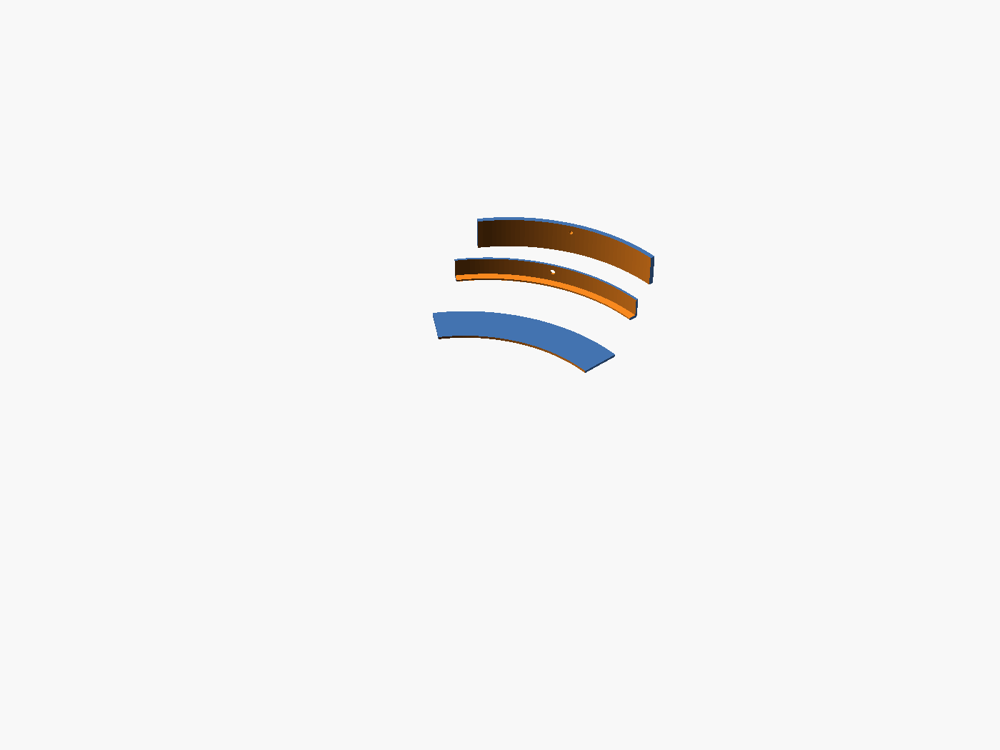
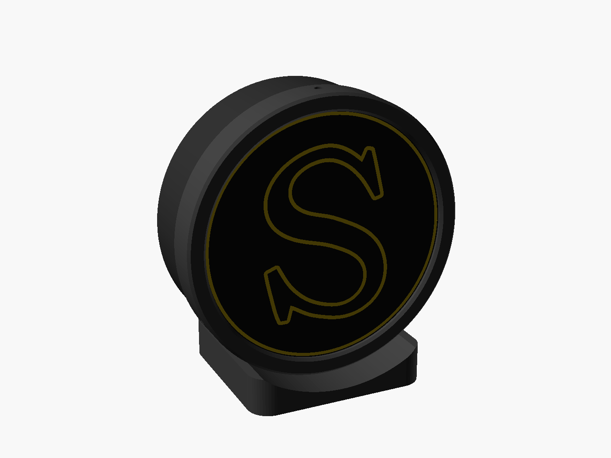

# Test prints

Three small tests to run before the full 9.6" boxes. Together they use about 200 g of
filament and check the three things most likely to need adjusting:

| # | Folder | What it checks | Filament | Rough time* |
|---|---|---|---|---|
| 1 | `face_coupon/` | how the yellow glows, and your print settings | ~6 g, 3 colours | 20–30 min |
| 2 | `full_size_fit/` | bezel slide fit, face seat and a bezel screw **at full size** | ~30 g, 1 colour | ~1 h |
| 3 | `mini/` | a complete working 4" desk light box | ~150 g | 5–6 h total |

*Rough estimates. Colour changes add most of the time to the face prints. Bambu Studio
shows the real time once it slices.

The test faces use the **yellow S on its own**: a black S with its yellow outline and the
yellow pinstripe ring on black, no flag. That needs only 3 filaments (black, yellow and a
hidden white backing), so it fits one AMS. The full-colour flag faces are made the same
way, so what you learn here carries over.

Do them in this order. If test 1 or 2 shows a problem, fix it before printing the next one.

---

## 1. Face coupon: `face_coupon/face.3mf`
A 60 mm circle cut from the full-size (9.6") yellow-S face: part of the S, its yellow
outline and the black background.

* Open `face.3mf` in Bambu Studio and assign each part to its AMS slot. The parts are
  named by colour: `face_141414` = black, `face_f6cf14` = yellow, `face_f5f5f2` = white.
  The white is the 1 mm backing behind the yellow. You don't see it from the front, but
  it spreads the light evenly.
* **Textured PEI plate, 0.2 mm layers, 0.2 mm first layer, 100 % sparse infill
  (rectilinear).** PLA Basic, not Matte, for the colours and the white.
* It looks mirrored in the slicer. That is correct: it prints face-down.

**Check:** hold it in front of a phone flashlight, or tape it over a lamp.
* Yellow looks washed out or too pale → make the colour skin thicker: run `face.py` with
  `--skin 0.8`.
* Yellow looks too dark or orange, or the light is weak → `--skin 0.4`, or try another
  brand of yellow.
* You can see the LED as a bright spot → make the white thicker: `--back 1.4`.
* Infill lines show → check that sparse infill is at 100 %.
* Black lets light through → use a different black, or both thicker (`--skin 0.8 --back 1.2`).

Regenerate the coupon with new settings like this (run in `lightbox/`):
```
python3 face.py ../susquehanna-s/svg/preview_yellow_s.svg test/face_coupon --coupon -35 -45 60 --backing "#f5f5f2" --skin 0.8
```
When you are happy with it, use the same `--skin` / `--back` values for the full face.

## 2. Full-size fit test: `full_size_fit/`
60-degree slices of the real 240 mm parts. One colour, any filament. Print all three on
one plate:
* `body_arc.stl`: the top 20 mm of the body wall, with one bezel screw hole
* `bezel_arc.stl`: the matching slice of the bezel (prints front-down)
* `face_arc.stl`: a slice of the face's edge



**Check:** lay the face slice on the body rim, then slide the bezel slice over both.
* The bezel should slide on by hand with a little friction, no rattle, and clamp the face
  flat. Its screw hole should line up with the hole in the body: drive an M3 × 6
  self-tapping screw in. It should bite firmly into the 3.2 mm wall.
* **Too tight:** raise `clear` in `lightbox.scad` (0.3 → 0.4). **Loose:** lower it (→ 0.2).
* **Face rattles:** the face pocket is 0.2 mm deeper than the face. If the face is loose,
  set the `+ 0.2` in `module bezel()` to `+ 0.1`.
* Then run `./build.sh` again to rebuild every part.

## 3. Mini light box: `mini/`
A working 4" (100 mm) version of the desk stand box, with the yellow S. It tests the
whole system: glow, LED plate, bezel, screws and stand. It is also a nice small product.
Wired (USB) only, because a power bank doesn't fit at this size.

 

| File | Print in | Notes |
|---|---|---|
| `face.3mf` | black, yellow, white | same settings as the coupon |
| `body.stl` | black (or white for brighter edges) | open side up, no supports |
| `bezel.stl` | black / grey | front-down on the textured plate |
| `stand.stl` | black | flat side down |
| `led_plate.stl` | **white** PETG or PLA | |

All except the face fit together on one plate if you print them in one colour. Print the
LED plate separately in white.

**You also need:**
* About 40 cm of 5 V USB COB LED strip (one ring at r ≈ 38 mm and one at r ≈ 20 mm; the
  plate has small marks), plus a USB plug/cable and ideally an inline dimmer
* 3 × M3 × 6 self-tapping screws (bezel) + 2 × M3 × 8 (body to stand)

**Assembly:**
1. Drop the LED plate into the body, stick the strip on and feed the cable out through
   the bottom slot.
2. Screw the body to the stand: 2 screws from inside, into the stand.
3. Lay the face on the rim with the art upright, slide the bezel on and drive the 3 side
   screws.

**Check:** is the light even? The mini has 25 mm between the LEDs and the face, against
40 mm in the full-size box. If it is even here, the big box will be even too. Also check
how bright it is with your strip and power supply.

---

The yellow-S artwork is `../../susquehanna-s/svg/preview_yellow_s.svg`, written by
`susquehanna-s/yellow_s.py`. Rebuild the mini face with:
```
python3 face.py ../susquehanna-s/svg/preview_yellow_s.svg test/mini --disc 99 --window 90.6 --backing "#f5f5f2"
```
The other test files are rebuilt by `../build.sh`. Their sources are `../test_fit.scad`
and `../test_mini.scad`.
