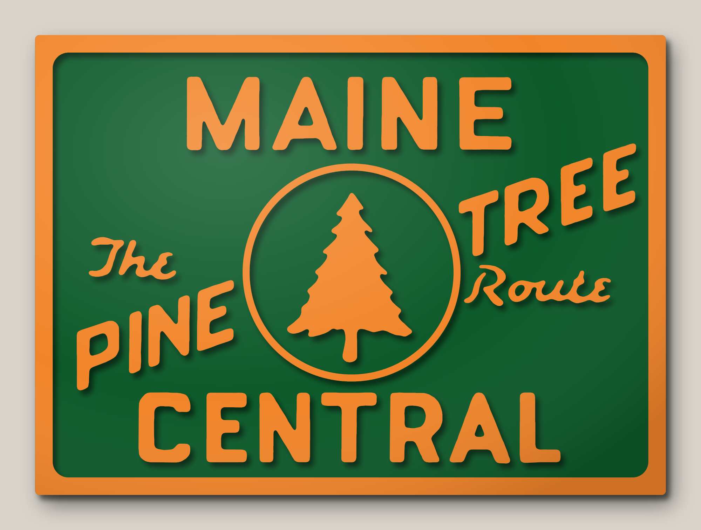
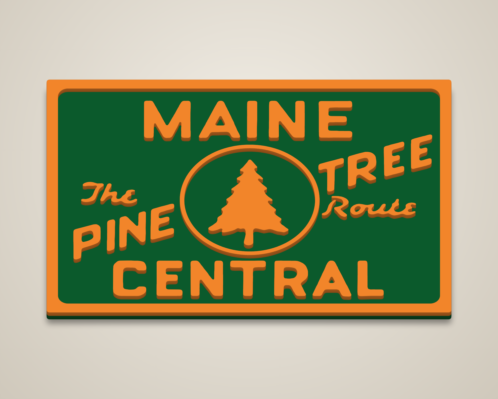
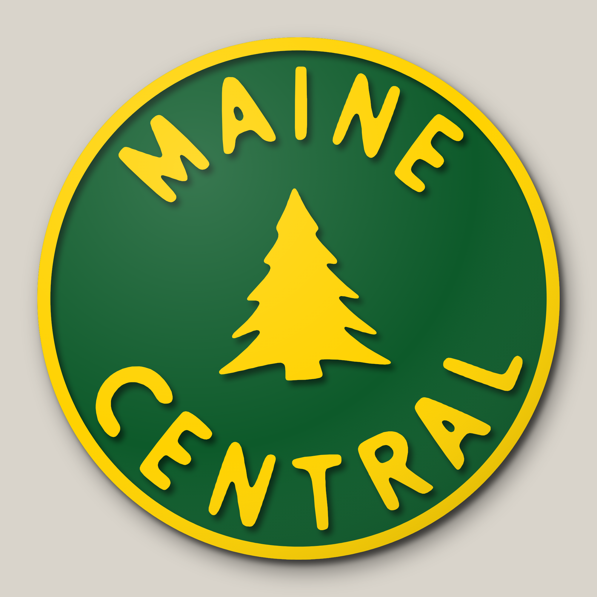
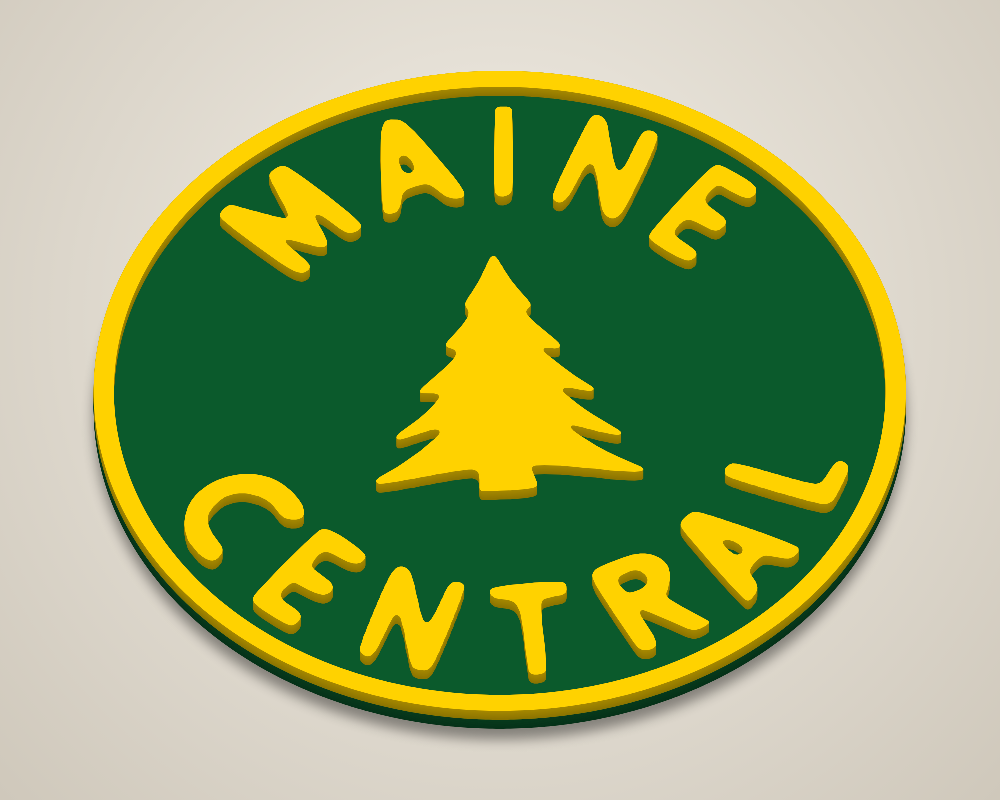

# Maine Central – stacked laser-cut signs (square and round)

Two layered 3-D signs from the Maine Central heralds in `source/`.
Each layer is cut, painted one colour, then stacked and glued from the bottom layer (1) up.

| Square – "The Pine Tree Route" (18" × 13-1/8") | Round (14") |
|---|---|
|  |  |
|  |  |

## Square sign (`square/svg/`) – orange on green


| # | File | Paint | Suggested stock | What it is |
|---|------|-------|-----------------|------------|
| 1 | `layer1_base_orange.svg` | Orange | 1/4" | 18" × 13.125" backer; its edge shows as the 1/2" orange border |
| 2 | `layer2_green_field.svg` | Green | 1/8" | 17" × 12.125" green field with rounded corners |
| 3 | `layer3_orange_art.svg` | Orange | 1/4" | MAINE / CENTRAL / PINE / TREE, "The" and "Route", the ring and the pine tree (27 separate pieces) |

Total thickness is about 5/8".

This is the rectangular herald at its own proportions (300 × 219 on the image), so it is not a true square.
To change the size, edit `SQ_W` in `generate.py`; the height follows. The ring around the tree is
0.20" wide. The herald's ring scales to only 0.15", so it is widened slightly so it cuts and handles safely.

## Round sign (`round/svg/`) – yellow on green


| # | File | Paint | Suggested stock | What it is |
|---|------|-------|-----------------|------------|
| 1 | `layer1_base_green.svg` | Green | 1/4" | 14.00" disc – outer green rim and backer |
| 2 | `layer2_yellow_ring.svg` | Yellow | 1/8" | 12.76" disc – yellow pinstripe ring |
| 3 | `layer3_green_field.svg` | Green | 1/8" | 12.30" disc – green field |
| 4 | `layer4_yellow_art.svg` | Yellow | 1/4" | arched MAINE / CENTRAL and the pine tree (13 separate pieces) |

Total thickness is about 3/4". Layers 1–3 are concentric discs. Centre each one on the layer below.

## Square sign, border on the edge (`square-rim/svg/`)

| Front | Angle |
|---|---|
|  |  |

Same layout as the square sign, but the orange border is a raised frame flush with the top of the lettering.

| # | File | Paint | Suggested stock | What it is |
|---|------|-------|-----------------|------------|
| 1 | `layer1_base_green.svg` | Green (edge orange) | 1/4" | 18" × 13.125" green field and backer |
| 2 | `layer2_orange_frame_and_art.svg` | Orange | 1/4" | 1/2" border frame, plus the lettering, ring and tree (28 pieces) |

* The frame, letters, ring and tree are all cut from the same 1/4" sheet and glued straight onto
  the backer, so they all finish at the same height. Total thickness is 1/2".
* Glue the frame on first, lined up with the edges of the backer, then place the artwork inside it.
* Paint the edge of the backer orange so the whole side reads as one tall orange band.
* The frame is a single 18" × 13-1/8" piece only 1/2" wide. Handle it carefully until it is glued down.

## Round sign, ring on the edge (`round-rim/svg/`)

| Front | Angle |
|---|---|
|  |  |

Same herald, but the yellow ring sits on the outer edge, and its top is flush with the top of the lettering.

| # | File | Paint | Suggested stock | What it is |
|---|------|-------|-----------------|------------|
| 1 | `layer1_base_green.svg` | Green (edge yellow) | 1/4" | 14.00" disc – green field and backer |
| 2 | `layer2_yellow_rim_and_art.svg` | Yellow | 1/4" | 0.35" ring around the edge, plus the lettering and tree (14 pieces) |

* The ring, letters and tree are all cut from the same 1/4" sheet and glued straight onto the
  backer, so they all finish at the same height. Total thickness is 1/2".
* Line the ring up with the edge of the backer first, then place the letters and tree inside it.
* Paint the edge of the backer yellow so the whole side of the sign reads as one tall yellow band.
* With the outer green rim gone, the lettering and tree are scaled up 8%. That keeps the same
  gap to the ring as on the herald. Ring width is `RIM_W` in `generate.py`.

## Files and build notes
All cut files contain cut lines only (red hairline, no fill), at actual size in inches. All the layers
of a sign share the same page size, so they line up.

* `preview_flat.svg` – full-colour flat preview.
* `placement_template.svg` – every layer's outline in a different colour. Print it at 1:1
  (actual size, tiled), lay it on the green field and use it to place the letters, ring and tree.
  For example, prick through the corners of each letter, or glue the template on and cut it away.
* Paint each layer before glue-up. Paint the edges too: from an angle, the edges of the raised pieces show.
* Kerf is not compensated. With a typical 0.004–0.008" kerf, the pieces come out a few thousandths undersize.
  That is fine for stacked art.
* No cut piece has features thinner than 0.08". The script lettering ("The", "Route") is the most
  delicate part: cut it in 1/4" plywood or MDF, not 1/8", and use hold-downs so the small pieces don't drop
  through the bed. "The" is cut as two pieces, T and "he". "Route" is cut as three pieces.

## How it was made / regenerating
The lettering and trees are traced from the herald images (`source/herald_square.png`,
`source/herald_round.png`). `trace.py` upsamples each image 16×, separates the orange or yellow
artwork from the green, and writes the outlines to `trace.json`. `generate.py` scales them to inches,
smooths the pixel wobble (0.03" radius), and draws the border, discs and tree ring as exact
geometry.

The round herald's lettering is hand-drawn and a little irregular. The trace keeps that character,
so the letters are not cleaned up into a font.

```
pip install shapely numpy opencv-python-headless
python3 trace.py           # source/*.png -> trace.json (only needed if the images change)
python3 generate.py        # trace.json  -> square/svg/ and round/svg/
node render.js square      # renders (needs Playwright + Chromium)
node render.js square-rim
node render.js round
node render.js round-rim
```
