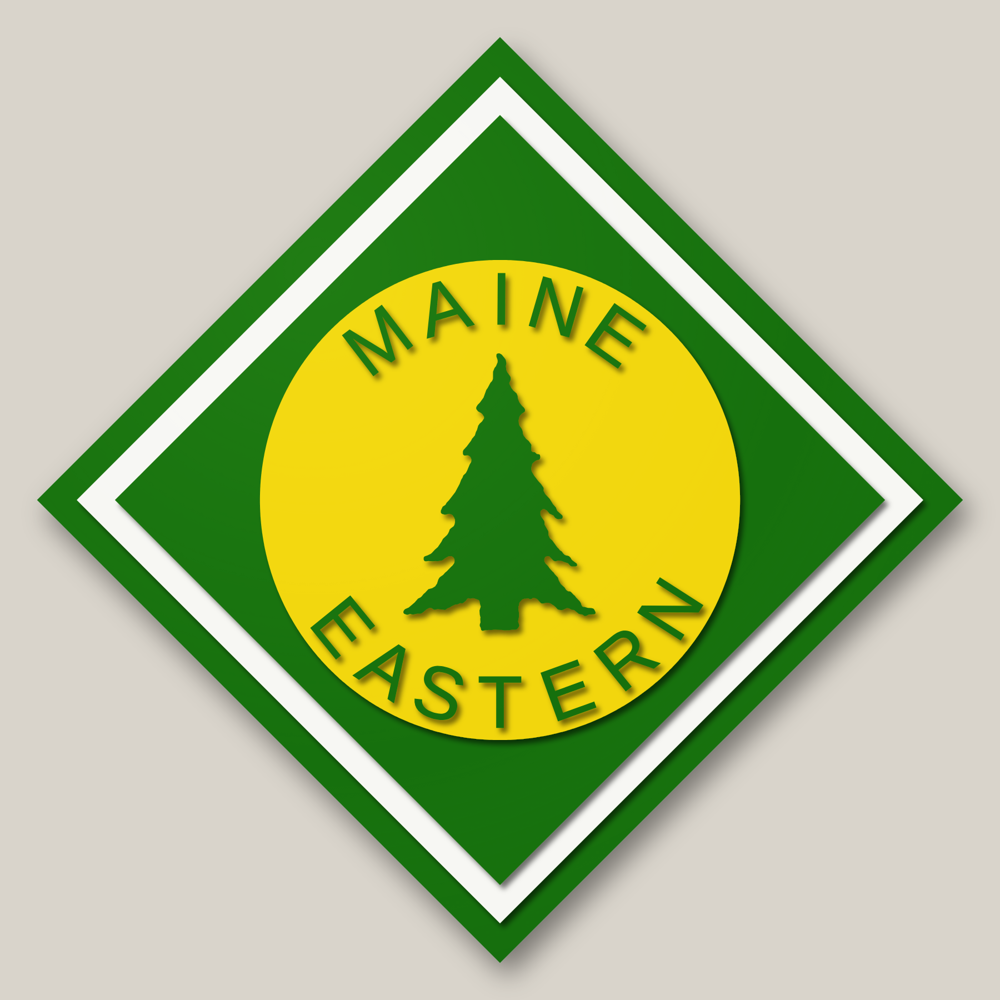
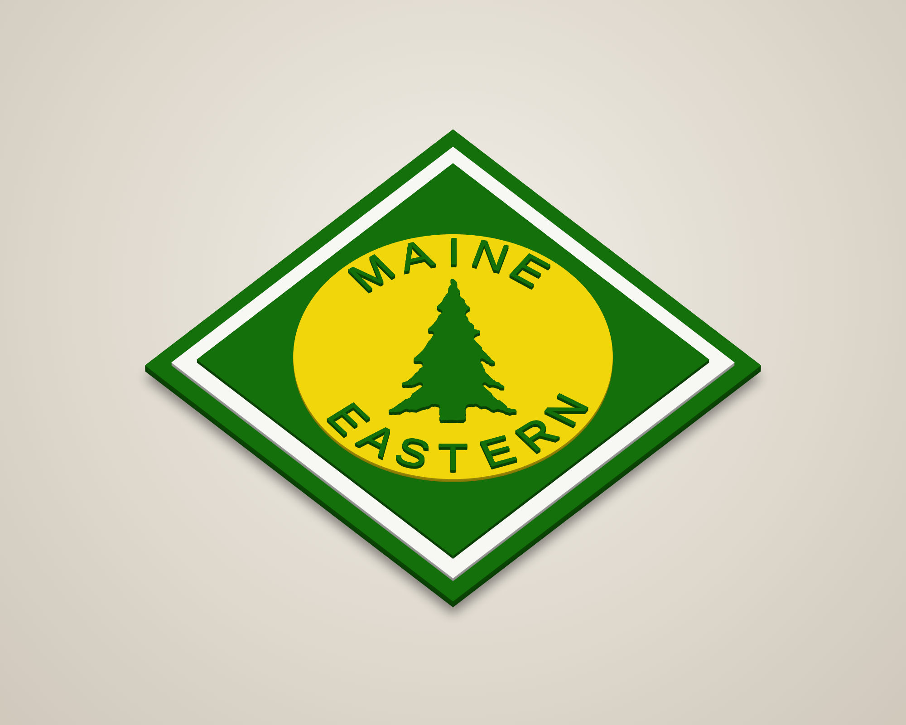
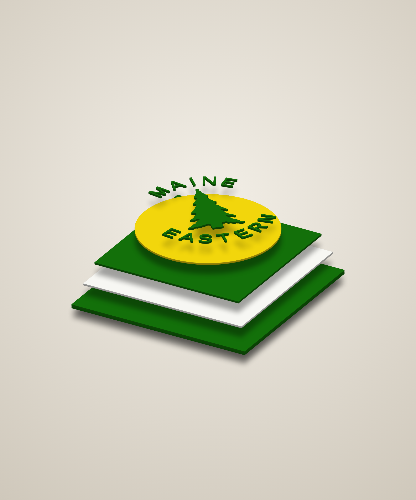
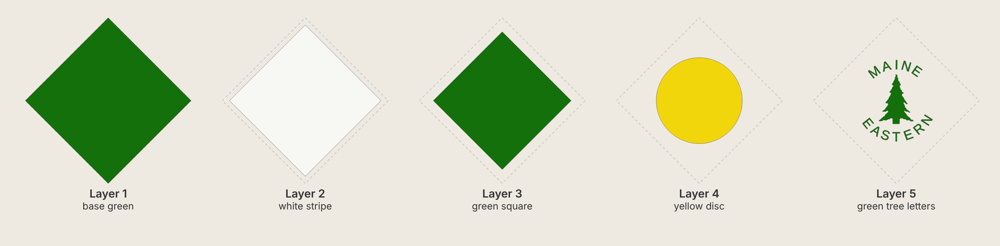
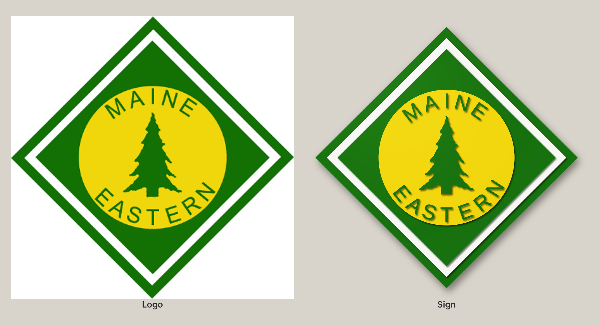

# Maine Eastern Railroad – 12" diamond stacked laser-cut sign

A five-layer 3-D sign of the Maine Eastern Railroad diamond logo. You cut each layer, paint it
one colour, then stack and glue the layers from 1 (bottom) to 5 (top). The sign is a 12" square
hung on its point, so it is 17" tall.



| Angle | Exploded |
|---|---|
|  |  |



Compared with the logo:



## Cut files (`svg/`)

The cut files have the square's edges level (the artwork is turned 45°). That way every layer
fits on 12" × 12" stock and on most laser beds. All files are 12 in × 12 in on the same centre,
so the layers line up. They contain only cut lines (red hairline, no fill).

| # | File | Paint | Suggested stock | What it is |
|---|------|-------|-----------------|------------|
| 1 | `layer1_base_green.svg` | Green | 1/4" | 12.00" square – outer green border and backer |
| 2 | `layer2_white_stripe.svg` | White | 1/8" | 10.97" square – white stripe |
| 3 | `layer3_green_square.svg` | Green | 1/8" | 9.98" square – inner green |
| 4 | `layer4_yellow_disc.svg` | Yellow | 1/8" | 8.80" disc – yellow circle |
| 5 | `layer5_green_tree_letters.svg` | Green | 1/8" (or 3/16" for more depth) | spruce tree and 12 letters (MAINE / EASTERN) |

With this stock, the sign is about 3/4" thick in total. Stock thickness doesn't change the cut files.

Other files:
* `preview_flat.svg`: full-colour flat preview, hung on its point.
* `placement_template.svg`: every layer's outline in a different colour, in the same orientation
  as the cut files. Print it at 1:1 (actual size, tiled) to position the tree and letters.
* `reference_logo.png`: the logo image that all the measurements come from.

## Build notes
* Paint each layer before glue-up, including the edges. The edges of the raised pieces show
  when you look at the sign from an angle.
* Layers 1–4 are centred squares and a disc. Line up their centres and corners, or drill a small
  pin hole through the centre of each on the laser.
* Layer 5 is 13 loose pieces. Glue them down one at a time. To place them, use the template, or cut
  layer 5 again from scrap card and use the sheet with the holes in it as a stencil. Keep the
  inner parts of the A and R: they come out of the letters and you don't glue them down.
* The lettering is about 0.93" tall, with strokes about 0.13" wide. The thinnest parts are the tips
  of the tree's branches (spikes thinner than 0.05" are trimmed). Use hold-downs or tabs so the
  small pieces don't fall through the bed.
* Kerf is not compensated. With a typical kerf of 0.004–0.008", pieces come out a few thousandths
  undersize, which is fine for stacked art.
* Green: a deep "John Deere" or forest green is close to the logo (#13700A).

## Regenerating
The geometry is parametric in `generate.py`.

```bash
pip install shapely numpy fonttools
```

```bash
python3 generate.py        # writes svg/ for the default 12" square
```

```bash
python3 generate.py 10     # a 10" square (14.1" tall when hung on point)
```

```bash
node render.js             # writes renders/ (needs Playwright + Chromium)
```

* **Rings and disc:** sizes measured from `reference_logo.png`, as fractions of the outer square.
* **Lettering:** Liberation Sans Regular, a metric clone of Arial. Its widths match the logo's
  letters to within about 5%, and the strokes are grown slightly to match the logo's weight.
  Each letter is placed at the angle measured on the logo.
* **Tree:** traced from the logo with `trace_tree.py` (`tree_trace.json`), then smoothed. To
  trace again from a better image, run
  `pip install opencv-python-headless`, then `python3 trace_tree.py image.png`. The image must be
  laid out like `reference_logo.png`, or `CENTRE_PX` in the script must be updated.
