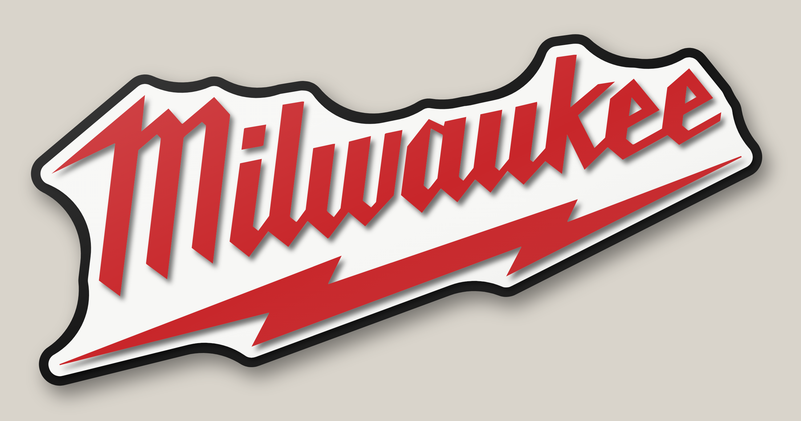
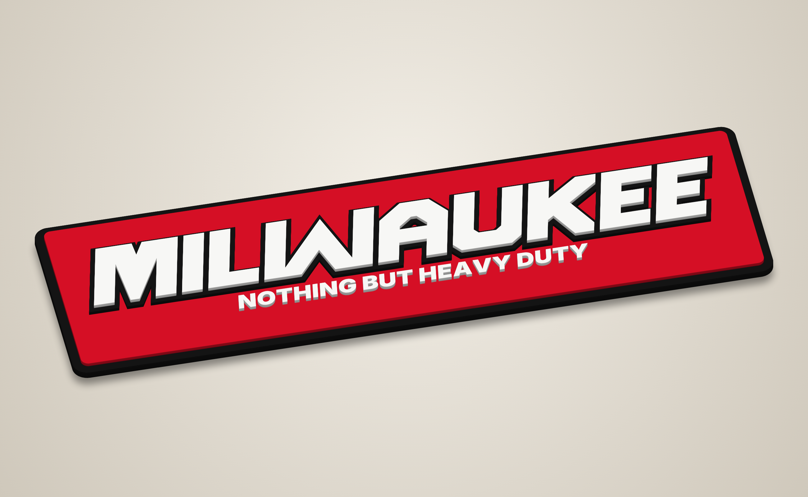
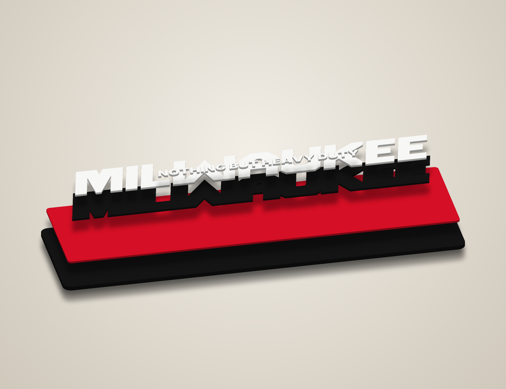
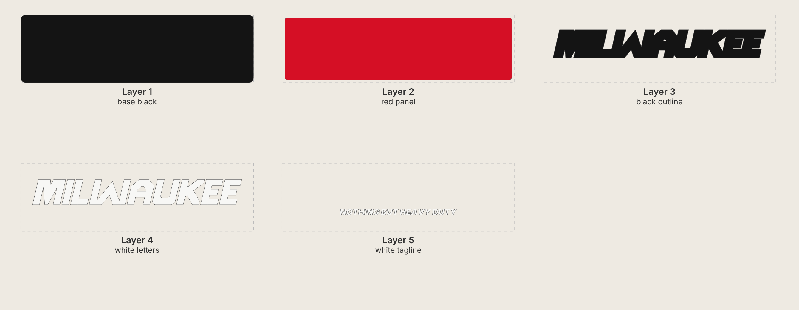
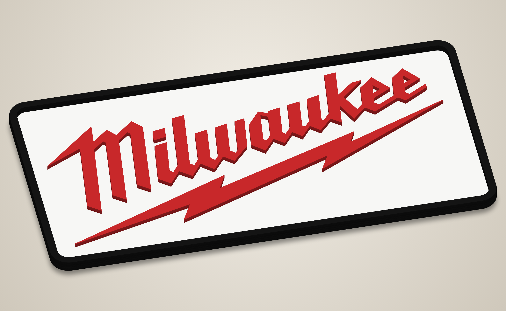

# Milwaukee logo sign – stacked laser-cut sign

A Christmas gift sign of the Milwaukee lightning-bolt logo. **For personal use only.** The logo is
a Milwaukee Electric Tool trademark, so don't sell signs made from these files.

The logo is traced directly from `source/logo.png`, so the letters and bolt match the real logo.



| Angle | Exploded |
|---|---|
|  |  |



## Two versions

| Version | Folder | Backer size | Look |
|---|---|---|---|
| **Contour** (main) | `svg/` | 23.1" × 11.1" | Cut to the logo's shape, white border and black rim |
| Panel | `svg_panel/` | 24.2" × 12.2" | Rounded rectangle, like a shop sign ([preview](renders_panel/render_front.png)) |

Both versions use the same 22"-wide red logo.

### Bambu R1 versions (600 × 300 mm bed, no material feeder)

These are sized so every layer fits the R1's 600 × 300 mm bed with clearance. Each SVG is a
600 × 300 mm sheet with the part centred, so it drops straight onto the bed. You'll need
600 × 300 mm stock (or a little smaller than the bed) for the backer and white layers.

| Version | Folder | Backer size | Logo width |
|---|---|---|---|
| **Contour** | `svg_r1/` | 590 × 284 mm | 557 mm |
| Panel | `svg_r1_panel/` | 569 × 290 mm | 508 mm |

Previews: [`renders_r1/`](renders_r1/render_front.png), [`renders_r1_panel/`](renders_r1_panel/render_front.png).
To fit a different bed, change `R1_MAX_MM` in `generate.py` and run `python3 generate.py r1`
(or `r1 panel`).

### Raised-frame panel versions

These are the panel version with a black frame that rises to the same height as the red logo, so
the logo sits inside a tray. The frame is 0.4" (10 mm) wide.



| Version | Folder | Backer size | Logo width |
|---|---|---|---|
| Panel, raised frame | `svg_panel_raised/` | 620 × 315 mm (24.4" × 12.4") | 554 mm |
| **Bambu R1** panel, raised frame | `svg_r1_panel_raised/` | 563 × 290 mm | 497 mm |

These versions have two extra layers, both painted black:

| # | File | Stock | What it is |
|---|------|-------|------------|
| 4 | `layer4_black_frame_lower.svg` | 1/8" (same as the white) | frame ring; sits on the backer around the white field |
| 5 | `layer5_black_frame_upper.svg` | 1/4" (same as the red) | frame ring on top of layer 4; its top is level with the red |

* The frame's inner edge is the white field's outline, so the white drops into the lower ring
  and the ring locates it. Glue the backer, then the lower ring, then the white, then the upper
  ring, then the red.
* Each ring is a single long, narrow piece. Handle it carefully until it's glued down, and use
  hold-downs when cutting.
* If you change the stock thicknesses, keep the frame rings the same thickness as the white and
  red layers, so the frame stays level with the logo.

## Cut files

Each SVG is drawn at actual size (units in mm), and every layer in a folder shares the same origin, so they line
up. They contain cut lines only (red hairline, no fill).

| # | File | Paint | Stock | Pieces | What it is |
|---|------|-------|-------|--------|------------|
| 1 | `layer1_base_black.svg` | Black | 1/4" | 1 | backer; shows as a 0.3" black rim |
| 2 | `layer2_white_field.svg` | White | 1/8" | 1 | white field (0.35" white border around the logo in the contour version) |
| 3 | `layer3_red_logo.svg` | Red | 1/4" | 5 | the logo: "M", "ilwa", the i dot, "ukee", lightning bolt |

Total thickness is 5/8". Cutting the red layer from 1/4" stock makes the logo stand out. Any
thickness works.

Other files in each folder:
* `preview_flat.svg`: full-colour flat preview.
* `placement_template.svg`: outline of every layer. Print it at actual size (tiled) to place the red
  pieces, or use the white layer's offcut as a jig (see below).

## Build notes
* Paint each layer, edges included, before glue-up. Milwaukee red is close to a bright
  "cherry/apple red". Gloss looks closest to the logo.
* **Placement jig:** cut layer 3 a second time from scrap, without the red pieces' insides. That is,
  cut the logo outline out of a scrap sheet the same size as the white layer. Lay it on the white
  layer, drop the red pieces into the holes, glue, and lift the jig off.
* The bolt's tips and any features thinner than 0.08" are slightly blunted, so they survive cutting.
  Use hold-downs for the bolt; it is long and thin.
* The (R) mark is left off, as it is too small to cut.
* Kerf is not compensated. That's fine for stacked art.
* Add a keyhole hanger or a French cleat on the back of layer 1.

## Changing it
Settings are at the top of `generate.py`: `LOGO_W` (overall size), `WHITE` and `RIM` (border
widths), `CLOSE` (how smooth the contour outline is), and the panel padding.

```
pip install shapely opencv-python-headless
python3 trace_logo.py source/logo.png   # only if you swap in a different logo image
python3 generate.py            # contour version -> svg/
python3 generate.py panel      # panel version   -> svg_panel/
python3 generate.py r1         # Bambu R1 contour -> svg_r1/
python3 generate.py r1 panel   # Bambu R1 panel   -> svg_r1_panel/
python3 generate.py panel raised      # raised frame -> svg_panel_raised/
python3 generate.py r1 panel raised   # raised frame, R1 bed -> svg_r1_panel_raised/
node render.js                 # -> renders/        (needs Playwright + Chromium)
node render.js svg_panel       # -> renders_panel/  (likewise for the other svg_* folders)
```
`trace_logo.py` reads the logo's coverage from the image (the alpha channel of a transparent
PNG, or red-ness on a white background). It then simplifies each edge to a straight-sided polygon.
