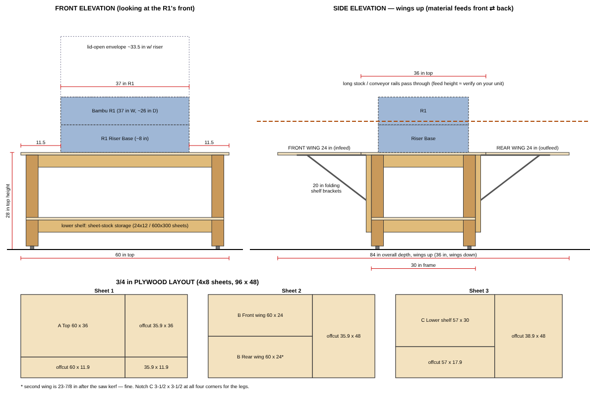

# Workbench: Bambu Lab R1 laser + Automatic Conveyor Feeder

(`workbench.svg` holds the same drawing at full scale. Run `python3 drawing.py` to regenerate it.)

## Design basis

| Item | Spec used | Source |
|---|---|---|
| R1 footprint | 940 W × 660 D mm (37 × 26 in), lid open | Bambu Lab / MatterHackers listings |
| Recommended clearance | 100 mm (4 in) left, right, rear and top | same |
| Height with Riser Base, lid open | 850 mm (33.5 in) | same |
| Conveyor Feeder | ~117 × 1234 × 756 mm, 9.2 kg. Needs the Riser Base. Rail runs 450–1500 mm, extensions reach 3000 mm | Swing Design listing |
| Feed direction | Long stock comes out the **front and back** of the machine | MatterHackers |

What follows from these specs:

* **Top height is 28 in**, which is lower than a normal 36 in bench. The riser adds about 8 in and the open lid stands about 33.5 in, so the lid top lands around 61 in. A lower bench keeps the bed easy to reach and the lid easy to see over.
* **Open front and back.** The bench has no back panel or rear stretchers above the shelf, so stock and conveyor rails can pass straight through.
* **Fold-up front and rear wings** sit flush with the top and support the conveyor's guide-rail feet and the long stock. Wings up gives 84 in (2.1 m) of supported depth, which covers the 2 m configuration. Wings down shrinks the bench to 36 in deep.
* **Top is 60 × 36 in.** That leaves 11.5 in each side of the 37 in machine, which is more than the 4 in clearance it needs. There is room for the exhaust hose and Bambu Bus cable, and space to lay parts.
* **The lower shelf** holds sheet stock flat (24 × 12 in / 600 × 300 mm sheets fit with room to spare).
* **Leveling feet, not casters.** The laser wants to stay level and still. If you need to move the bench, use locking casters rated at least 150 lb each and subtract their height from the leg length.

## Lumber to buy

| Qty | Material | Notes |
|---|---|---|
| 1 | 4×4 × 10 ft (or 2 × 8 ft) | legs |
| 7 | 2×4 × 8 ft | frame, joists and bracket stiles (includes 1 spare) |
| 2 | 3/4 in plywood, 4×8, sanded/cabinet grade (birch or similar) | top and wings |
| 1 | 3/4 in plywood or OSB, 4×8 | lower shelf (1/2 in also works) |

## Cut list

Actual sizes: 4×4 = 3½ × 3½, 2×4 = 1½ × 3½, ply = ¾.

| Part | Qty | Material | Length / size | Where |
|---|---|---|---|---|
| Legs | 4 | 4×4 | 26¼ in | corners |
| Top long aprons (front/back) | 2 | 2×4 | 57 in | top frame, on edge |
| Top short aprons (sides) | 2 | 2×4 | 27 in | between the long aprons |
| Top joists | 2 | 2×4 | 27 in | inside the top frame, ~19 in on center |
| Lower long aprons | 2 | 2×4 | 57 in | shelf frame, bottom edge 5 in off the floor |
| Lower short aprons | 2 | 2×4 | 27 in | shelf frame |
| Lower joist | 1 | 2×4 | 27 in | center of the shelf frame |
| Bracket stiles | 4 | 2×4 | 22¼ in | 2 on the front face, 2 on the back, flat against both aprons |
| A — Top | 1 | ¾ ply | 60 × 36 in | overhangs the frame 1½ in at the sides, 3 in front and back |
| B — Wings | 2 | ¾ ply | 60 × 24 in | front (infeed) and rear (outfeed) |
| C — Lower shelf | 1 | ¾ ply | 57 × 30 in | notch 3½ × 3½ at each corner for the legs |

**How the 2×4s come out of 8 ft boards (96 in):**

* Boards 1–4: 57 + 27 each (4 long aprons and 4 short pieces)
* Board 5: 27 + 27 + 27 (the last 3 short pieces)
* Board 6: 22¼ × 4 (stiles)
* Board 7: spare, for mistakes or blocking

**Legs:** cut 4 × 26¼ from the 10 ft 4×4. With two 8 ft posts, cut 2 legs from each.

**Plywood:** the layout is in the drawing. The offcuts (35 × 36, 35 × 48, 38 × 48, 57 × 17) are big enough for a hose shelf or a drawer later.

## Hardware

| Qty | Item |
|---|---|
| 4 | Heavy-duty folding shelf brackets, 20 in (pair rated ≥ 500 lb) |
| 2 | Continuous (piano) hinges, 1½ in open width, 60 in (or cut down from 72 in) |
| 4 | Leveling feet, 3/8-16 thread, with 4 tee nuts or threaded inserts |
| ~32 | Structural wood screws, ¼ × 3⅛ in (GRK RSS / Spax PowerLag): aprons to legs |
| ~40 | 3 in construction screws: joists and stiles |
| ~60 | 1⅝ in wood screws: plywood to frame, every 8 in |
| — | Wood glue, sandpaper, finish (2–3 coats water-based poly, or paint) |

## Assembly

1. **Legs.** Drill the bottom of each leg for the tee nut or insert and install the leveling feet. Set each foot to stick out about 1 in.
2. **Top frame.** Screw the two 57 in aprons over the outside faces of the legs, flush with the leg tops, using 2 structural screws per leg. Fit the 27 in side aprons between them, also screwed into the legs. Add the 2 joists at about 19 in spacing, 2 × 3 in screws through each end.
3. **Shelf frame.** Repeat step 2 with the lower aprons and the center joist. Put the bottom edge of the aprons 4 in above the leg bottoms, which is 5 in off the floor with the feet set.
4. **Check square.** Measure the diagonals before the plywood goes on. Then glue and screw shelf C onto the lower frame. The plywood stops the frame from racking.
5. **Top.** Center top A with a 1½ in overhang at each side and 3 in front and back. Glue it and screw it down every 8 in. Countersink the screws so the R1 feet and stock slide smoothly.
6. **Bracket stiles.** Screw the stiles flat against the front face of the top and lower aprons, about 10 in in from each end. Do the same at the back. Mount one 20 in folding bracket on each stile, set so it holds the wing level with the top.
7. **Wings.** Join each wing B to the top's front or back edge with a piano hinge on the underside, so the wing drops straight down. Folded, a wing hangs about 4 in off the floor.
8. **Finish.** Ease the edges, then apply finish. Waxing the top and wings makes long stock slide better.
9. **Level.** Put the bench in place, level it with the feet, then set the R1 on its riser centered on the top.

## Placement and use

* **Floor depth:** plan for **84 in (7 ft)** front to back with the wings up, plus walkway space. For 2.5–3 m stock, put a roller stand at the top's height (28 in, or whatever feed height you measure) beyond each wing.
* Don't put the back of the bench against a wall if you use the conveyor. Turning the bench sideways along a wall works.
* Run the exhaust hose to the side and out a window or wall vent. Keep the hose short, with few bends.
* With the Riser Base or conveyor installed, the R1 is **no longer fully enclosed (Class 4)**. Wear CO2-rated laser eyewear and keep people away from the open front and back slots.

## Verify before cutting

* The **feed height of the conveyor rails** and where the **guide-rail supports** stand. The design assumes they rest on a flat surface level with the top, which is what the wings provide. If yours mount differently, change the wing height or the bracket position.
* **Actual R1 and riser weights.** The frame is good for several hundred pounds, but check that the bracket rating suits whatever you will lean on the wings.
