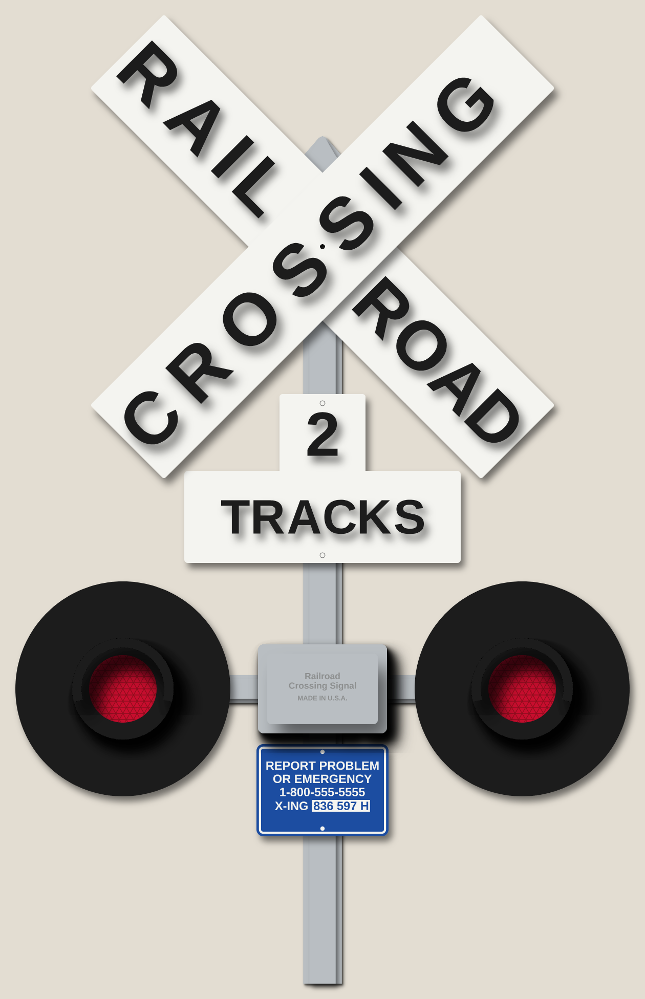
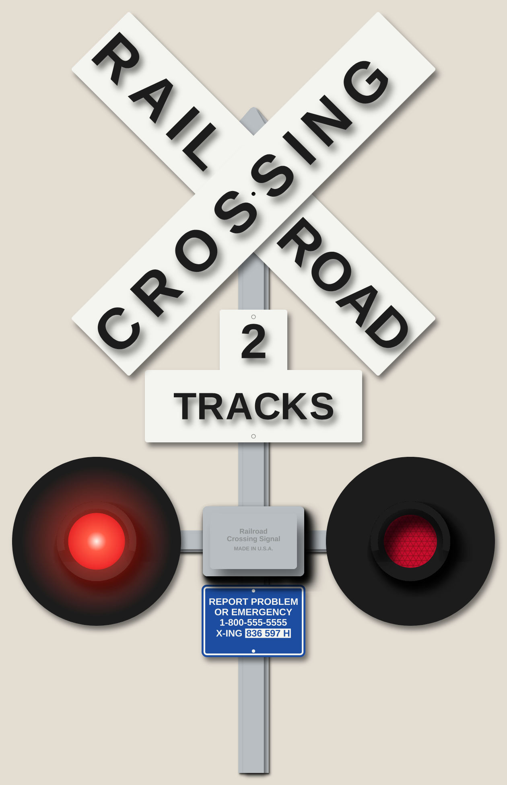
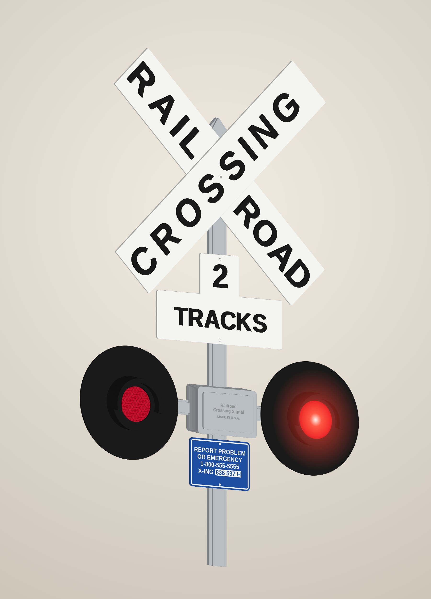
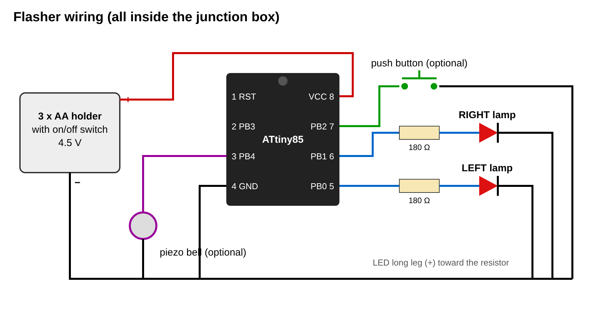

# Railroad crossing signal – stacked 1/8" MDF wall sign with working lights

A crossbuck signal with a "2 TRACKS" plate, two lamps and an emergency plaque, built
from 14 layers of 1/8" MDF. The lamps flash alternately from a battery pack hidden in
the grey junction box. Its front cover is held on with magnets.

| Front | Lit |
|---|---|
|  |  |



**Overall size: 20" wide × 31½" tall × 1¾" deep.** The largest pieces are the two 18" × 3.4"
blades and the 15" × 8" spine cross piece, so a 12" × 20" bed is enough. For a smaller
laser, see [Changing the size](#changing-the-size).

## How it's built

Every part is on a numbered layer, counting out from the wall (layer 1 = against the wall).

* **Spine (layers 1–3, grey).** The pole, the lamp arms and the back of the junction box.
  Each layer comes in three pieces (upper, cross, lower). The joints are staggered from layer
  to layer and hidden behind the TRACKS plate and the blue plaque. The front layer is narrower
  than the two behind it, so the pole looks rounded.
  * Layer 1 has two **keyhole slots** for wall screws. Layer 2 behind them leaves room for the screw head.
  * Layer 2 has a **wire channel** in each arm, from behind each lamp to under the junction box.
  * Layer 3 has the holes that bring the wires out: one behind each lamp and two inside the box.
* **Crossbuck (layers 4–6, white with black letters).** The RAILROAD blade is behind and
  the CROSSING blade is in front, as on the photo. The letters are raised 1/8" pieces. A hole
  at the centre takes a #6 bolt through blades and pole, like the bolt on the real sign.
* **TRACKS plate (layers 4–5)** and **blue plaque (layer 4)**, mounted on the pole.
* **Lamps (layers 4–14, black).** Each lamp is a disc with a housing on it. The housing has a
  back plate that holds the LED, a 3/8" deep light chamber, a pocket for the red acrylic lens,
  a bezel that traps the lens, and a 4-layer hood (visor) over the top.
* **Junction box (layers 4–12, grey).** This is the battery compartment: 3.7" × 2.4" × 3/4" deep inside.
  The lid is three layers: magnet plate, cover, and a raised label panel engraved
  "Railroad Crossing Signal – MADE IN U.S.A.". Four 1/4" × 1/8" magnets in the corners hold it
  on, and a notch under the bottom edge gives you a fingernail grip. A slot in the bottom wall
  takes an optional push button.

## Cut files (`svg/`)

All files are at 1:1 scale in inches, and each file already holds every copy you need.
* **Red hairline = cut.**
* **Black fill = engrave.**
* **Blue hairline = score.** These are only decorative bolt heads; skip them if you like.

| File | Qty | Layer | Paint | Notes |
|------|----:|------:|-------|-------|
| `spine_1_back_upper/cross/lower.svg` | 1 each | 1 | Grey | keyholes |
| `spine_2_mid_upper/cross/lower.svg` | 1 each | 2 | Grey | wire channels |
| `spine_3_front_upper/cross/lower.svg` | 1 each | 3 | Grey | wire holes |
| `blade_railroad.svg` | 1 | 4 | White | |
| `tracks_plate.svg` | 1 | 4 | White | |
| `plaque.svg` | 1 | 4 | Blue / white | engrave (see below) |
| `lamp_disc.svg` | 2 | 4 | Black | |
| `box_frame.svg` | 2 | 4, 8 | Grey | |
| `blade_crossing.svg` | 1 | 5 | White | |
| `letters_railroad.svg` | 8 letters | 5 | Black | |
| `letters_tracks.svg` | 7 pieces | 5 | Black | "2" + TRACKS |
| `lamp_housing_back.svg` | 2 | 5 | Black | LED hole |
| `box_frame_button.svg` | 3 | 5, 6, 7 | Grey | button slot |
| `letters_crossing.svg` | 8 letters | 6 | Black | |
| `lamp_cavity_ring.svg` | 6 | 6, 7, 8 | Black (paint inside **white**) | |
| `lamp_lens_pocket.svg` | 2 | 9 | Black | |
| `lens.svg` | 2 | 9 | – | **1/8" red acrylic**, facets engraved on the back |
| `box_frame_magnets.svg` | 1 | 9 | Grey | magnet pockets |
| `lamp_bezel.svg` | 2 | 10 | Black | |
| `box_lid_1_magnets.svg` | 1 | 10 | Grey | magnet pockets |
| `lamp_hood.svg` | 8 | 11–14 | Black | |
| `box_lid_2_cover.svg` | 1 | 11 | Grey | |
| `box_lid_3_label.svg` | 1 | 12 | Grey | engraved label |

**Letter jigs.** `jig_letters_railroad.svg`, `jig_letters_crossing.svg` and `jig_letters_tracks.svg`
are the blade (or plate) outline with the letters cut out. Cut them from card stock. Lay a
jig on its painted blade with the edges flush, drop the letters into the holes and glue
them, then lift the jig off.

Other files:
* `preview/assembly_template.svg` – every part outline, colour-coded by layer. Print it at
  1:1 (tiled) if you want a layout guide.
* `preview/preview_flat.svg` – full-colour flat preview.

## Shopping list

| Item | Qty | Notes |
|------|----:|-------|
| 1/8" (3 mm) MDF | about 5 sheets of 12" × 20" | |
| 1/8" red acrylic | 6" × 3" | Transparent red works. Translucent ("cast") red diffuses the light better. |
| 5 mm red LED, diffused or "straw hat" wide-angle | 2 | Wide-angle LEDs light the lens most evenly. |
| 180 Ω resistor, 1/4 W | 2 | |
| ATtiny85 (DIP-8) + 8-pin socket + small perfboard | 1 | Or a Digispark ATtiny85 board, which you can program over USB. |
| 3 × AA battery holder **with switch** | 1 | Must fit 3.2" × 1.9" × 0.7" (most do). |
| 1/4" × 1/8" neodymium disc magnets | 8 | |
| 6–7 mm momentary push button | 1 | Optional: starts and stops the flashing. |
| Passive piezo disc | 1 | Optional crossing bell. |
| 26 AWG wire, #6 × 1¼" machine screw and nut, wood glue, paint | | |

## Electronics



The firmware is in `firmware/crossing_flasher/crossing_flasher.ino`.

* **Behaviour.** The lamps alternate at 45 flashes a minute. Each lamp fades up and down
  like an incandescent bulb.
* **Timer.** When you switch on, the lamps flash for 10 minutes and then the chip goes into
  deep sleep, drawing about 1 µA. The push button starts and stops the flashing and wakes the
  chip from sleep, so you can leave the battery switch on. Set `RUN_MINUTES = 0` to flash for
  as long as the switch is on.
* **Crossing bell.** Set `USE_BELL = true` if you fitted the piezo.
* **Programming.** Use the Arduino IDE with ATTinyCore (ATtiny85, 8 MHz internal) and an
  "Arduino as ISP" or USBasp programmer. Or use a Digispark with the Digistump core.
  **On a Digispark, wire the battery + to the `5V` pin, not `VIN`.** Remove its power LED to
  save battery.
* **Battery life.** Three AAs give roughly 100 hours of continuous flashing.
* **Arduino Nano or Uno.** The sketch also runs on these: change the pin numbers at the top.
  The sleep mode only works on the ATtiny85.
* **No programming?** A ready-made "railroad crossing flasher" module for model railways,
  or a 555 alternating-flasher kit, wires to the same two LEDs.

## Assembly

1. **Paint first.** Paint every part, including its edges, before glue-up:
   * spine and box: light grey;
   * blades and TRACKS plate: white;
   * letters and lamp parts: black.

   Paint the **inside** of the lamp cavity rings white or line them with foil: the
   lamp glows more evenly. Don't paint where glued faces meet, or mask those areas.
2. **Plaque (white letters on blue).** Paint the plaque white, then blue, and let it cure.
   Cover it with paper transfer tape and engrave `plaque.svg` through the tape (low power, so
   the laser only cuts the mask). Spray white over the openings, then peel the tape.
3. **Spine.** Glue layers 1 → 2 → 3, staggering the joints as cut. Line up the centre bolt
   hole and the wire holes; a 1/8" dowel or drill bit through the holes helps. Clamp it flat.
4. **Wires.** Before the next step, run two thin wires per lamp through the layer-2 channel:
   in at the hole behind the lamp, out at the hole inside the box.
5. **Lamps.** Push each LED through its housing back plate from behind, so the rim sits in
   the hole in the disc. Solder it to its wires, then glue the disc to the arm with the holes
   lined up.
   * Glue on the three cavity rings, then the lens pocket ring.
   * Drop in the lens with its engraved face toward the LED.
   * Glue the bezel on top, then the four hood layers with their opening at the bottom.
6. **Junction box.** Glue the frames in order onto the spine: `box_frame`, three
   `box_frame_button`, `box_frame`, `box_frame_magnets`.
   * Press the magnets into the frame pockets.
   * Glue the lid layers together, then press the lid's magnets in with opposite poles
     facing the frame's magnets. Check the lid's attraction before the glue sets.
7. **Crossbuck.** Glue the RAIL and ROAD letters onto the RAILROAD blade using its jig, and
   the CROSSING letters onto the CROSSING blade. Glue the RAILROAD blade to the pole, then
   the CROSSING blade on top. Bolt through the centre hole.
8. **Plates.** Glue the TRACKS plate and its letters, and the plaque, onto the pole.
9. **Electronics.** Fit the flasher board and the battery holder in the box, then close the lid.
10. **Hang it.** Mark the two keyhole centres: 1.4" above the crossbuck centre, and 23.4"
    below that. Set two screws so their heads stand about 3/16" off the wall, and hang the sign.

Kerf isn't compensated: parts come out a few thousandths undersize, which is fine for
stacked work. If your lens is loose in its pocket, a dot of clear glue fixes it.

## Changing the size

All the geometry is parametric in `generate.py`: blade size, letter height, pole, lamp
position, box size, lens and LED holes, plaque text, the number on the tracks plate, and so on.
The script refuses to write files if two parts on the same layer overlap.

```bash
pip install shapely numpy fonttools
python3 generate.py      # writes svg/ and preview/
node render.js           # writes renders/ (needs Playwright + Chromium)
```

* **Text.** Change `TRACKS_NUMBER` to "3" for a 3-track crossing. Edit `PLAQUE_LINES` and
  `PLAQUE_XING` for your own crossing number.
* **Letters.** They use Liberation Sans Bold, which is metric-compatible with Arial Bold.
  The cut files contain outlines, so you don't need the font installed to cut them.
* **Smaller sign.** For a smaller laser (a 400 × 400 mm bed, for example), reduce
  `BLADE_L` / `BLADE_W` and scale the other main sizes to match. Keep `LENS_D`, the LED
  holes and the box cavity at a size that still fits your battery holder.
