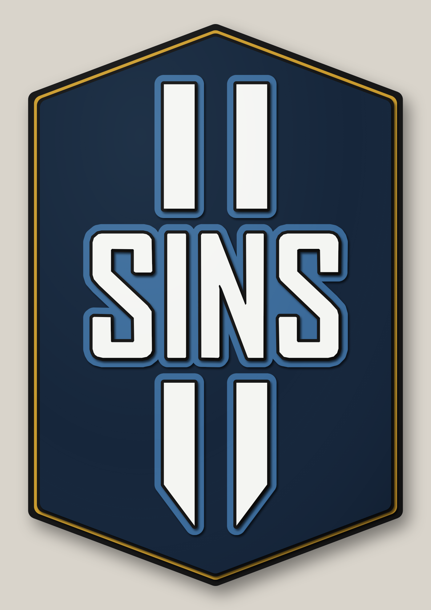
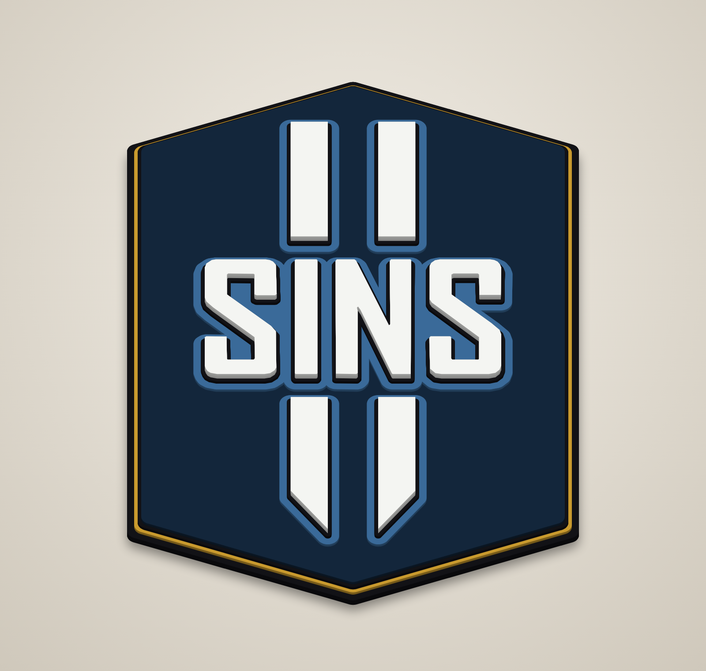
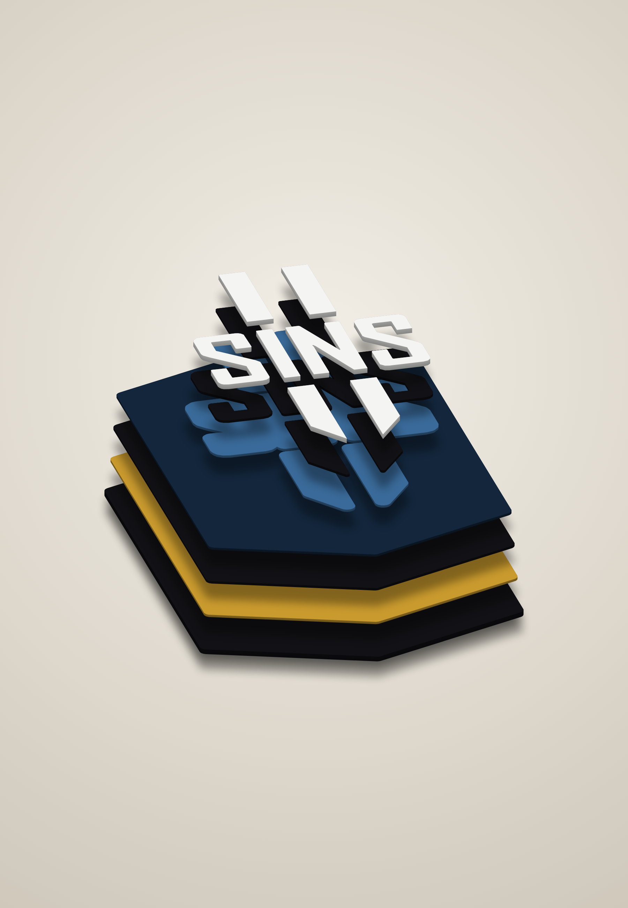
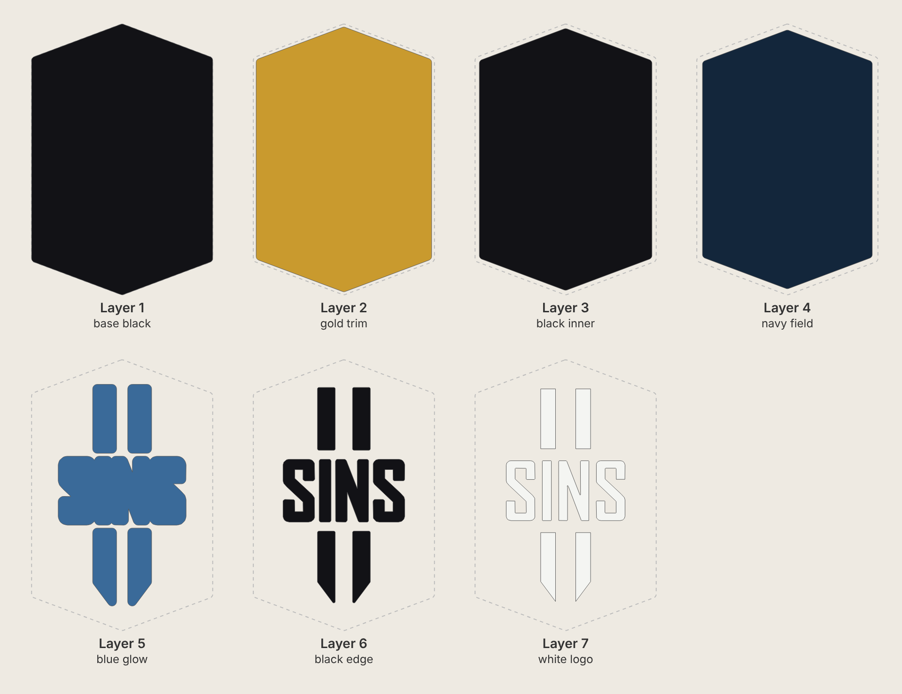

# Sins II hexagon badge – 24" tall stacked laser-cut sign

The simplified *Sins of a Solar Empire II* logo from the game's app icon (`reference_icon.webp`):
two "II" bars, SINS, then two pointed bars, on a tall hexagon backboard with a gold trim.
The SINS letters are the ones traced from the official logo (see `../sins-solar-empire-2`).
It's a fan piece for personal display. The logo is a trademark of its owners.



| Angle | Exploded |
|---|---|
|  |  |



**Finished size: 16" wide × 24" tall × 1-1/8" thick.** The logo is 10.5" × 18.8".

## Cut files (`svg/`)

All files are 16" × 24" on the same centre, so every layer lines up. They contain
cut lines only (red hairline, no fill).

| # | File | Paint | Stock | Pieces | What it is |
|---|------|-------|-------|--------|------------|
| 1 | `layer1_base_black.svg` | Black | 1/4" | 1 | Hexagon backer: the black outer rim |
| 2 | `layer2_gold_trim.svg` | Gold | 1/8" | 1 | Hexagon, 0.25" smaller: gold trim |
| 3 | `layer3_black_inner.svg` | Black | 1/8" | 1 | Hexagon, 0.125" smaller again: thin black band |
| 4 | `layer4_navy_field.svg` | Navy | 1/8" | 1 | Hexagon field |
| 5 | `layer5_blue_glow.svg` | Mid blue | 1/8" | 5 | Blue band, 0.4" around the logo (SINS is one piece) |
| 6 | `layer6_black_edge.svg` | Black | 1/8" | 8 | Thin black edge, 0.13" around each letter and bar |
| 7 | `layer7_white_logo.svg` | White | 1/4" | 8 | S, I, N, S and the four bars |

Other files:
* `preview_flat.svg` – full-colour flat preview.
* `placement_template.svg` – every layer's outline in a different colour. Print it at 1:1
  (tiled) to position the logo pieces during glue-up.

The backer is a single 16" × 24" piece, so it needs a bed at least that big
(for example 24" × 18"). It does not fit a 600 × 400 mm (23.6" × 15.7") bed.

## Build notes
* Paint each layer before glue-up, including the edges: they show from an angle.
* Glue order: 1 → 2 → 3 → 4 (nested hexagons, all centred), then 5, 6 and 7 using
  the template. Every piece sits fully on the layer below, so nothing needs supports.
* Kerf is not compensated. With a typical 0.004–0.008" kerf, the pieces come out
  a few thousandths undersize, which is fine for stacked art.
* No part of the logo is thinner than 0.2".

## Regenerating
```
pip install shapely
python3 generate.py        # writes svg/
node render.js             # writes renders/ (needs Playwright + Chromium)
```
At the top of `generate.py`: `HEIGHT`, `WIDTH` and `SHOULDER` set the hexagon, `SINS_H` sets
the logo size (the bars scale with it), and `BAR_W`, `BAR_GAP`, `ROW_GAP`, `TOP_BAR_H`,
`BOT_BAR_H` set the bar proportions.
