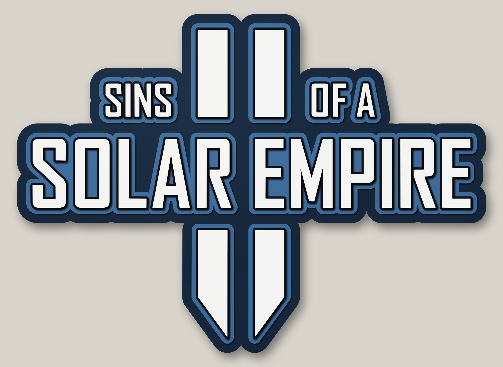
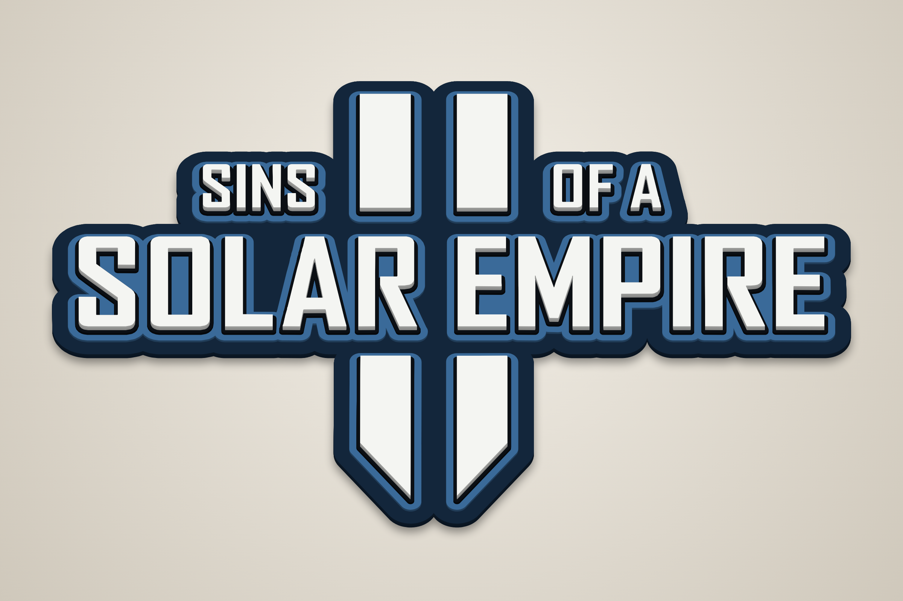
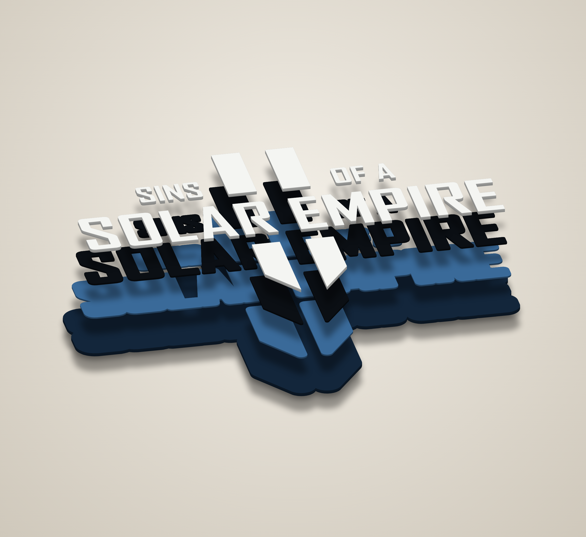
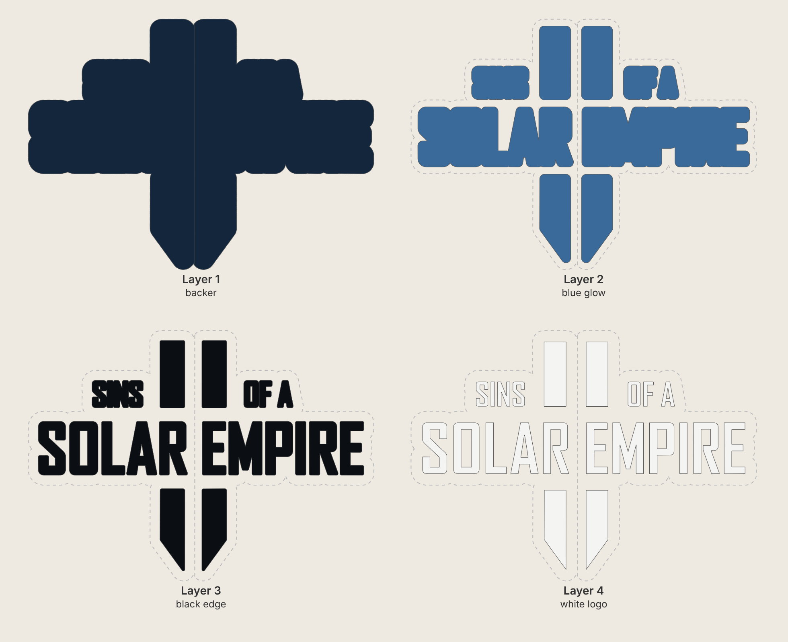

# Sins of a Solar Empire II – 24" tall stacked laser-cut sign

Four-layer 3-D sign of the *Sins of a Solar Empire II* logo, traced from the official
black logo artwork (`source/logo.png`). It is a fan piece for personal display. The logo is a
trademark of its owners, so don't sell copies without a licence.



| Angle | Exploded |
|---|---|
|  |  |



**Finished size: 33.2" wide × 24.0" tall × 3/4" thick.** The logo itself is 31" × 21.8".

## Cut files (`svg/`)

All layer files share the same artboard (33.17" × 24.02"), so the layers line up.
They contain cut lines only (red hairline, no fill).

| # | File | Paint | Stock | Pieces | What it is |
|---|------|-------|-------|--------|------------|
| 1 | `layer1_backer.svg` | Dark navy | 1/4" | 2 | Backer, 1.1" larger than the logo all round. Cut in two halves |
| 2 | `layer2_blue_glow.svg` | Mid blue | 1/8" | 9 | Blue band, 0.45" around the logo |
| 3 | `layer3_black_edge.svg` | Black | 1/8" | 19 | Thin black edge, 0.15" around each letter and bar |
| 4 | `layer4_white_logo.svg` | White | 1/4" | 22 | The logo: 4 bars and 18 letters |
| – | `layer0_splice_plate_back.svg` | none (back) | 1/4" | 1 | 3" × 23" plate glued to the back across the backer seam |

Other files:
* `preview_flat.svg` – full-colour flat preview.
* `placement_template.svg` – every layer's outline in a different colour. Print it at 1:1
  (tiled), or cut/score it on cheap card, to position the letters during glue-up.

The colours follow the game's icon: white logo on blue. Any colour scheme works,
because each layer is painted separately.

### Bed size
The backer is too large for most lasers in one piece, so it's split into two halves. The cut runs straight down the gap between the
two "II" bars and between SOLAR and EMPIRE, so it only shows as a hairline in the dark navy.
The halves are 16.0" and 17.2" wide by 24" tall (fits a 24" × 18" bed). The widest blue piece
(behind EMPIRE) is 16.1" × 5.8". If your bed takes the full backer, set `SPLIT = False`
in `generate.py`.

## Build notes
* Paint each layer before glue-up, including the edges: they show from an angle.
* Glue the two backer halves edge to edge on a flat surface, then glue the splice plate
  across the seam on the back. The plate is a good place for a French cleat or hanging hardware.
* Glue order: blue (2), then black edges (3), then the white logo (4). Each piece sits
  fully on the layer below, so nothing needs supports.
* Kerf is not compensated. With a typical 0.004–0.008" kerf, the pieces come out
  a few thousandths undersize, which is fine for stacked art.
* No part of the logo is thinner than 0.2", so everything cuts cleanly.
  The (R) mark is left out.

## Regenerating
```
pip install shapely numpy opencv-python-headless
python3 trace_logo.py      # source/logo.png -> logo_trace.json
python3 generate.py        # writes svg/
node render.js             # writes renders/ (needs Playwright + Chromium)
```
`SIGN_H` (overall height), `BACKER`, `GLOW`, `EDGE` and `SPLIT` at the top of `generate.py`
set the size and border widths.
