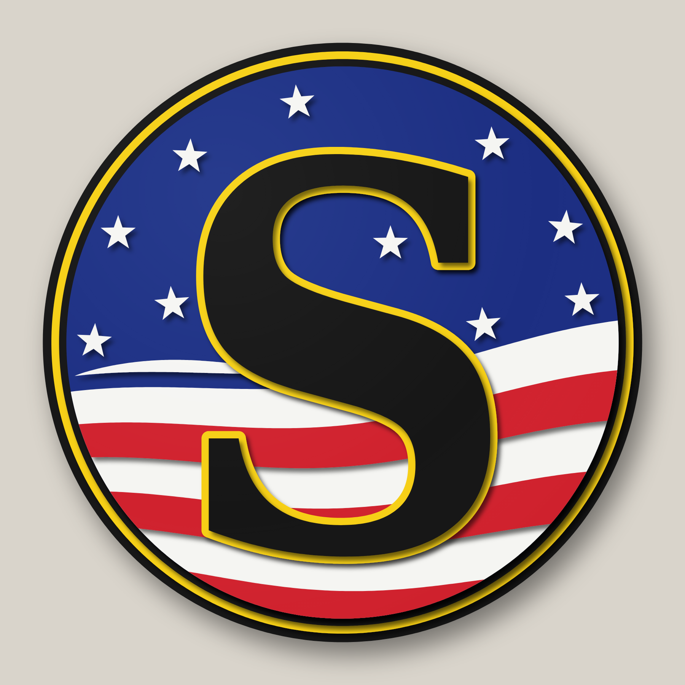
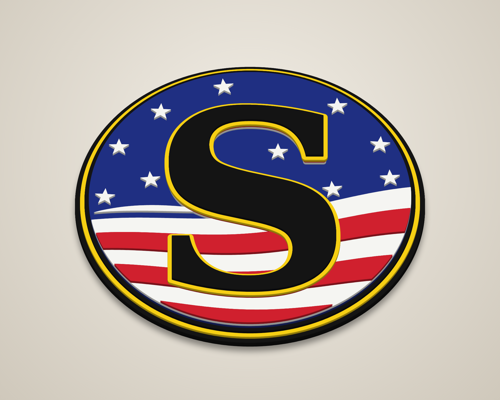
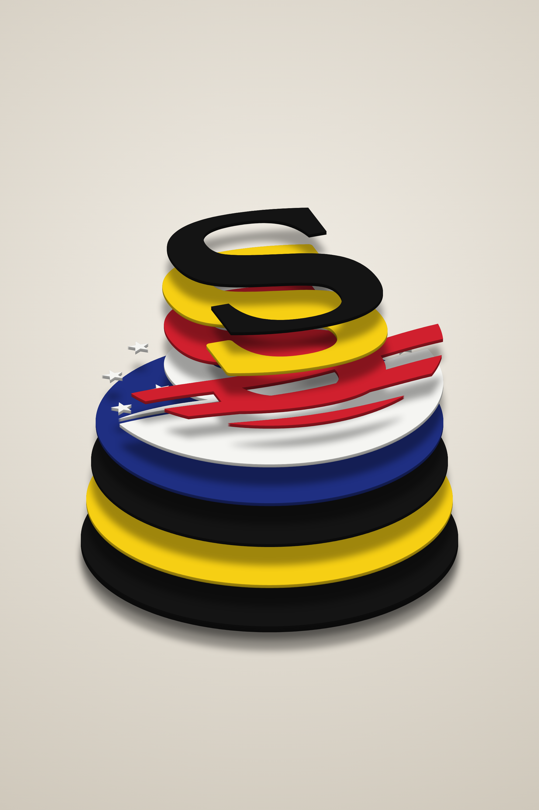
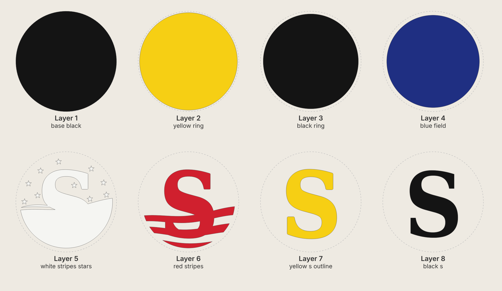

# Susquehanna "S" – 14" round stacked laser-cut sign

Eight-layer 3-D sign of the Susquehanna flag "S" logo (made with the railroad's permission).
Each layer is cut, painted one colour, then stacked and glued, bottom (1) to top (8).



| Angle | Exploded |
|---|---|
|  |  |



## Cut files (`svg/`)

All files are 14 in × 14 in on the same centre, so every layer lines up. They contain
cut lines only (red hairline, no fill).

| # | File | Paint | Suggested stock | What it is |
|---|------|-------|-----------------|------------|
| 1 | `layer1_base_black.svg` | Black | 1/4" | 14.00" disc – outer black rim and backer |
| 2 | `layer2_yellow_ring.svg` | Yellow | 1/8" | 13.60" disc – yellow pinstripe ring |
| 3 | `layer3_black_ring.svg` | Black | 1/8" | 13.24" disc – inner black ring |
| 4 | `layer4_blue_field.svg` | Blue | 1/8" | 12.90" disc – blue field |
| 5 | `layer5_white_stripes_stars.svg` | White | 1/8" | white stripe panel, swoosh and 10 stars |
| 6 | `layer6_red_stripes.svg` | Red | 1/8" | red stripes |
| 7 | `layer7_yellow_s_outline.svg` | Yellow | 1/8" | yellow outline of the S (0.17" border) |
| 8 | `layer8_black_s.svg` | Black | 1/8" | black S |

Total thickness with this stock is about 1-1/8". The stock thickness doesn't change the cut files.

Other files:
* `preview_flat.svg` – full-colour flat preview.
* `placement_template.svg` – every layer's outline in a different colour. Print it at 1:1
  (actual size, tiled) to position the stars, swoosh, red stripes and S pieces during glue-up.

### Hidden S support
Layers 5 and 6 each include an S-shaped piece that sits directly under the S
(inset 0.06" so it stays out of sight). It holds the S outline flat on top of the
stripes, so the S doesn't rock or leave gaps. It also joins the red stripes into
one piece, which makes layer 6 easy to align. Paint it with its layer; it is
covered by layers 7 and 8.

## Build notes
* Paint each layer before glue-up. Paint the edges too: the edges of the raised
  pieces show from an angle.
* Kerf is not compensated. With a typical 0.004–0.008" kerf, the pieces come out
  a few thousandths undersize, which is fine for stacked art.
* Smallest pieces: stars are about 0.86" across, and the swoosh tapers to a fine
  point. Use a honeycomb bed with hold-downs, or leave tabs.
* Glue order: 1 → 2 → 3 → 4 (all concentric discs), then 5 using the template,
  then 6, 7, 8.

## Regenerating
The geometry is fully parametric (sizes, S position, stars, stripe waves) in `generate.py`.

```
pip install shapely fonttools
python3 generate.py        # writes svg/
node render.js             # writes renders/ (needs Playwright + Chromium)
```
The S letterform is from DejaVu Serif Bold (`fonts/`, free licence), scaled to fit the logo.
