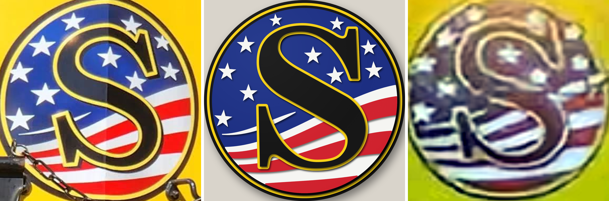
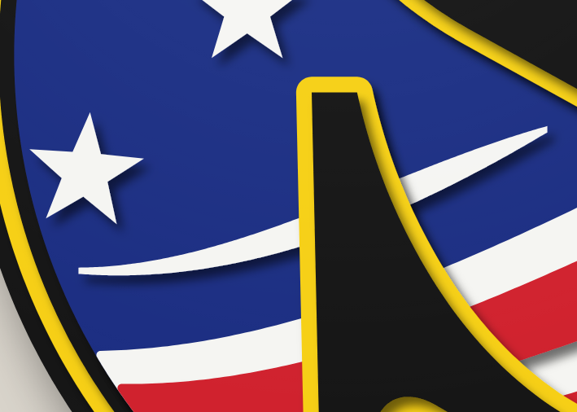
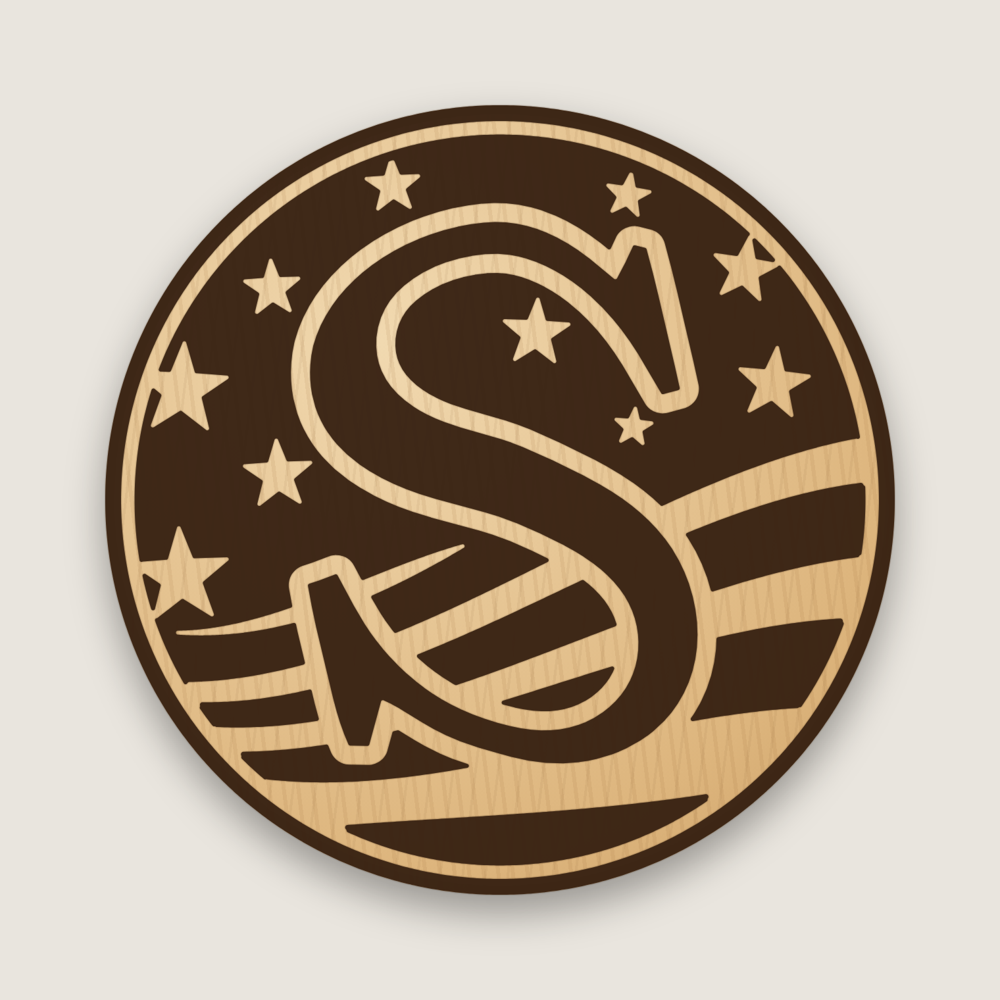
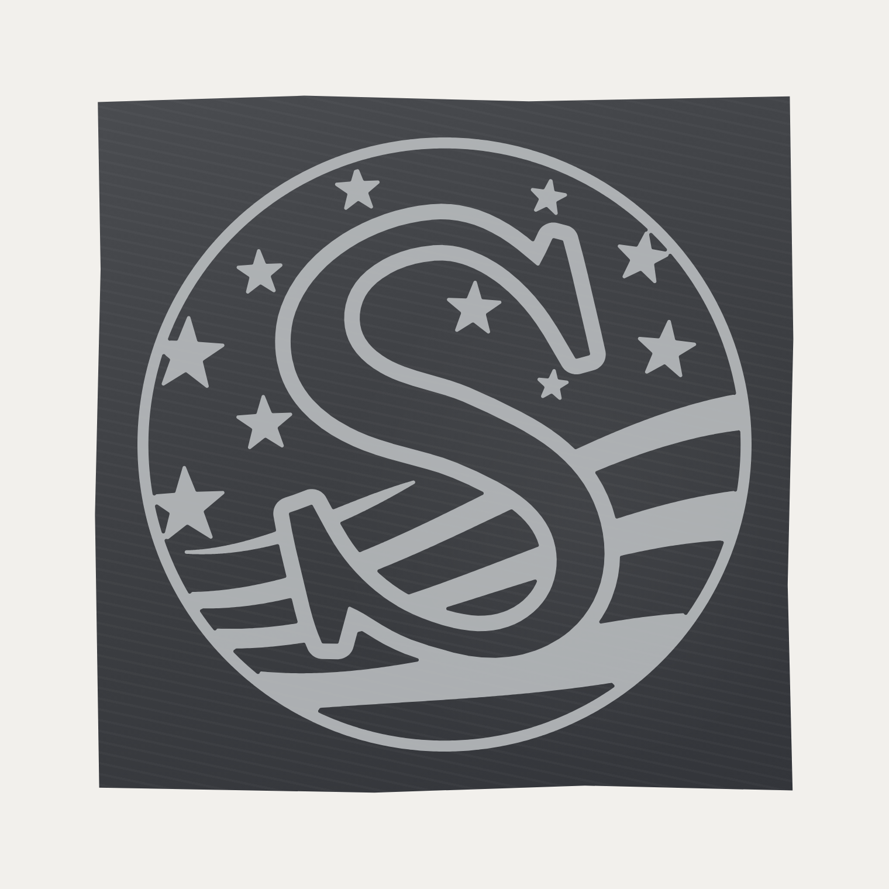
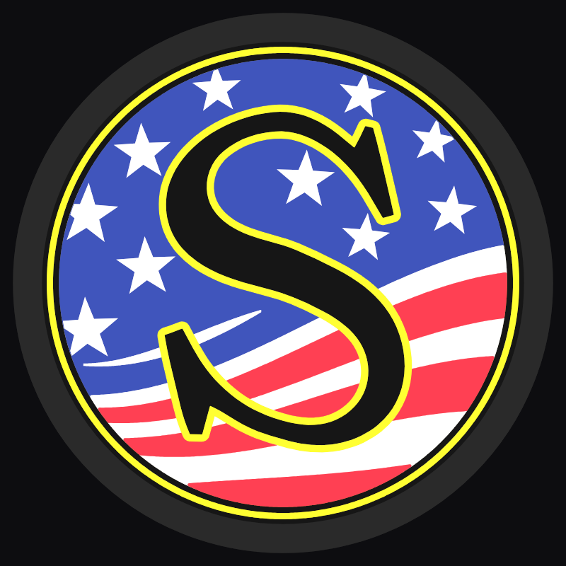

# Susquehanna "S" – 14" round stacked laser-cut sign

Eight-layer 3-D sign of the Susquehanna flag "S" logo (made with the railroad's permission).
Each layer is cut, painted one colour, then stacked and glued, bottom (1) to top (8).


| Angle | Exploded |
|---|---|
|  |  |


Compared with the locomotive (left: head-on photo, right: faded photo):



Swoosh passing behind the serif:



## Cut files (`svg/`)

All files are 14 in × 14 in on the same centre, so every layer lines up. They contain
cut lines only (red hairline, no fill).

| # | File | Paint | Suggested stock | What it is |
|---|------|-------|-----------------|------------|
| 1 | `layer1_base_black.svg` | Black | 1/4" | 14.00" disc – outer black rim and backer |
| 2 | `layer2_yellow_ring.svg` | Yellow | 1/8" | 13.60" disc – yellow pinstripe ring |
| 3 | `layer3_black_ring.svg` | Black | 1/8" | 13.24" disc – inner black ring |
| 4 | `layer4_blue_field.svg` | Blue | 1/8" | 12.90" disc – blue field |
| 5 | `layer5_white_stripes_stars.svg` | White | 1/8" | white stripe panel, swoosh and 10 stars |
| 6 | `layer6_red_stripes.svg` | Red | 1/8" | red stripes |
| 7 | `layer7_yellow_s_outline.svg` | Yellow | 1/8" | yellow outline of the S (0.17" border) |
| 8 | `layer8_black_s.svg` | Black | 1/8" | black S |

Total thickness with this stock is about 1-1/8". The stock thickness doesn't change the cut files.

Other files:
* `preview_flat.svg` – full-colour flat preview.
* `placement_template.svg` – every layer's outline in a different colour. Print it at 1:1
  (actual size, tiled) to position the stars, swoosh, red stripes and S pieces during glue-up.

### Hidden S support
Layers 5 and 6 each include an S-shaped piece that sits directly under the S
(inset 0.06" so it stays out of sight). It holds the S outline flat on top of the
stripes, so the S doesn't rock or leave gaps. It also joins the red stripes into
one piece, which makes layer 6 easy to align. Paint it with its layer; it is
covered by layers 7 and 8.

## Build notes
* Paint each layer before glue-up. Paint the edges too: the edges of the raised
  pieces show from an angle.
* Kerf is not compensated. With a typical 0.004–0.008" kerf, the pieces come out
  a few thousandths undersize, which is fine for stacked art.
* Stars keep one shape, but each has its own size (1.3–1.9" across), tilt and position,
  fitted to the matching star in the photo. As on the locomotive, the two stars at the
  left edge run under the ring and are clipped by it. Five stars next to the S are scaled
  to 90% so they clear its outline. Swoosh tips are blunted to 0.07", and
  stripe points at the rim are trimmed, so no part of the stripe layers is thinner than
  about 0.09". Use hold-downs or tabs for the stars.
* The stripe edges, swoosh and star positions were measured from a head-on photo of the logo
  (pixel scans, fitted with smooth curves): six bands under the blue, white-red-white-red-white,
  then a wide red band at the bottom.
* The white swoosh passes behind the S's lower serif, as on the locomotive. It is
  cut as part of the white stripe piece and joined to it through the hidden S support,
  so both visible ends line up on their own.
* Glue order: 1 → 2 → 3 → 4 (all concentric discs), then 5 using the template,
  then 6, 7, 8.

## Regenerating
The geometry is fully parametric (sizes, S position, stars, stripe waves) in `generate.py`.

```
pip install shapely numpy
python3 generate.py        # writes svg/
node render.js             # writes renders/ (needs Playwright + Chromium)
```
The S letterform (`s_logo_trace.json`) was traced from a head-on photo of the
locomotive logo with `trace_s.py`. The script reads the black letter inside the
yellow outline, smooths the curves, and keeps the serif corners and spurs sharp.
It also repairs a glare dent on the top-left curve. To re-trace from a photo:
`pip install opencv-python-headless scipy`, then `python3 trace_s.py photo.jpg`.
The yellow outline is 0.21" wide, as measured from the photo, and the thinnest
stroke of the S is wider than 0.3". The S is centred on the sign: the photos disagree
slightly about where it sits on the curved locomotive nose. `S_OFFSET` in `generate.py`
moves it; set it to `(0, 0)` to place it exactly as on the head-on photo.

## Engraved coaster version (`coaster/`)

A simplified, one-tone version of the design for laser-engraving round coasters
(for example skateboard-wood coasters).



| File | Size |
|------|------|
| `coaster/coaster_4in.svg` | 4" round |
| `coaster/coaster_3.5in.svg` | 3.5" round |

* **Black fill = engrave.** The outer ring, blue field, red stripes and the S are engraved.
  The pinstripe, white stripes, stars, swoosh and the S outline are left as bare wood.
* **Red hairline circle = optional cut.** Turn that layer off if your coasters are already round.
* **Simplifications from the sign:** the three thin rings become one engraved ring plus a bare
  pinstripe. The S outline is widened (0.34" at sign scale) so the S reads at coaster size.
  Stars next to the S are shrunk (down to 60%) to keep a wood gap. Details thinner than
  0.02" are dropped.
* **Other sizes:** run `python3 coaster.py 3.75`, for example. Run `node coaster_render.js
  coaster/coaster_3.75in.svg` to preview it.
* **Engraving tip:** this is a fill (raster) engrave. Engrave with the art right-way-up on the
  top face. Coasters are small, so a lower line interval (around 270–340 LPI) keeps the
  stars and pinstripe crisp.

### Slate coaster (4" square)



`coaster/slate_coaster_3.5in_on_4in.svg` is for 4" × 4" slate coasters.

* **Inverted artwork.** A laser turns slate pale grey, so this file engraves the logo's light
  parts: the pinstripe ring, white stripes, stars, swoosh and the outline of the S. The dark
  slate itself becomes the blue field, the red stripes and the S.
* **Size.** The design is 3.5" across, centred on the 4" tile, which leaves 1/4" clear of the
  chipped edges.
* **Two layers.** Black fill = engrave. The blue square is only an alignment guide the size of
  the tile: set it to *not output* (or delete it) before running the job.
* **Other sizes.** For a 3.25" design, run `python3 coaster.py slate 4 3.25`.
* **Engraving tip.** Slate needs only light power: you're bleaching the surface, not cutting
  into it. Run a small test on the back or a spare tile first. A wipe with a little mineral
  oil afterwards deepens the dark slate and makes the engraving pop.

## Light-box face (`lightbox_face/`)

A flat, multi-colour 3-D-printed face of this design for the round light boxes in
[`../lightbox`](../lightbox/README.md). It is 239 mm across and 1.6 mm thick, and glows
when lit from behind.



`lightbox_face/face.3mf` is ready for Bambu Studio and uses 5 filaments. It was made with:
`python3 ../lightbox/face.py svg/preview_flat.svg lightbox_face`

### Yellow S only
`python3 yellow_s.py` writes `svg/preview_yellow_s.svg`: the black S with its yellow outline
and the yellow pinstripe ring on black, with no flag. It is used for the light-box test
prints because it needs only 3 filaments (black, yellow and a white backing).
