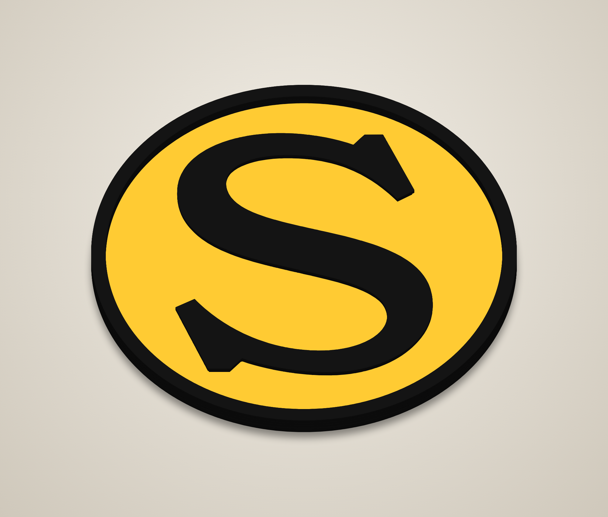
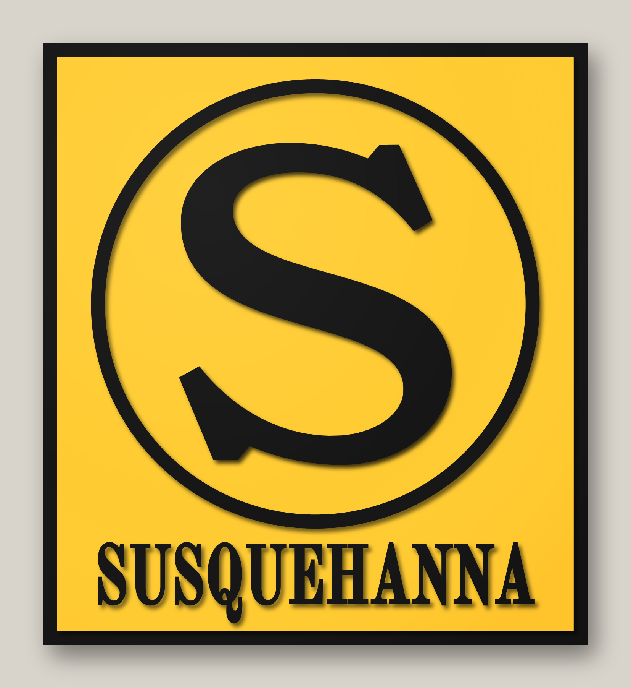
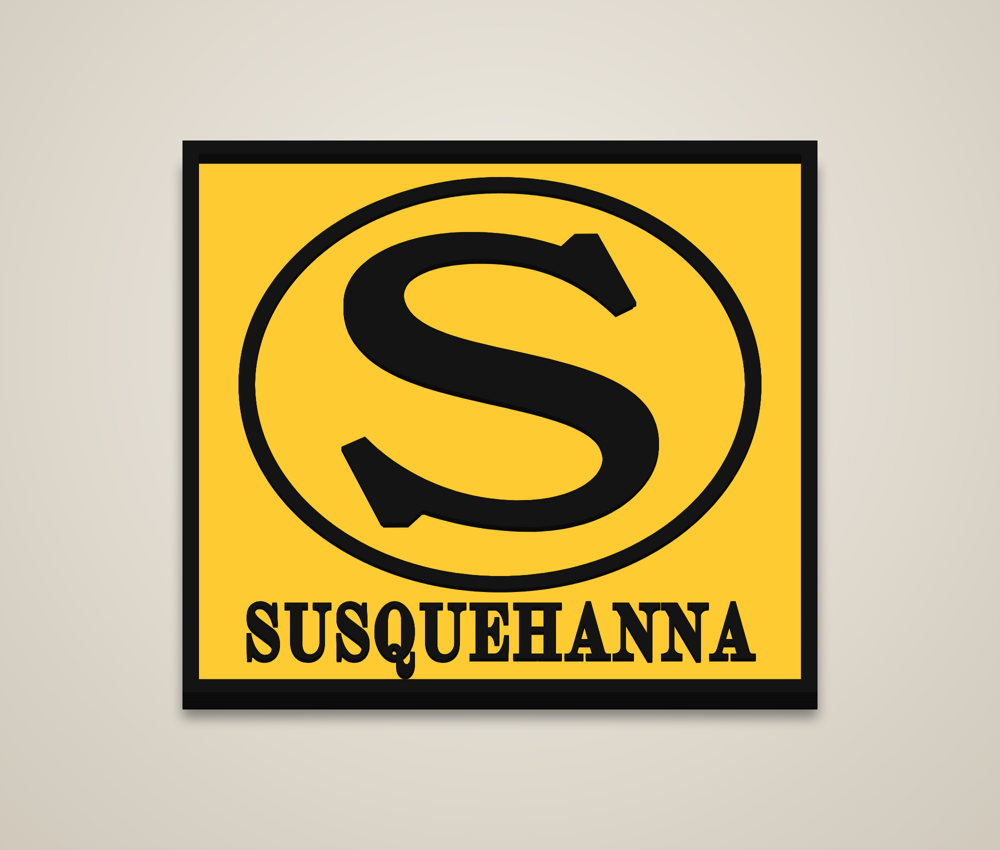

# Yellow "S" signs – stacked laser-cut

Two stacked laser-cut signs of the yellow Susquehanna "S" herald. Each one comes in a
**flat** version and a **raised-rim** version. Each layer is cut, painted one colour,
then stacked and glued from bottom to top.

| | Flat | Raised rim |
|---|---|---|
| **Round** (14") |  |  |
| **Panel** (14" × 15.44") |  |  |

Each `renders/<variant>/` folder also has `render_angle.png`, `render_exploded.png` and
`layer_sheet.png`.

## Cut files (`svg/<variant>/`)

All files in a folder share the same artboard and origin, so every layer lines up. They
contain cut lines only (red hairline, no fill).

### Round – `svg/round/`
| # | File | Paint | Stock | What it is |
|---|------|-------|-------|------------|
| 1 | `layer1_base_black.svg` | Black | 1/4" | 14.00" disc – backer; its edge is the black outer ring |
| 2 | `layer2_yellow_field.svg` | Yellow | 1/8" | 13.05" disc – yellow field |
| 3 | `layer3_black.svg` | Black | 1/8" | hidden S riser (the S inset 0.06") |
| 4 | `layer4_black_s.svg` | Black | 1/8" | black S |

### Panel – `svg/panel/`
| # | File | Paint | Stock | What it is |
|---|------|-------|-------|------------|
| 1 | `layer1_base_black.svg` | Black | 1/4" | 14.00" × 15.44" backer; its edge is the 0.36" black border |
| 2 | `layer2_yellow_field.svg` | Yellow | 1/8" | yellow panel |
| 3 | `layer3_black.svg` | Black | 1/8" | ring (11.53" OD, 0.36" wide), 11 letters, hidden S riser |
| 4 | `layer4_black_s.svg` | Black | 1/8" | black S |

### Raised-rim versions – `svg/round_rim/`, `svg/panel_rim/`
The same as the flat versions, plus the outer black ring (round) or border (panel)
built up in three more rings so it is **flush with the top of the S** (0.625" total).
| File | Paint | What changes |
|------|-------|--------------|
| `layer2b_rim_ring.svg` | Black | rim ring 1 – sits around the yellow field, on the same level |
| `layer3_black.svg` | Black | as above + rim ring 2 |
| `layer4_black_s.svg` | Black | the S + rim ring 3 |

The three rim rings are identical. If you'd rather, cut one ring from 3/8" stock
instead (use `layer2b_rim_ring.svg`) and skip the rings in layers 3 and 4.
The yellow field drops into the rim, so the rim also locates it. Kerf leaves a hairline
gap of about one kerf width, which the black paint hides.

Other files in each folder:
* `preview_flat.svg` – full-colour flat preview.
* `placement_template.svg` – every layer's outline in a different colour. Print it at
  1:1 to position the S, ring and letters during glue-up.

## Build notes
* Total height is 0.625" with the stock above. The stock thickness doesn't change the cut files.
* **Hidden S riser:** layer 3 includes the S inset by 0.06". It lifts the S a full
  1/4" off the yellow for a stronger shadow. It is painted black, so from an angle it
  reads as one thick S. To skip it, cut layer 4 from 1/4" stock.
* Paint each layer before glue-up, including the edges.
* Kerf is not compensated (a few thousandths undersize is fine for stacked art).
* The thinnest stroke of the S is about 0.85". The panel lettering is 1.49" tall and was
  thickened 0.03" so that no stroke is thinner than about 0.10". The letters are
  separate pieces: use hold-downs or tabs, and the placement template to space them.
* Glue order: 1 → 2 (centred, or dropped into the rim ring) → 3 → 4.

## Where the shapes come from
* **S and round proportions:** traced from the flat logo image (`source/logo.png`) with
  `trace_s.py`, which writes `s_trace.json`. The yellow disc is 0.9324 of the outer diameter.
* **Panel:** proportions measured from the panel logo (border, ring, text box; see
  `PANEL_PX` in `generate.py`). The S fills the ring the same way it fills the yellow disc
  on the round logo. "SUSQUEHANNA" is set in Old Standard TT Bold (`fonts/`, SIL Open
  Font License), condensed to the width of the original lettering. Tweak `PANEL_PX`
  if you want to adjust the layout against the original.

## Regenerating
```
pip install shapely numpy fonttools
python3 generate.py                     # all four variants, 14"
python3 generate.py round --rim --size 18   # one variant at another size -> svg/round_rim_18in/
node render.js                          # renders/ (needs Playwright + Chromium)
```
To re-trace the S: `pip install opencv-python-headless pillow`, then `python3 trace_s.py`.
